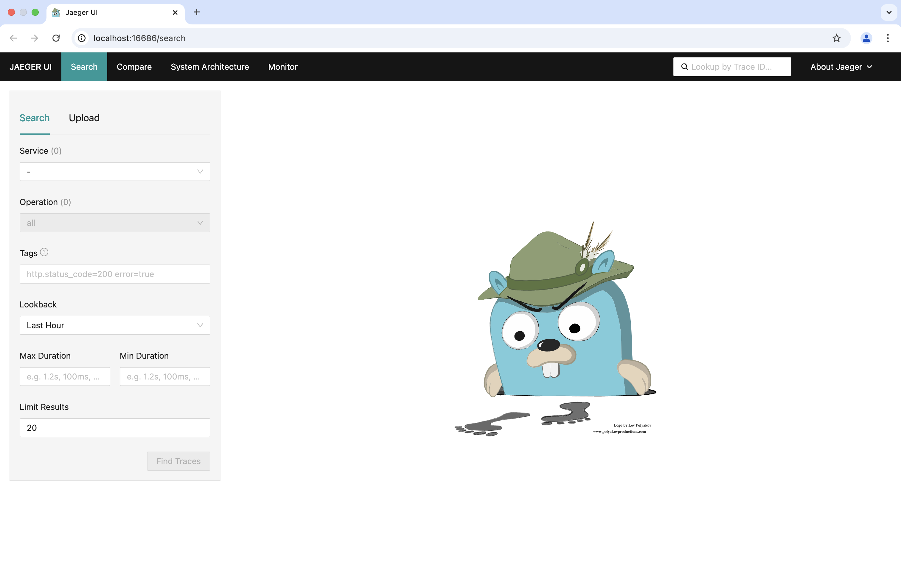
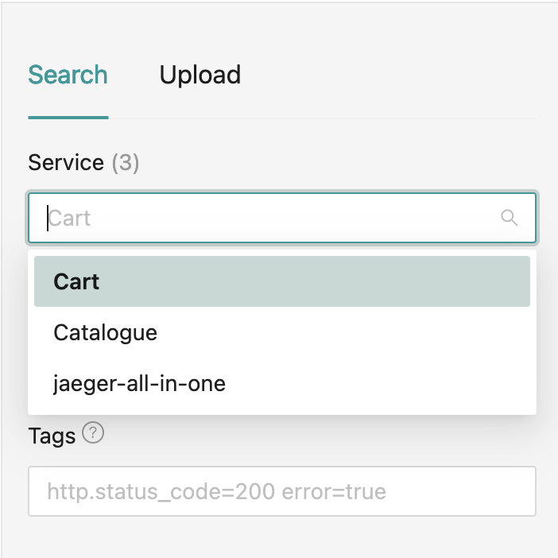
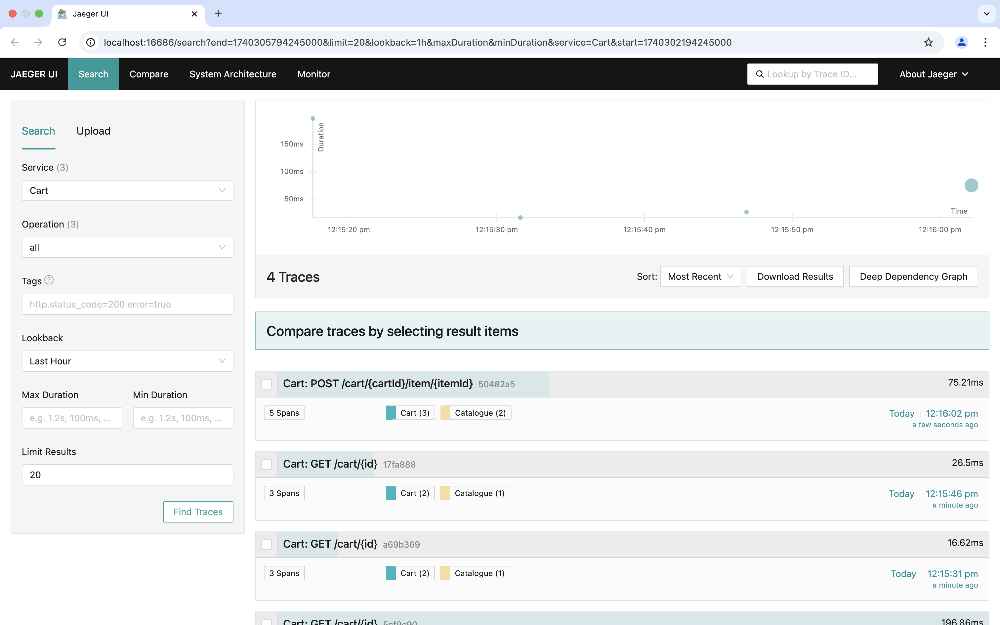
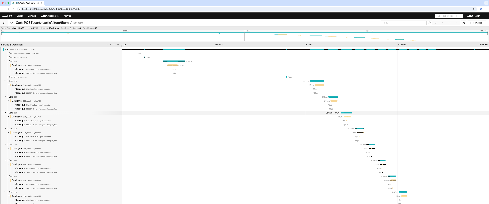
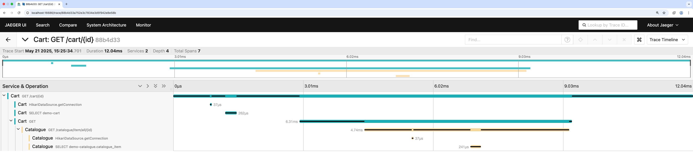

<!-- Generated by Sociable Weaver (https://github.com/albertattard/sw). Manual edits will be overwritten when regenerated. -->

# Distributed Application using REST Synchronous Communication

A simple distributed application that has two components, each deployed as a
separate Java application.

- Catalogue
- Cart (shopping cart)

The *Cart* component depends on information available in the *Catalogue*
component, such as the *CatalogueItem*, *id* and, *caption*. The components are
connected through a synchronous REST API. The *Cart* component depends on the
*Catalogue*, and it cannot run independently. Both components are required for
the *Cart* component to function as expected.

## Prerequisites

- [Oracle Java 25](https://www.oracle.com/java/technologies/downloads/#java25)

- [`jq`](https://jqlang.org/)

- [Docker](https://docs.docker.com/get-docker/)

## Build the application

This will build both components.

```shell
./mvnw clean package
```

(*Optional*) List the created artefacts for the *Catalogue* component.

```shell
tree --sort=name -L 1 --prune './catalogue/target'
```

There should be one JAR file, the fat JAR file
`opentelemetry-catalogue-1.0.0.jar`.

```
./catalogue/target
├── opentelemetry-catalogue-1.0.0.jar
└── opentelemetry-catalogue-1.0.0.jar.original

1 directory, 2 files
```

(*Optional*) List the created artefacts for the *Cart* component.

```shell
tree --sort=name -L 1 --prune './cart/target'
```

There should be one JAR file, the fat JAR file
`opentelemetry-cart-1.0.0.jar`.

```
./cart/target
├── opentelemetry-cart-1.0.0.jar
└── opentelemetry-cart-1.0.0.jar.original

1 directory, 2 files
```

## Run Jaeger Tracing

The database queries are instrumented too using the
[JDBC Instrumentation](https://opentelemetry.io/docs/languages/java/automatic/spring-boot/#jdbc-instrumentation).

```shell
docker run \
  --rm \
  --detach \
  --name 'jaeger' \
  --publish 16686:16686 \
  --publish 14250:14250 \
  --publish 4318:4318 \
  'docker.io/jaegertracing/all-in-one:1.76.0'
```

Wait for the Jaeger to start.

```shell
while [ "$(curl -s -o /dev/null -w '%{http_code}' 'http://localhost:16686/search')" -ne '200' ]
do
  echo 'Waiting for Jaeger to start'
  sleep 1
done
```

Access Jaeger through the browser.

```shell
open 'http://localhost:16686/search'
```

This will load a blank search as this Jaeger container has not yet observed
any traces.



## Run the Application

The *Cart* component depends on the *Catalogue* component, so it’s
recommended to start the *Catalogue* component first. Starting the *Cart*
component without the *Catalogue* component will result in failure once a
request is made, as the *Cart* component relies on the *Catalogue* to be up
and running.

Both components are started in the background for convenience, but you can
also run them in different terminal sessions if you prefer.

1. **Run the *Catalogue* component in the background**:

   ```shell
   # Start the application in the background
   java -jar './catalogue/target/opentelemetry-catalogue-1.0.0.jar' > './catalogue/target/application.log' 2>&1 &

   # Save the PID so later steps can reuse it after this entry finishes.
   echo "$!" > './catalogue/target/application.pid'

   # Wait for the application to start
   while [ "$(curl --silent --output /dev/null --write-out '%{http_code}' 'http://localhost:8081/catalogue/item/1')" -ne '200' ]
   do
     echo 'Waiting for the Catalogue component to start'
     sleep 1
   done
   ```

2. **Run the *Cart* component in the background**:

   ```shell
   # Start the application in the background
   java -jar './cart/target/opentelemetry-cart-1.0.0.jar' > './cart/target/application.log' 2>&1 &

   # Save the PID so later steps can reuse it after this entry finishes.
   echo "$!" > './cart/target/application.pid'

   # Wait for the application to start
   while [ "$(curl --silent --output /dev/null --write-out '%{http_code}' 'http://localhost:8082/cart/1')" -ne '200' ]
   do
     echo 'Waiting for the Cart component to start'
     sleep 1
   done
   ```

Note that both components are running on different ports, and the *Cart*
component expects the *Catalogue* to be listening on port `8081`.

| Component   |   Port |
| ----------- | -----: |
| *Catalogue* | `8081` |
| *Cart*      | `8082` |

## Try the Application

By interacting with the application, you will generate metrics, traces, and
logs that can be observed through the observability tools.

1. **Request a catalogue item**

   The database contains the following catalogue items, as shown in the
   following table.

   | `id` | `caption`         | `description`                                                         |
   | ---: | ----------------- | --------------------------------------------------------------------- |
   |    1 | Leather Sofa      | A very nice and comfortable sofa                                      |
   |    2 | Wooden Table      | A large table ideal for 6 to 8 people                                 |
   |    3 | Plastic Chair     | A robust plastic chair ideal for children and adults alike            |
   |    4 | Mug               | The ideal way to start the day                                        |
   |    5 | LED TV            | A very large TV set, ideal for those who love to binge-watch TV shows |
   |    6 | Bookshelf         | Spacious and stylish, perfect for organizing books and decor          |
   |    7 | Office Desk       | A sturdy desk suitable for both home and office use                   |
   |    8 | Recliner Chair    | Relax in comfort with this adjustable recliner                        |
   |    9 | Dining Set        | Includes a table and four chairs, perfect for family meals            |
   |   10 | Floor Lamp        | Modern lamp that adds ambiance to any room                            |
   |   11 | Wall Clock        | A large decorative clock that fits any interior                       |
   |   12 | Microwave Oven    | Compact microwave for quick and easy meals                            |
   |   13 | Blender           | Perfect for making smoothies, soups, and sauces                       |
   |   14 | Vacuum Cleaner    | Lightweight and powerful for everyday cleaning                        |
   |   15 | Bookshelf Speaker | Compact speakers with high-quality sound                              |
   |   16 | Coffee Table      | A stylish centerpiece for your living room                            |
   |   17 | Curtains          | Elegant drapes that complement any decor                              |
   |   18 | Bed Frame         | Strong and durable bed frame for restful nights                       |
   |   19 | Mattress          | Comfortable and supportive for a good night's sleep                   |
   |   20 | Nightstand        | A sleek nightstand with drawer for bedtime essentials                 |
   |   21 | Wardrobe          | Spacious wardrobe to keep your clothes neatly stored                  |
   |   22 | Toaster           | Toast bread to perfection every time                                  |
   |   23 | Kettle            | Boils water quickly and efficiently                                   |
   |   24 | Laundry Basket    | Durable and lightweight basket for easy laundry transport             |
   |   25 | Wall Art          | Add character to your home with this modern art piece                 |

   Fetch the catalogue item with id `1`.

   ```shell
   curl --silent 'http://localhost:8081/catalogue/item/1' | jq
   ```

   The catalogue item with id `1`

   ```json
   {
     "id": 1,
     "caption": "Leather Sofa",
     "description": "A very nice and comfortable sofa"
   }
   ```

2. **Request a cart**

   The database also contains the following carts, with their respective
   catalogue items and quantities, as shown in the following table.

   | `cart_id` | `item_id` | `caption`         | `quantity` |
   | --------: | --------: | ----------------- | ---------: |
   |         1 |         1 | Leather Sofa      |          1 |
   |         1 |         5 | LED TV            |          1 |
   |         2 |         2 | Wooden Table      |          1 |
   |         2 |         3 | Plastic Chair     |          6 |
   |         3 |         4 | Mug               |          4 |
   |         4 |         1 | Leather Sofa      |          1 |
   |         4 |         2 | Wooden Table      |          1 |
   |         4 |         5 | LED TV            |          1 |
   |         4 |         6 | Bookshelf         |          1 |
   |         4 |         8 | Recliner Chair    |          1 |
   |         4 |        10 | Floor Lamp        |          1 |
   |         4 |        11 | Wall Clock        |          1 |
   |         4 |        15 | Bookshelf Speaker |          1 |
   |         4 |        17 | Curtains          |          1 |
   |         4 |        25 | Wall Art          |          1 |

   Fetch the contents of cart with id `1`

   ```shell
   curl --silent 'http://localhost:8082/cart/1' | jq
   ```

   The cart item with id `1`

   ```json
   {
     "id": 1,
     "items": [
       {
         "id": 1,
         "caption": "Leather Sofa",
         "quantity": 1
       },
       {
         "id": 5,
         "caption": "LED TV",
         "quantity": 1
       }
     ]
   }
   ```

   Fetch the contents of cart with id `4`

   ```shell
   curl --silent 'http://localhost:8082/cart/4' | jq
   ```

   The cart item with id `4`

   ```json
   {
     "id": 4,
     "items": [
       {
         "id": 1,
         "caption": "Leather Sofa",
         "quantity": 1
       },
       {
         "id": 2,
         "caption": "Wooden Table",
         "quantity": 1
       },
       {
         "id": 5,
         "caption": "LED TV",
         "quantity": 1
       },
       {
         "id": 6,
         "caption": "Bookshelf",
         "quantity": 1
       },
       {
         "id": 8,
         "caption": "Recliner Chair",
         "quantity": 1
       },
       {
         "id": 10,
         "caption": "Floor Lamp",
         "quantity": 1
       },
       {
         "id": 11,
         "caption": "Wall Clock",
         "quantity": 1
       },
       {
         "id": 15,
         "caption": "Bookshelf Speaker",
         "quantity": 1
       },
       {
         "id": 17,
         "caption": "Curtains",
         "quantity": 1
       },
       {
         "id": 25,
         "caption": "Wall Art",
         "quantity": 1
       }
     ]
   }
   ```

3. **Add a new catalogue item**

   Add the following item to the catalogue

   | Property Name | Value                                   |
   | ------------- | --------------------------------------- |
   | `caption`     | Green Plant                             |
   | `description` | Put a little life in your living room!! |

   ```shell
   # Save the response in a file as we will use it later on
   curl --silent \
     -X POST 'http://localhost:8081/catalogue/item' \
     -H 'Content-Type: application/json' \
     -d '{"caption":"Green Plant","description":"Put a little life in your living room!!"}' \
     | jq \
     > './catalogue/target/new-catalogue-item.json'

   # Print the output
   jq . './catalogue/target/new-catalogue-item.json'
   ```

   This will return the newly added catalogue item together with its id.

   ```json
   {
     "id": 26,
     "caption": "Green Plant",
     "description": "Put a little life in your living room!!"
   }
   ```

   Print the new catalogue item id

   ```shell
   # Print the new catalogue item id
   ITEM_ID="$(jq .id './catalogue/target/new-catalogue-item.json')"
   echo "New catalogue item id: ${ITEM_ID}"
   ```

   The newly created catalogue item id

   ```
   New catalogue item id: 26
   ```

4. **Add the new catalogue item to cart**

   Please note that this depends on the previous step. Add the newly created
   catalogue item to cart with id `4`.

   Fetch the cart details.

   ```shell
   curl --silent 'http://localhost:8082/cart/4' | jq
   ```

   The current cart contents

   ```json
   {
     "id": 4,
     "items": [
       {
         "id": 1,
         "caption": "Leather Sofa",
         "quantity": 1
       },
       {
         "id": 2,
         "caption": "Wooden Table",
         "quantity": 1
       },
       {
         "id": 5,
         "caption": "LED TV",
         "quantity": 1
       },
       {
         "id": 6,
         "caption": "Bookshelf",
         "quantity": 1
       },
       {
         "id": 8,
         "caption": "Recliner Chair",
         "quantity": 1
       },
       {
         "id": 10,
         "caption": "Floor Lamp",
         "quantity": 1
       },
       {
         "id": 11,
         "caption": "Wall Clock",
         "quantity": 1
       },
       {
         "id": 15,
         "caption": "Bookshelf Speaker",
         "quantity": 1
       },
       {
         "id": 17,
         "caption": "Curtains",
         "quantity": 1
       },
       {
         "id": 25,
         "caption": "Wall Art",
         "quantity": 1
       }
     ]
   }
   ```

   Read the new item id obtained from the previous step and fetch the
   catalogue item.

   ```shell
   # Read the new item id obtained from the previous command
   ITEM_ID="$(jq .id './catalogue/target/new-catalogue-item.json')"

   # Fetch the new catalogue item
   curl --silent "http://localhost:8081/catalogue/item/${ITEM_ID}" | jq
   ```

   The newly created catalogue item

   ```json
   {
     "id": 26,
     "caption": "Green Plant",
     "description": "Put a little life in your living room!!"
   }
   ```

   Add the newly created catalogue item to the cart.

   ```shell
   # Read the new item id obtained from the previous command
   ITEM_ID="$(jq .id './catalogue/target/new-catalogue-item.json')"

   # Add the new item to cart with id 4
   curl --silent -X POST "http://localhost:8082/cart/4/item/${ITEM_ID}" | jq
   ```

   The cart contents after adding the newly created catalogue item.

   ```json
   {
     "id": 4,
     "items": [
       {
         "id": 1,
         "caption": "Leather Sofa",
         "quantity": 1
       },
       {
         "id": 2,
         "caption": "Wooden Table",
         "quantity": 1
       },
       {
         "id": 5,
         "caption": "LED TV",
         "quantity": 1
       },
       {
         "id": 6,
         "caption": "Bookshelf",
         "quantity": 1
       },
       {
         "id": 8,
         "caption": "Recliner Chair",
         "quantity": 1
       },
       {
         "id": 10,
         "caption": "Floor Lamp",
         "quantity": 1
       },
       {
         "id": 11,
         "caption": "Wall Clock",
         "quantity": 1
       },
       {
         "id": 15,
         "caption": "Bookshelf Speaker",
         "quantity": 1
       },
       {
         "id": 17,
         "caption": "Curtains",
         "quantity": 1
       },
       {
         "id": 25,
         "caption": "Wall Art",
         "quantity": 1
       },
       {
         "id": 26,
         "caption": "Green Plant",
         "quantity": 1
       }
     ]
   }
   ```

5. **Analyse the traces**

   Access Jaeger through the browser.

   ```shell
   open 'http://localhost:16686/search'
   ```

   Refresh the page if this was already opened. There should be three services
   available.

   

   Select the *Cart* service and press the _Search_ button.

   

   The list of observed traces captured from the *Cart* component will be shown
   here. In the last example, we made a `POST` request to add a new item to the
   cart. Click on this request to view its details.

   

   Note the interaction between the *Cart* and *Catalogue* components. When
   adding an item to the cart, the *Cart* component sends a request to the
   *Catalogue* component for each item. Cart ID 4 contains many items, which
   exacerbates the issue.

   This is a common challenge in distributed systems, where communication
   between components can become too fine-grained. Using REST for such
   interactions, as shown here, is not my preferred approach. I typically favour
   messaging systems, which decouple components and reduce inter-component
   communication.

   The *Catalogue* component could expose a new endpoint that accepts a list of
   item IDs and returns all matching items in a single request.

6. **Stop both application components**

   ```shell
   kill "$(cat './catalogue/target/application.pid')" 2>/dev/null &&  rm -f './catalogue/target/application.pid'
   kill "$(cat './cart/target/application.pid')" 2>/dev/null &&  rm -f './cart/target/application.pid'
   ```

## Refactor the application

We will refactor the application by adding a new endpoint to the *Catalogue*
component. This endpoint will accept a list of catalogue item IDs and return
their details in a single response. The *Cart* component will then use this
endpoint to reduce the number of messages from one per item to one per cart.

While this approach improves efficiency, it is not ideal, as it maintains a
tight coupling between two components that are intended to be independent.
The *Cart* component remains dependent on the *Catalogue* component.

**Step 1: Add a new endpoint to the *Catalogue* component**

1. Write a test to validate the functionality of the new endpoint.

   ```diff
   @@ -47,6 +47,50 @@ class CatalogueItemControllerTest {
            }
        }

   +    @Nested
   +    class GetAllCatalogueItemsTest {
   +
   +        @Test
   +        void returnTheCatalogueItemsWithTheGivenExistingId() {
   +            final ResponseEntity<List<CatalogueItemTo>> response = getCatalogueItemsWithId(1, 2, 3, 4);
   +            assertThat(response.getStatusCode())
   +                    .isEqualTo(HttpStatus.OK);
   +            assertThat(response.getBody()) /* TODO: May need to sort the result */
   +                    .isEqualTo(List.of(
   +                            new CatalogueItemTo(1L, "Leather Sofa", "A very nice and comfortable sofa"),
   +                            new CatalogueItemTo(2L, "Wooden Table", "A large table ideal for 6 to 8 people"),
   +                            new CatalogueItemTo(3L, "Plastic Chair", "A robust plastic chair ideal for children and adults alike"),
   +                            new CatalogueItemTo(4L, "Mug", "The ideal way to start the day")
   +                    ));
   +        }
   +
   +        @Test
   +        void returnTheSameItemOnceEvenWhenItsIdIsProvidedMultipleTimes() {
   +            final ResponseEntity<List<CatalogueItemTo>> response = getCatalogueItemsWithId(1, 1, 1, 1);
   +            assertThat(response.getStatusCode())
   +                    .isEqualTo(HttpStatus.OK);
   +            assertThat(response.getBody())
   +                    .isEqualTo(List.of(
   +                            new CatalogueItemTo(1L, "Leather Sofa", "A very nice and comfortable sofa")
   +                    ));
   +        }
   +
   +        @Test
   +        void returnEmptyListWhenGivenAnIdThatDoesNotExists() {
   +            final ResponseEntity<List<CatalogueItemTo>> response = getCatalogueItemsWithId(100);
   +            assertThat(response.getStatusCode())
   +                    .isEqualTo(HttpStatus.OK);
   +            assertThat(response.getBody())
   +                    .isEqualTo(List.of());
   +        }
   +
   +        private ResponseEntity<List<CatalogueItemTo>> getCatalogueItemsWithId(final long... ids) {
   +            final String stringIds = LongStream.of(ids).mapToObj(String::valueOf).collect(Collectors.joining(","));
   +            final ParameterizedTypeReference<List<CatalogueItemTo>> type = new ParameterizedTypeReference<>() {};
   +            return restTemplate.exchange("/catalogue/item/all/%s".formatted(stringIds), HttpMethod.GET, null, type);
   +        }
   +    }
   +
        @Nested
        class AddCatalogueItemTest {
   ```

   The
   [`./catalogue/src/test/java/demo/catalogue/CatalogueItemControllerTest.java` test file](./catalogue/src/test/java/demo/catalogue/CatalogueItemControllerTest.java)
   should now include a new inner class to test the ned endpoint, as shown
   below.

   ```java
   package demo.catalogue;

   import org.junit.jupiter.api.Nested;
   import org.junit.jupiter.api.Test;
   import org.springframework.beans.factory.annotation.Autowired;
   import org.springframework.boot.test.context.SpringBootTest;
   import org.springframework.boot.resttestclient.TestRestTemplate;
   import org.springframework.boot.resttestclient.autoconfigure.AutoConfigureTestRestTemplate;
   import org.springframework.core.ParameterizedTypeReference;
   import org.springframework.http.HttpMethod;
   import org.springframework.http.HttpStatus;
   import org.springframework.http.ResponseEntity;

   import java.util.List;
   import java.util.regex.Pattern;
   import java.util.stream.Collectors;
   import java.util.stream.LongStream;

   import static org.assertj.core.api.Assertions.assertThat;

   @SpringBootTest(webEnvironment = SpringBootTest.WebEnvironment.RANDOM_PORT)
   @AutoConfigureTestRestTemplate
   class CatalogueItemControllerTest {

       @Autowired
       private TestRestTemplate restTemplate;

       @Nested
       class GetCatalogueItemTest {

           @Test
           void returnTheCatalogueItemWhenGivenAnExistingId() {
               final ResponseEntity<CatalogueItemTo> response = getCatalogueItemWithId(1);
               assertThat(response.getStatusCode())
                       .isEqualTo(HttpStatus.OK);
               assertThat(response.getBody())
                       .isEqualTo(new CatalogueItemTo(1L, "Leather Sofa", "A very nice and comfortable sofa"));
           }

           @Test
           void returnNotFoundWhenGivenAnIdThatDoesNotExists() {
               final ResponseEntity<CatalogueItemTo> response = getCatalogueItemWithId(100);
               assertThat(response.getStatusCode())
                       .isEqualTo(HttpStatus.NOT_FOUND);
           }

           private ResponseEntity<CatalogueItemTo> getCatalogueItemWithId(final long id) {
               return restTemplate.getForEntity("/catalogue/item/%d".formatted(id), CatalogueItemTo.class);
           }
       }

       @Nested
       class GetAllCatalogueItemsTest {

           @Test
           void returnTheCatalogueItemsWithTheGivenExistingId() {
               final ResponseEntity<List<CatalogueItemTo>> response = getCatalogueItemsWithId(1, 2, 3, 4);
               assertThat(response.getStatusCode())
                       .isEqualTo(HttpStatus.OK);
               assertThat(response.getBody()) /* TODO: May need to sort the result */
                       .isEqualTo(List.of(
                               new CatalogueItemTo(1L, "Leather Sofa", "A very nice and comfortable sofa"),
                               new CatalogueItemTo(2L, "Wooden Table", "A large table ideal for 6 to 8 people"),
                               new CatalogueItemTo(3L, "Plastic Chair", "A robust plastic chair ideal for children and adults alike"),
                               new CatalogueItemTo(4L, "Mug", "The ideal way to start the day")
                       ));
           }

           @Test
           void returnTheSameItemOnceEvenWhenItsIdIsProvidedMultipleTimes() {
               final ResponseEntity<List<CatalogueItemTo>> response = getCatalogueItemsWithId(1, 1, 1, 1);
               assertThat(response.getStatusCode())
                       .isEqualTo(HttpStatus.OK);
               assertThat(response.getBody())
                       .isEqualTo(List.of(
                               new CatalogueItemTo(1L, "Leather Sofa", "A very nice and comfortable sofa")
                       ));
           }

           @Test
           void returnEmptyListWhenGivenAnIdThatDoesNotExists() {
               final ResponseEntity<List<CatalogueItemTo>> response = getCatalogueItemsWithId(100);
               assertThat(response.getStatusCode())
                       .isEqualTo(HttpStatus.OK);
               assertThat(response.getBody())
                       .isEqualTo(List.of());
           }

           private ResponseEntity<List<CatalogueItemTo>> getCatalogueItemsWithId(final long... ids) {
               final String stringIds = LongStream.of(ids).mapToObj(String::valueOf).collect(Collectors.joining(","));
               final ParameterizedTypeReference<List<CatalogueItemTo>> type = new ParameterizedTypeReference<>() {};
               return restTemplate.exchange("/catalogue/item/all/%s".formatted(stringIds), HttpMethod.GET, null, type);
           }
       }

       @Nested
       class AddCatalogueItemTest {

           @Test
           void returnTheNewIdOfTheAddedCatalogueItem() {
               final NewCatalogueItemTo item = new NewCatalogueItemTo("Green Plant", "Put a little life in your living room!!");

               final ResponseEntity<CatalogueItemTo> response = restTemplate.postForEntity("/catalogue/item", item, CatalogueItemTo.class);
               assertThat(response.getStatusCode())
                       .isEqualTo(HttpStatus.CREATED);

               final long id = assertThatHeaderLocationHasCatalogueItemId(response);

               assertThat(response.getBody())
                       .isEqualTo(new CatalogueItemTo(id, item.caption(), item.description()));
           }

           private static long assertThatHeaderLocationHasCatalogueItemId(final ResponseEntity<CatalogueItemTo> response) {
               assertThat(response.getHeaders())
                       .isNotNull();
               assertThat(response.getHeaders().getLocation())
                       .isNotNull();

               final String location = response.getHeaders().getLocation().getPath();
               assertThat(location)
                       .matches(Pattern.compile("/catalogue/item/\\d+"));

               return Long.parseLong(location.substring(16));
           }
       }
   }
   ```

   Run the test to make sure it fails for the right reason.

   ```shell
   ./mvnw clean test
   ```

   The new tests `CatalogueItemControllerTest.GetAllCatalogueItemsTest` should
   fail

   ```
   ...
   [INFO] Results:
   [INFO]
   [ERROR] Errors:
   [ERROR]   CatalogueItemControllerTest.returnEmptyListWhenGivenAnIdThatDoesNotExists » RestClient Error while extracting response for type [java.util.List<demo.catalogue.CatalogueItemTo>] and content type [application/json]
   [ERROR]   CatalogueItemControllerTest.returnTheCatalogueItemsWithTheGivenExistingId » RestClient Error while extracting response for type [java.util.List<demo.catalogue.CatalogueItemTo>] and content type [application/json]
   [ERROR]   CatalogueItemControllerTest.returnTheSameItemOnceEvenWhenItsIdIsProvidedMultipleTimes » RestClient Error while extracting response for type [java.util.List<demo.catalogue.CatalogueItemTo>] and content type [application/json]
   [INFO]
   [ERROR] Tests run: 6, Failures: 0, Errors: 3, Skipped: 0
   [INFO]
   [INFO] ------------------------------------------------------------------------
   [INFO] Reactor Summary for Distributed Application using OpenTelemetry to measure performance 1.0.0:
   [INFO]
   [INFO] Distributed Application using OpenTelemetry to measure performance - Cart SUCCESS [  7.760 s]
   [INFO] Distributed Application using OpenTelemetry to measure performance - Catalogue FAILURE [  5.267 s]
   [INFO] Distributed Application using OpenTelemetry to measure performance SKIPPED
   [INFO] ------------------------------------------------------------------------
   [INFO] BUILD FAILURE
   [INFO] ------------------------------------------------------------------------
   ...
   ```

2. Implement the necessary code to pass the test.

   In this example we will start from the controller and will walk backwards
   implementing all the required things.

   ```diff
   @@ -33,6 +33,14 @@ public class CatalogueItemController {
                    .orElseGet(() -> ResponseEntity.notFound().build());
        }

   +    @GetMapping("/all/{id}")
   +    public ResponseEntity<List<CatalogueItemTo>> getAll(@PathVariable(value = "id") final Set<Long> ids) {
   +        return ResponseEntity.ok(
   +                service.findAllById(ids).stream()
   +                        .map(CatalogueItemTo::of)
   +                        .collect(Collectors.toList()));
   +    }
   +
        @PostMapping()
        public ResponseEntity<CatalogueItemTo> add(@RequestBody final NewCatalogueItemTo item) {
            return item.toEntity()
   ```

   The
   [`./catalogue/src/main/java/demo/catalogue/CatalogueItemController.java` file](./catalogue/src/main/java/demo/catalogue/CatalogueItemController.java)
   should now include a new endpoint, as shown below.

   ```java
   package demo.catalogue;

   import org.springframework.http.ResponseEntity;
   import org.springframework.web.bind.annotation.GetMapping;
   import org.springframework.web.bind.annotation.PathVariable;
   import org.springframework.web.bind.annotation.PostMapping;
   import org.springframework.web.bind.annotation.RequestBody;
   import org.springframework.web.bind.annotation.RequestMapping;
   import org.springframework.web.bind.annotation.RestController;

   import java.net.URI;
   import java.util.List;
   import java.util.Set;
   import java.util.stream.Collectors;

   import static java.util.Objects.requireNonNull;

   @RestController
   @RequestMapping("/catalogue/item")
   public class CatalogueItemController {

       private final CatalogueItemService service;

       public CatalogueItemController(final CatalogueItemService service) {
           this.service = requireNonNull(service, "Service cannot be null");
       }

       @GetMapping("/{id}")
       public ResponseEntity<CatalogueItemTo> get(@PathVariable(value = "id") final long id) {
           return service.findById(id)
                   .map(CatalogueItemTo::of)
                   .map(ResponseEntity::ok)
                   .orElseGet(() -> ResponseEntity.notFound().build());
       }

       @GetMapping("/all/{id}")
       public ResponseEntity<List<CatalogueItemTo>> getAll(@PathVariable(value = "id") final Set<Long> ids) {
           return ResponseEntity.ok(
                   service.findAllById(ids).stream()
                           .map(CatalogueItemTo::of)
                           .collect(Collectors.toList()));
       }

       @PostMapping()
       public ResponseEntity<CatalogueItemTo> add(@RequestBody final NewCatalogueItemTo item) {
           return item.toEntity()
                   .map(service::add)
                   .map(CatalogueItemTo::of)
                   .map(e -> ResponseEntity.created(location(e)).body(e));
       }

       private static URI location(final CatalogueItemTo item) {
           requireNonNull(item, "Catalogue item cannot be null");
           return URI.create("/catalogue/item/%d".formatted(item.id()));
       }
   }
   ```

   Add the required method in the service to support the new endpoint in the
   controller.

   ```diff
   @@ -21,6 +21,11 @@ public class CatalogueItemService {
            return repository.findById(id);
        }

   +    public List<CatalogueItemEntity> findAllById(final Set<Long> ids) {
   +        requireNonNull(ids, "IDs cannot be null");
   +        return repository.findAllById(ids);
   +    }
   +
        public CatalogueItemEntity add(final CatalogueItemEntity entity) {
            requireNonNull(entity, "Entity cannot be null");
            return repository.save(entity);
   ```

   The
   [`./catalogue/src/main/java/demo/catalogue/CatalogueItemService.java` file](./catalogue/src/main/java/demo/catalogue/CatalogueItemService.java)
   should now include the new method that returns a list of catalogue items, as
   shown below.

   ```java
   package demo.catalogue;

   import org.springframework.stereotype.Service;

   import java.util.List;
   import java.util.Optional;
   import java.util.Set;

   import static java.util.Objects.requireNonNull;

   @Service
   public class CatalogueItemService {

       private final CatalogueItemRepository repository;

       public CatalogueItemService(final CatalogueItemRepository repository) {
           this.repository = requireNonNull(repository, "Repository cannot be null");
       }

       public Optional<CatalogueItemEntity> findById(final long id) {
           return repository.findById(id);
       }

       public List<CatalogueItemEntity> findAllById(final Set<Long> ids) {
           requireNonNull(ids, "IDs cannot be null");
           return repository.findAllById(ids);
       }

       public CatalogueItemEntity add(final CatalogueItemEntity entity) {
           requireNonNull(entity, "Entity cannot be null");
           return repository.save(entity);
       }
   }
   ```

   Run the tests again.

   ```shell
   ./mvnw clean test
   ```

   All test should pass

   ```
   ...
   [INFO] ------------------------------------------------------------------------
   [INFO] BUILD SUCCESS
   [INFO] ------------------------------------------------------------------------
   ...
   ```

**Step 2: Use the new *Catalogue* endpoint in the *Cart* component**

1. Update existing tests to support the new *Catalogue* endpoint.

   ```diff
   @@ -34,42 +34,63 @@ class CartControllerTest {

            catalogueServer.when(request()
                            .withMethod("GET")
   -                        .withPath("/catalogue/item/1"))
   +                        .withPath("/catalogue/item/all/1,5"))
                    .respond(response()
                            .withStatusCode(200)
                            .withHeaders(new Header("Content-Type", "application/json; charset=utf-8"))
                            .withBody("""
   -                                {
   -                                  "id":1,
   -                                  "caption":"Leather Sofa",
   -                                  "description":"A very nice and comfortable sofa"
   -                                }"""));
   +                                [
   +                                  {
   +                                    "id":1,
   +                                    "caption":"Leather Sofa",
   +                                    "description":"A very nice and comfortable sofa"
   +                                  },
   +                                  {
   +                                    "id":5,
   +                                    "caption":"LED TV",
   +                                    "description":"A very large TV set, ideal for those who love to binge-watch TV shows"
   +                                  }
   +                                ]"""));

            catalogueServer.when(request()
                            .withMethod("GET")
   -                        .withPath("/catalogue/item/2"))
   +                        .withPath("/catalogue/item/all/2,3,4"))
                    .respond(response()
                            .withStatusCode(200)
                            .withHeaders(new Header("Content-Type", "application/json; charset=utf-8"))
                            .withBody("""
   -                                {
   -                                  "id":2,
   -                                  "caption":"Wooden Table",
   -                                  "description":"A large table ideal for 6 to 8 people"
   -                                }"""));
   +                                [
   +                                  {
   +                                    "id":2,
   +                                    "caption":"Wooden Table",
   +                                    "description":"A large table ideal for 6 to 8 people"
   +                                  },
   +                                  {
   +                                    "id":3,
   +                                    "caption":"Plastic Chair",
   +                                    "description":"A robust plastic chair ideal for children and adults alike"
   +                                  },
   +                                  {
   +                                    "id":4,
   +                                    "caption":"Mug",
   +                                    "description":"The ideal way to start the day"
   +                                  }
   +                                ]"""));

            catalogueServer.when(request()
                            .withMethod("GET")
   -                        .withPath("/catalogue/item/3"))
   +                        .withPath("/catalogue/item/all/4"))
                    .respond(response()
                            .withStatusCode(200)
                            .withHeaders(new Header("Content-Type", "application/json; charset=utf-8"))
                            .withBody("""
   -                                {
   -                                  "id":3,
   -                                  "caption":"Plastic Chair",
   -                                  "description":"A robust plastic chair ideal for children and adults alike"
   -                                }"""));
   +                                [
   +                                  {
   +                                    "id":4,
   +                                    "caption":"Mug",
   +                                    "description":"The ideal way to start the day"
   +                                  }
   +                                ]"""));

            catalogueServer.when(request()
                            .withMethod("GET")
   @@ -84,19 +105,6 @@ class CartControllerTest {
                                      "description":"The ideal way to start the day"
                                    }"""));

   -        catalogueServer.when(request()
   -                        .withMethod("GET")
   -                        .withPath("/catalogue/item/5"))
   -                .respond(response()
   -                        .withStatusCode(200)
   -                        .withHeaders(new Header("Content-Type", "application/json; charset=utf-8"))
   -                        .withBody("""
   -                                {
   -                                  "id":5,
   -                                  "caption":"LED TV",
   -                                  "description":"A very large TV set, ideal for those who love to binge-watch TV shows"
   -                                }"""));
   -
            catalogueServer.when(request()
                            .withMethod("GET")
                            .withPath("/catalogue/item/10"))
   ```

   The
   [`./cart/src/test/java/demo/cart/CartControllerTest.java` test file](./cart/src/test/java/demo/cart/CartControllerTest.java)
   should now expect that the *Cart* component utilises the new endpoint
   instead of making a request for each catalogue item, as shown below.

   ```java
   package demo.cart;

   import org.junit.jupiter.api.AfterAll;
   import org.junit.jupiter.api.BeforeAll;
   import org.junit.jupiter.api.Nested;
   import org.junit.jupiter.api.Test;
   import org.mockserver.integration.ClientAndServer;
   import org.mockserver.model.Header;
   import org.springframework.beans.factory.annotation.Autowired;
   import org.springframework.boot.test.context.SpringBootTest;
   import org.springframework.boot.resttestclient.TestRestTemplate;
   import org.springframework.boot.resttestclient.autoconfigure.AutoConfigureTestRestTemplate;
   import org.springframework.http.HttpStatus;
   import org.springframework.http.ResponseEntity;

   import java.util.List;
   import java.util.Map;

   import static org.assertj.core.api.Assertions.assertThat;
   import static org.mockserver.integration.ClientAndServer.startClientAndServer;
   import static org.mockserver.model.HttpRequest.request;
   import static org.mockserver.model.HttpResponse.response;

   @SpringBootTest(webEnvironment = SpringBootTest.WebEnvironment.RANDOM_PORT)
   @AutoConfigureTestRestTemplate
   class CartControllerTest {

       @Autowired
       private TestRestTemplate restTemplate;

       private static ClientAndServer catalogueServer;

       @BeforeAll
       static void startServer() {
           catalogueServer = startClientAndServer(8081);

           catalogueServer.when(request()
                           .withMethod("GET")
                           .withPath("/catalogue/item/all/1,5"))
                   .respond(response()
                           .withStatusCode(200)
                           .withHeaders(new Header("Content-Type", "application/json; charset=utf-8"))
                           .withBody("""
                                   [
                                     {
                                       "id":1,
                                       "caption":"Leather Sofa",
                                       "description":"A very nice and comfortable sofa"
                                     },
                                     {
                                       "id":5,
                                       "caption":"LED TV",
                                       "description":"A very large TV set, ideal for those who love to binge-watch TV shows"
                                     }
                                   ]"""));

           catalogueServer.when(request()
                           .withMethod("GET")
                           .withPath("/catalogue/item/all/2,3,4"))
                   .respond(response()
                           .withStatusCode(200)
                           .withHeaders(new Header("Content-Type", "application/json; charset=utf-8"))
                           .withBody("""
                                   [
                                     {
                                       "id":2,
                                       "caption":"Wooden Table",
                                       "description":"A large table ideal for 6 to 8 people"
                                     },
                                     {
                                       "id":3,
                                       "caption":"Plastic Chair",
                                       "description":"A robust plastic chair ideal for children and adults alike"
                                     },
                                     {
                                       "id":4,
                                       "caption":"Mug",
                                       "description":"The ideal way to start the day"
                                     }
                                   ]"""));

           catalogueServer.when(request()
                           .withMethod("GET")
                           .withPath("/catalogue/item/all/4"))
                   .respond(response()
                           .withStatusCode(200)
                           .withHeaders(new Header("Content-Type", "application/json; charset=utf-8"))
                           .withBody("""
                                   [
                                     {
                                       "id":4,
                                       "caption":"Mug",
                                       "description":"The ideal way to start the day"
                                     }
                                   ]"""));

           catalogueServer.when(request()
                           .withMethod("GET")
                           .withPath("/catalogue/item/4"))
                   .respond(response()
                           .withStatusCode(200)
                           .withHeaders(new Header("Content-Type", "application/json; charset=utf-8"))
                           .withBody("""
                                   {
                                     "id":4,
                                     "caption":"Mug",
                                     "description":"The ideal way to start the day"
                                   }"""));

           catalogueServer.when(request()
                           .withMethod("GET")
                           .withPath("/catalogue/item/10"))
                   .respond(response()
                           .withStatusCode(404));
       }

       @Nested
       class GetCartTest {

           @Test
           void returnTheCartWithItemsWhenGivenAnExistingId() {
               final ResponseEntity<CartTo> response = getCartWithId(1);
               assertThat(response.getStatusCode())
                       .isEqualTo(HttpStatus.OK);
               assertThat(response.getBody())
                       .isEqualTo(new CartTo(1L, List.of(
                               new CartItemTo(1L, "Leather Sofa", 1),
                               new CartItemTo(5L, "LED TV", 1)
                       )));
           }

           @Test
           void returnNotFoundWhenGivenAnIdThatDoesNotExists() {
               final ResponseEntity<CartTo> response = getCartWithId(10);
               assertThat(response.getStatusCode())
                       .isEqualTo(HttpStatus.NOT_FOUND);
           }

           private ResponseEntity<CartTo> getCartWithId(final long id) {
               return restTemplate.getForEntity("/cart/%d".formatted(id), CartTo.class);
           }
       }

       @Nested
       class AddItemToCartTest {

           @Test
           void returnTheCartWithTheNewItemWhenTheItemIsNotAlreadyInTheCart() {
               final ResponseEntity<CartTo> response = addItemToCart(2, 4);
               assertThat(response.getStatusCode())
                       .isEqualTo(HttpStatus.OK);
               assertThat(response.getBody())
                       .isEqualTo(new CartTo(2L, List.of(
                               new CartItemTo(2L, "Wooden Table", 1),
                               new CartItemTo(3L, "Plastic Chair", 6),
                               new CartItemTo(4L, "Mug", 1)
                       )));
           }

           @Test
           void returnTheCartWithTheNewQuantityWhenTheItemIsAlreadyInTheCart() {
               final ResponseEntity<CartTo> response = addItemToCart(3, 4);
               assertThat(response.getStatusCode())
                       .isEqualTo(HttpStatus.OK);
               assertThat(response.getBody())
                       .isEqualTo(new CartTo(3L, List.of(
                               new CartItemTo(4L, "Mug", 5)
                       )));
           }

           @Test
           void returnNotFoundWhenGivenACartIdThatDoesNotExists() {
               final ResponseEntity<CartTo> response = addItemToCart(10, 1);
               assertThat(response.getStatusCode())
                       .isEqualTo(HttpStatus.NOT_FOUND);
           }

           @Test
           void returnNotFoundWhenGivenAnItemIdThatDoesNotExists() {
               final ResponseEntity<CartTo> response = addItemToCart(1, 10);
               assertThat(response.getStatusCode())
                       .isEqualTo(HttpStatus.NOT_FOUND);
           }

           private ResponseEntity<CartTo> addItemToCart(final long cartId, final long itemId) {
               return restTemplate.postForEntity("/cart/%d/item/%d".formatted(cartId, itemId), Map.of(), CartTo.class);
           }
       }

       @AfterAll
       static void stopServer() {
           catalogueServer.stop();
       }
   }
   ```

   Run the test to make sure it fails for the right reason.

   ```shell
   ./mvnw clean test
   ```

   Two tests with the `CartControllerTest` should fail

   ```
   ...
   [INFO] Results:
   [INFO]
   [ERROR] Failures:
   [ERROR]   CartControllerTest.returnTheCartWithItemsWhenGivenAnExistingId
   expected: CartTo[id=1, items=[CartItemTo[id=1, caption=Leather Sofa, quantity=1], CartItemTo[id=5, caption=LED TV, quantity=1]]]
    but was: CartTo[id=1, items=[CartItemTo[id=1, caption=null, quantity=1], CartItemTo[id=5, caption=null, quantity=1]]]
   [ERROR]   CartControllerTest.returnTheCartWithTheNewItemWhenTheItemIsNotAlreadyInTheCart
   expected: CartTo[id=2, items=[CartItemTo[id=2, caption=Wooden Table, quantity=1], CartItemTo[id=3, caption=Plastic Chair, quantity=6], CartItemTo[id=4, caption=Mug, quantity=1]]]
    but was: CartTo[id=2, items=[CartItemTo[id=2, caption=null, quantity=1], CartItemTo[id=3, caption=null, quantity=6], CartItemTo[id=4, caption=Mug, quantity=1]]]
   [INFO]
   [ERROR] Tests run: 9, Failures: 2, Errors: 0, Skipped: 0
   [INFO]
   [INFO] ------------------------------------------------------------------------
   [INFO] Reactor Summary for Distributed Application using OpenTelemetry to measure performance 1.0.0:
   [INFO]
   [INFO] Distributed Application using OpenTelemetry to measure performance - Cart FAILURE [  7.625 s]
   [INFO] Distributed Application using OpenTelemetry to measure performance - Catalogue SKIPPED
   [INFO] Distributed Application using OpenTelemetry to measure performance SKIPPED
   [INFO] ------------------------------------------------------------------------
   [INFO] BUILD FAILURE
   [INFO] ------------------------------------------------------------------------
   ...
   ```

2. Implement the required code to pass the updated tests.

   In this example we will start from the service and will walk backwards
   implementing all the required things.

   ```diff
   @@ -66,13 +66,9 @@ public class CartService {
                    .map(CartItemEntity::itemId)
                    .collect(Collectors.toSet());

   -        final Map<Long, CatalogueItemEntity> catalogueItems = cartItemIds.stream()
   -                .collect(Collectors.toMap(Function.identity(), itemGateway::findById))
   -                .entrySet().stream()
   -                .filter(entry -> entry.getValue().isPresent()) /* Remove the catalogue items that were not found */
   -                .collect(Collectors.toMap(
   -                        Map.Entry::getKey,
   -                        entry -> entry.getValue().get()));
   +        final Map<Long, CatalogueItemEntity> catalogueItems = itemGateway.findAllById(cartItemIds)
   +                .stream()
   +                .collect(Collectors.toMap(CatalogueItemEntity::id, Function.identity()));

            for (final CartItemEntity item : cart.items()) {
                final Long id = item.itemId();
   ```

   The
   [`./cart/src/main/java/demo/cart/CartService.java` file](./cart/src/main/java/demo/cart/CartService.java)
   should now make a single request to fetch all the needed items instead of
   making a request for each catalogue item in the cart, as shown below.

   ```java
   package demo.cart;

   import demo.catalogue.CatalogueItemEntity;
   import demo.catalogue.CatalogueItemGateway;
   import jakarta.transaction.Transactional;
   import org.springframework.stereotype.Service;

   import java.util.List;
   import java.util.Map;
   import java.util.Optional;
   import java.util.Set;
   import java.util.function.Function;
   import java.util.stream.Collectors;

   import static java.util.Objects.requireNonNull;

   @Service
   public class CartService {

       private final CartRepository cartRepository;
       private final CatalogueItemGateway itemGateway;

       public CartService(final CartRepository cartRepository,
                          final CatalogueItemGateway itemGateway) {
           this.cartRepository = requireNonNull(cartRepository, "Cart repository cannot be null");
           this.itemGateway = requireNonNull(itemGateway, "Catalogue item gateway cannot be null");
       }

       public Optional<CartEntity> findById(final long id) {
           return cartRepository.findById(id)
                   .map(this::fetchCartItemsCaption);
       }

       @Transactional
       public Optional<CartEntity> addItemToCart(final long cartId, final long itemId) {
           final Optional<CartEntity> optionalCart = cartRepository.findById(cartId);

           /* Cart not found */
           if (optionalCart.isEmpty()) {
               return Optional.empty();
           }

           final CartEntity cart = optionalCart.get();

           final CartItemEntity itemInCart = cart.findCartItemWithId(itemId);
           if (itemInCart == null) {
               final Optional<CatalogueItemEntity> optionalItem = itemGateway.findById(itemId);

               /* Catalogue Item not found */
               if (optionalItem.isEmpty()) {
                   return Optional.empty();
               }

               cart.addItem(optionalItem.get(), 1);
           } else {
               itemInCart.adjustQuantityBy(1);
           }

           final CartEntity savedCart = cartRepository.save(cart);
           return Optional.of(fetchCartItemsCaption(savedCart));
       }

       private CartEntity fetchCartItemsCaption(final CartEntity cart) {
           final List<CartItemEntity> items = cart.items();
           final Set<Long> cartItemIds = items.stream()
                   .map(CartItemEntity::itemId)
                   .collect(Collectors.toSet());

           final Map<Long, CatalogueItemEntity> catalogueItems = itemGateway.findAllById(cartItemIds)
                   .stream()
                   .collect(Collectors.toMap(CatalogueItemEntity::id, Function.identity()));

           for (final CartItemEntity item : cart.items()) {
               final Long id = item.itemId();
               final CatalogueItemEntity entity = catalogueItems.get(id);
               if (entity != null) {
                   item.catalogueItemEntity(entity);
               }
           }

           return cart;
       }
   }
   ```

   Add the necessary method in the gateway.

   ```diff
   @@ -40,4 +40,13 @@ public class CatalogueItemGateway {
            }
            return Optional.empty();
        }
   +
   +    public List<CatalogueItemEntity> findAllById(final Set<Long> ids) {
   +        final String stringIds = ids.stream().map(String::valueOf).collect(Collectors.joining(","));
   +        final ParameterizedTypeReference<List<CatalogueItemTo>> type = new ParameterizedTypeReference<>() {};
   +        return restTemplate.exchange("/catalogue/item/all/%s".formatted(stringIds), HttpMethod.GET, null, type)
   +                .getBody() /* TODO: need to check for nulls */
   +                .stream().map(CatalogueItemTo::toEntity)
   +                .toList();
   +    }
    }
   ```

   The
   [`./cart/src/main/java/demo/catalogue/CatalogueItemGateway.java` file](./cart/src/main/java/demo/catalogue/CatalogueItemGateway.java)
   should now contain a new method that fetches a set of catalogue items in one
   request from the *Catalogue* service, as shown below.

   ```java
   package demo.catalogue;

   import org.slf4j.Logger;
   import org.slf4j.LoggerFactory;
   import org.springframework.core.ParameterizedTypeReference;
   import org.springframework.http.HttpMethod;
   import org.springframework.http.HttpStatus;
   import org.springframework.http.ResponseEntity;
   import org.springframework.stereotype.Service;
   import org.springframework.web.client.HttpClientErrorException;
   import org.springframework.web.client.RestTemplate;

   import java.util.List;
   import java.util.Optional;
   import java.util.Set;
   import java.util.stream.Collectors;

   import static java.util.Objects.requireNonNull;

   @Service
   public class CatalogueItemGateway {

       private static final Logger LOGGER = LoggerFactory.getLogger(CatalogueItemGateway.class);

       private final RestTemplate restTemplate;

       public CatalogueItemGateway(final RestTemplate restTemplate) {
           this.restTemplate = requireNonNull(restTemplate, "Rest template cannot be null");
       }

       public Optional<CatalogueItemEntity> findById(final long id) {
           try {
               final ResponseEntity<CatalogueItemTo> entity = restTemplate.getForEntity("/catalogue/item/%d".formatted(id), CatalogueItemTo.class);
               if (HttpStatus.OK.equals(entity.getStatusCode())) {
                   return Optional.ofNullable(entity.getBody())
                           .map(CatalogueItemTo::toEntity);
               }
           } catch (final HttpClientErrorException.NotFound e) {
               LOGGER.error("Catalogue Item with id {} not found", id, e);
           }
           return Optional.empty();
       }

       public List<CatalogueItemEntity> findAllById(final Set<Long> ids) {
           final String stringIds = ids.stream().map(String::valueOf).collect(Collectors.joining(","));
           final ParameterizedTypeReference<List<CatalogueItemTo>> type = new ParameterizedTypeReference<>() {};
           return restTemplate.exchange("/catalogue/item/all/%s".formatted(stringIds), HttpMethod.GET, null, type)
                   .getBody() /* TODO: need to check for nulls */
                   .stream().map(CatalogueItemTo::toEntity)
                   .toList();
       }
   }
   ```

   Build the application and run the tests again.

   ```shell
   ./mvnw clean package
   ```

   All test should pass

   ```
   ...
   [INFO] ------------------------------------------------------------------------
   [INFO] BUILD SUCCESS
   [INFO] ------------------------------------------------------------------------
   ...
   ```

**Step 3: Ensure the new changes have the intended effect.**

This can be tested by fetching the cart with ID 4. The *Cart* component should
make a single request to the *Catalogue* component to retrieve all  items in the
cart.

1. Run the *Catalogue* component in the background

   ```shell
   # Start the application in the background
   java -jar './catalogue/target/opentelemetry-catalogue-1.0.0.jar' > './catalogue/target/application.log' 2>&1 &

   # Save the PID so later steps can reuse it after this entry finishes.
   echo "$!" > './catalogue/target/application.pid'

   # Wait for the application to start
   while [ "$(curl --silent --output /dev/null --write-out '%{http_code}' 'http://localhost:8081/catalogue/item/1')" -ne '200' ]
   do
     echo 'Waiting for the Catalogue component to start'
     sleep 1
   done
   ```

2. Run the *Cart* component in the background

   ```shell
   # Start the application in the background
   java -jar './cart/target/opentelemetry-cart-1.0.0.jar' > './cart/target/application.log' 2>&1 &

   # Save the PID so later steps can reuse it after this entry finishes.
   echo "$!" > './cart/target/application.pid'

   # Wait for the application to start
   while [ "$(curl --silent --output /dev/null --write-out '%{http_code}' 'http://localhost:8082/cart/1')" -ne '200' ]
   do
     echo 'Waiting for the Cart component to start'
     sleep 1
   done
   ```

3. Fetch the contents of cart with id `4`

   ```shell
   curl --silent 'http://localhost:8082/cart/4' | jq
   ```

   The cart item with id `4`

   ```json
   {
     "id": 4,
     "items": [
       {
         "id": 1,
         "caption": "Leather Sofa",
         "quantity": 1
       },
       {
         "id": 2,
         "caption": "Wooden Table",
         "quantity": 1
       },
       {
         "id": 5,
         "caption": "LED TV",
         "quantity": 1
       },
       {
         "id": 6,
         "caption": "Bookshelf",
         "quantity": 1
       },
       {
         "id": 8,
         "caption": "Recliner Chair",
         "quantity": 1
       },
       {
         "id": 10,
         "caption": "Floor Lamp",
         "quantity": 1
       },
       {
         "id": 11,
         "caption": "Wall Clock",
         "quantity": 1
       },
       {
         "id": 15,
         "caption": "Bookshelf Speaker",
         "quantity": 1
       },
       {
         "id": 17,
         "caption": "Curtains",
         "quantity": 1
       },
       {
         "id": 25,
         "caption": "Wall Art",
         "quantity": 1
       }
     ]
   }
   ```

4. Analyse Communication between Cart and Catalogue

   Access Jaeger and verify that only one request is made from the *Cart*
   component to the *Catalogue* component.

   

   This time the *Cart* component only makes one request to fetch all catalogue
   items to the *Catalogue* component instead of one per catalogue item in the
   cart.

## Stop both application components

```shell
kill "$(cat './catalogue/target/application.pid')" 2>/dev/null &&  rm -f './catalogue/target/application.pid'
kill "$(cat './cart/target/application.pid')" 2>/dev/null &&  rm -f './cart/target/application.pid'
```

## Stop the Jaeger container

```shell
docker stop 'jaeger'
```
