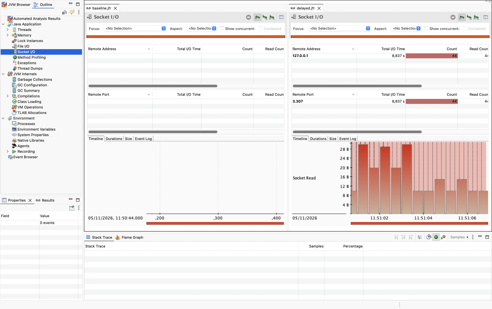
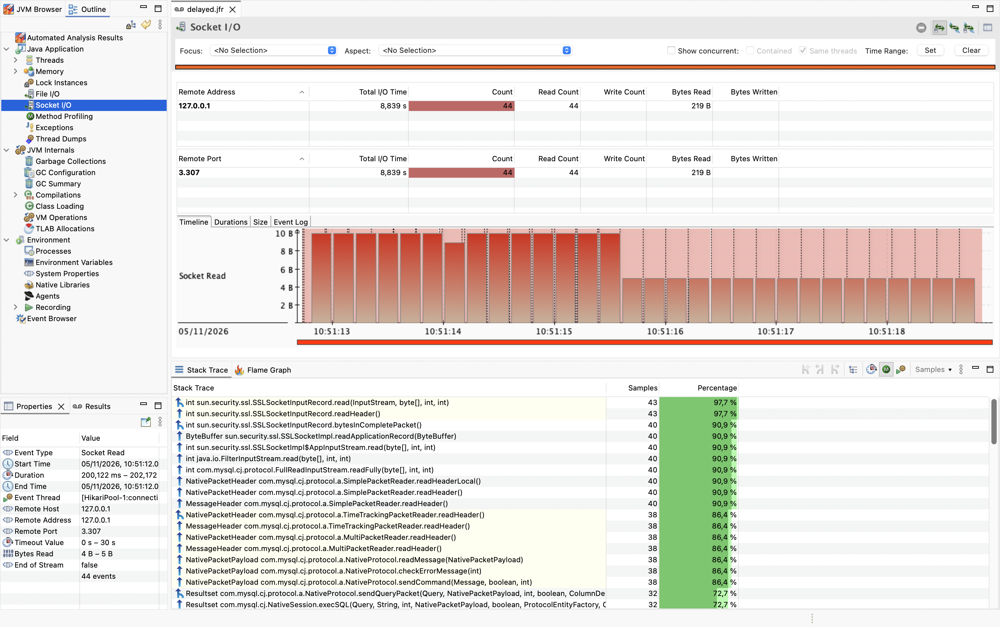

<!-- Generated by Sociable Weaver (https://github.com/albertattard/sw). Manual edits will be overwritten when regenerated. -->

# Socket I/O

Why does a request take a long time when the Java application is waiting for a
remote service? This example uses a Spring Boot quotes application, MySQL, a TCP
proxy, JDK Flight Recorder (JFR), and JDK Mission Control (JMC) to investigate
socket-read waits.

---

## Disclaimer

The examples provided in this repository are for **educational purposes only**
and are intended to be used **exclusively within this workshop**. While every
effort has been made to ensure accuracy and reliability, these examples are
provided **“as is”**, without any warranties, express or implied.

By using these examples, you acknowledge that you do so **at your own risk**.
The authors and contributors shall **not be held liable** for any direct,
indirect, incidental, or consequential damages resulting from the use, misuse,
or inability to use these examples.

It is the responsibility of the user to **review, test, and validate** any code
before applying it in a production or commercial environment.

### Performance Disclaimer

The performance values shown in this workshop are for reference only and should
not be treated as absolute. Results can vary depending on hardware, system
configuration, runtime environment, and other factors. Readers are encouraged to
conduct their own tests under controlled conditions to obtain accurate
measurements relevant to their specific use case.

---

## Learning objectives

By the end of this example, attendees can:

- measure HTTP response time and record a network-dependent workload;
- identify socket-read waits and their application call site in JFR;
- compare recordings with and without simulated network delay; and
- explain what socket-read events can and cannot establish about the cause.

## Prerequisites and environment

- [Oracle Java 25](https://www.oracle.com/java/technologies/downloads/#java25)

- [curl](https://curl.se/)

- Docker runtime, such as [Colima](https://github.com/abiosoft/colima) or
  [Podman](https://podman.io/).

Run locally with a POSIX shell, `jq`, `tree`, and
[JDK Mission Control](https://www.oracle.com/java/technologies/javase/products-jmc9-downloads.html).
The exercise downloads MySQL and Toxiproxy container images and Maven
dependencies. Ports 3307, 8474 and 8080 must be available. The containers and
their demo data are disposable. Docker publishes the proxy and its control API
on all host interfaces; use a trusted local environment for this exercise.

## Workload and experiment design

**Question:** Can JFR help pinpoint where time is spent during a slow HTTP
response?

**Variable:** A TCP proxy sits between the application and MySQL. The baseline
adds no delay; the comparison delays MySQL-to-application traffic by 200 ms.
This simulates network delay rather than a slow SQL query. From the Java
application’s point of view, both can appear as time spent waiting for data from
a socket; JFR alone cannot determine which caused the wait.

**Controls:** Both runs use the same application, database, data, JDBC proxy
connection, JVM, JFR profile settings and five sequential HTTP requests. The
startup readiness request warms the application before recording.

**Evidence:** Compare HTTP response times and `jdk.SocketRead` events and
stacks. The JFR profile configuration has a duration threshold, so shorter reads
may not be recorded. One query need not produce exactly one read event. The
proxy delays stream data, not individual queries, so it does not guarantee
exactly 200 ms of additional latency per request.

## Guided walkthrough

1. Build and test the application.

   The copied application uses H2 for its isolated tests and MySQL for the
   socket I/O exercise.

   ```shell
   ./mvnw clean package
   ```

   (*Optional*) Verify that the JAR file was created

   ```shell
   tree --sort=name -L 1 --prune './target'
   ```

   The application JAR file

   ```
   ./target
   ├── socket-io-1.0.0.jar
   └── socket-io-1.0.0.jar.original

   1 directory, 2 files
   ```

   Some of the following commands dump JFR files into a `jfr` directory. Make
   sure that the `jfr` directory exists.

   ```shell
   rm -rf './jfr'
   mkdir -p './jfr'
   ```

2. Start the disposable MySQL server and TCP proxy on a dedicated Docker
   network.

   The application connects through the proxy on port 3307. The database is
   created during initialisation and the application applies its Flyway
   migration on first start. The runbook registers cleanup for each resource;
   the final step also removes them when running commands manually.

   ```shell
   docker network create workshop-socket-io
   ```

   Select the MySQL Community Server image based on the local machine’s
   architecture. Oracle Container Registry uses a separate `-aarch64` tag for
   Apple Silicon. Both tags use the same MySQL version; this selection assumes
   an ARM Mac or an AMD64 Linux host with a local Docker daemon.

   ```shell
   # Determine the image tag based on the architecture
   MYSQL_IMAGE_TAG='container-registry.oracle.com/mysql/community-server:9.7.4'
   if [ "$(uname -m)" = 'arm64' ]; then
     MYSQL_IMAGE_TAG="${MYSQL_IMAGE_TAG}-aarch64"
   fi

   # Start the database container
   docker run \
     --rm \
     --detach \
     --name 'workshop-socket-io-mysql' \
     --network workshop-socket-io \
     --network-alias mysql \
     --env MYSQL_ROOT_PASSWORD='Socket I/O Demo' \
     --env MYSQL_DATABASE='quotes' \
     --env MYSQL_USER='demo' \
     --env MYSQL_PASSWORD='Socket I/O' \
     --health-cmd='mysqladmin ping --silent' \
     "${MYSQL_IMAGE_TAG}"

   # Wait for the database container to become healthy
   until [ "$(docker inspect --format '{{.State.Health.Status}}' 'workshop-socket-io-mysql')" = "healthy" ]; do sleep 1; done
   ```

   Start Toxiproxy on the same Docker network. Its data port and control API
   are published on the host; the forwarding route is configured next.

   ```shell
   docker run \
     --detach \
     --rm \
     --name workshop-socket-io-proxy \
     --network workshop-socket-io \
     --publish 3307:3307 \
     --publish 8474:8474 \
     ghcr.io/shopify/toxiproxy:2.13.0
   ```

   Configure Toxiproxy to forward connections from port `3307` to the MySQL
   server at `mysql:3306`. Initially, the proxy forwards traffic without adding
   any delay.

   ```shell
   curl \
     --silent \
     --show-error \
     --fail \
     --retry 20 \
     --retry-connrefused \
     --retry-delay 1 \
     --request POST http://127.0.0.1:8474/proxies \
     --header 'Content-Type: application/json' \
     --data '{"name":"mysql","listen":"0.0.0.0:3307","upstream":"mysql:3306"}' > /dev/null
   ```

   Inspect the proxy configuration and confirm that it is enabled, forwards
   to `mysql:3306`, and has no configured toxics.

   ```shell
   curl \
     --silent \
     --show-error \
     --fail \
     http://127.0.0.1:8474/proxies/mysql | jq
   ```

   Proxy configuration before adding latency

   ```json
   {
     "name": "mysql",
     "listen": "[::]:3307",
     "upstream": "mysql:3306",
     "enabled": true,
     "Logger": {},
     "toxics": []
   }
   ```

3. Run five baseline requests through the proxy with no added delay.

   The helper starts and stops the application, records the workload, and writes
   its log under `target/` and its recording under `jfr/`. The setup step above
   removes the existing `jfr/` directory before creating a new one.

   ```shell
   ./run-workload.sh jfr/baseline.jfr
   ```

   Baseline response times and recording

   ```
   Request time: 0.015347 s
   Request time: 0.011508 s
   Request time: 0.009866 s
   Request time: 0.009160 s
   Request time: 0.007936 s
   Recording: jfr/baseline.jfr
   ```

   This will make a few requests to the application and capture the recording to
   `jfr/baseline.jfr`.

   (*Optional*) Verify that the recording was created.

   ```shell
   tree --sort=name './jfr'
   ```

   The baseline recording

   ```
   ./jfr
   └── baseline.jfr

   1 directory, 1 file
   ```

   The baseline recording captures the application’s behaviour without added
   proxy latency. Next, add latency and repeat the same workload.

4. Configure a 200 ms delay on data travelling from MySQL to the application,
   and run the same workload again. Both recordings use the proxy.

   ```shell
   curl \
     --silent \
     --show-error \
     --fail \
     --request POST http://127.0.0.1:8474/proxies/mysql/toxics \
     --header 'Content-Type: application/json' \
     --data '{"name":"response-latency","type":"latency","stream":"downstream","attributes":{"latency":200,"jitter":0}}' > /dev/null
   ```

   Inspect the proxy configuration again and confirm that the `response-latency`
   toxic delays the downstream stream by 200 ms.

   ```shell
   curl \
     --silent \
     --show-error \
     --fail \
     http://127.0.0.1:8474/proxies/mysql | jq
   ```

   Proxy configuration with downstream latency enabled

   ```json
   {
     "name": "mysql",
     "listen": "[::]:3307",
     "upstream": "mysql:3306",
     "enabled": true,
     "Logger": {},
     "toxics": [
       {
         "attributes": {
           "latency": 200,
           "jitter": 0
         },
         "name": "response-latency",
         "type": "latency",
         "stream": "downstream",
         "toxicity": 1
       }
     ]
   }
   ```

   Run the same workload again with the proxy delaying responses from MySQL.

   ```shell
   ./run-workload.sh jfr/delayed.jfr
   ```

   Delayed response times and recording

   ```
   Request time: 1.219792 s
   Request time: 1.218716 s
   Request time: 1.215522 s
   Request time: 1.215593 s
   Request time: 1.214955 s
   Recording: jfr/delayed.jfr
   ```

5. Inspect both recordings in JDK Mission Control.

   Open `jfr/baseline.jfr` and `jfr/delayed.jfr`, then select
   **Java Application → Socket I/O** in each recording.

   In the example below, the baseline shows no socket I/O events, while the
   delayed recording shows socket reads from `127.0.0.1` on port `3307`, where
   Toxiproxy is listening.

   

   An empty baseline view does not mean that no database communication occurred.
   JFR may omit reads shorter than the recording threshold, and the events
   observed in your recording may differ.

   Select the socket-read events in the delayed recording and inspect their
   stack traces. The example below shows MySQL Connector/J frames above the
   socket read.

   

   Although the application queries MySQL through JDBC, the driver receives the
   database response over a network socket. JFR can show where the application
   waited, but the socket-read event alone cannot establish whether the delay
   came from the network, the database, or another cause.

   Compare the event durations and the HTTP response times from both runs. In
   this exercise, the proxy introduces the delay; one request may involve
   several socket reads.

   Alternatively, inspect the recorded socket events from the command line:

   ```shell
   jfr summary 'jfr/baseline.jfr' | grep 'jdk.SocketRead'
   ```

   Recorded socket-read events in the baseline

   ```
    jdk.SocketRead                              0             0
   ```

   Compare the baseline count with the number of socket-read events in the
   delayed recording. Counts include all recorded socket reads in the JVM, not
   only reads from the database connection.

   ```shell
   jfr summary 'jfr/delayed.jfr'  | grep 'jdk.SocketRead'
   ```

   Recorded socket-read events with proxy latency

   ```
    jdk.SocketRead                             44          1840
   ```

   Search the delayed recording’s socket-read stack traces for the application’s
   quote lookup and count the matching lines.

   ```shell
   jfr print --events jdk.SocketRead --stack-depth 128 'jfr/delayed.jfr' \
     | grep 'demo.quote.QuoteService.random' \
     | wc -l
   ```

   Stack-trace lines containing the application’s quote lookup

   ```
   30
   ```

   Each matching line shows that the quote lookup appeared in a recorded
   socket-read stack trace. This count is the number of matching lines, not
   necessarily the number of unique events, requests, or database queries. The
   filtered output does not include event durations or remote addresses; use JMC
   or print the full events to inspect those details.

6. Remove the disposable containers, network and data when finished.

   ```shell
   docker rm --force workshop-socket-io-proxy workshop-socket-io-mysql
   docker network rm workshop-socket-io
   ```

## Interpretation and caveats

A long socket read shows that a client thread waited for data; it does not by
itself prove whether the cause was network conditions, MySQL execution, or a
different problem. Here the proxy introduces the controlled delay. Other remote
dependencies, such as an HTTP service or message broker, can produce similar
Java-side evidence. Correlate the call site and timestamps with network and
service-side evidence before deciding what to change.

Summed durations across threads are not elapsed request time. Short reads may be
omitted by the recording threshold, and HTTP server sockets can also appear in
the recording. Toxiproxy delays data in one direction; this does not model all
the characteristics of a real network.

## References

- [Toxiproxy](https://github.com/Shopify/toxiproxy)
- [MySQL Community Server container](https://container-registry.oracle.com/ords/ocr/ba/mysql/community-server)
- [MySQL Connector/J](https://dev.mysql.com/doc/connector-j/en/)
- [JDK Flight Recorder](https://docs.oracle.com/en/java/javase/25/jfapi/)
