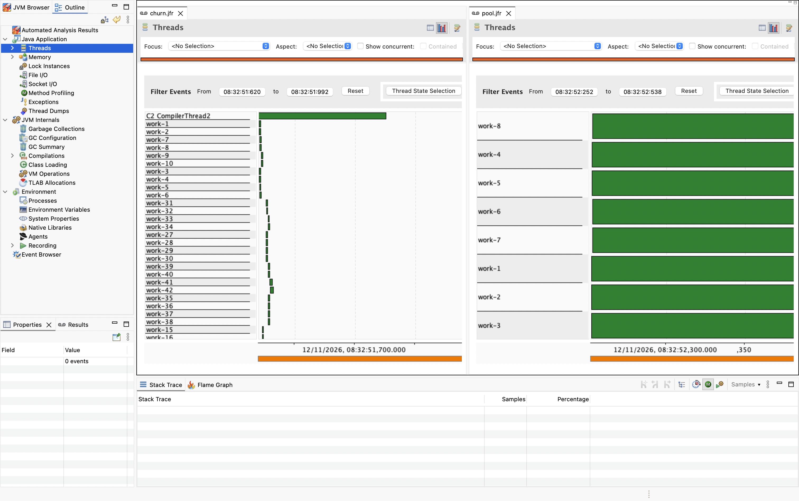
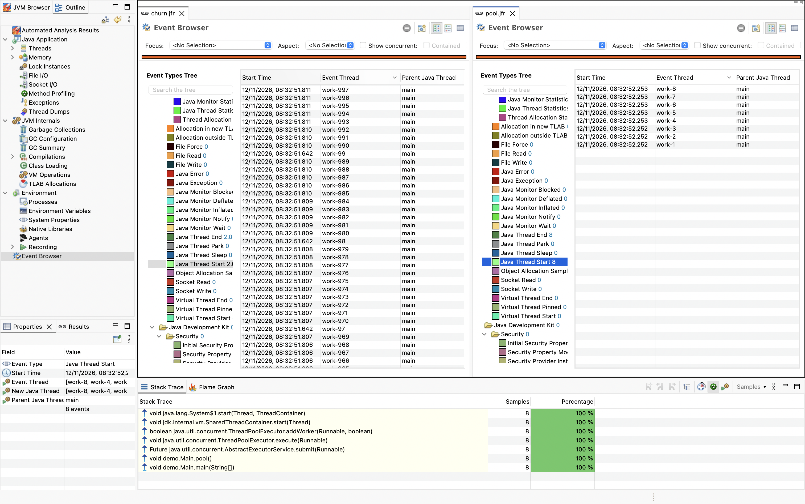

<!-- Generated by Sociable Weaver (https://github.com/albertattard/sw). Manual edits will be overwritten when regenerated. -->

# Thread churn

Thread churn is the repeated creation and termination of threads, often to
perform short-lived tasks. A high rate of thread starts does not by itself
indicate a thread leak or a performance problem; the impact depends on the
workload and its environment.

How can JFR and JDK Mission Control (JMC) reveal repeated platform thread
creation, and how can we assess whether it matters? This example compares a
thread-per-task implementation with a fixed pool that reuses threads, using the
same short workload. Participants inspect thread-start events and stack traces,
then compare thread lifecycles, task completion and elapsed time.

---

## Disclaimer

The examples provided in this repository are for **educational purposes only**
and are intended to be used **exclusively within this workshop**. While every
effort has been made to ensure accuracy and reliability, these examples are
provided **“as is”**, without any warranties, express or implied.

By using these examples, you acknowledge that you do so **at your own risk**.
The authors and contributors shall **not be held liable** for any direct,
indirect, incidental, or consequential damages resulting from the use, misuse,
or inability to use these examples.

It is the responsibility of the user to **review, test, and validate** any code
before applying it in a production or commercial environment.

### Performance Disclaimer

The performance values shown in this workshop are for reference only and should
not be treated as absolute. Results can vary depending on hardware, system
configuration, runtime environment, and other factors. Readers are encouraged to
conduct their own tests under controlled conditions to obtain accurate
measurements relevant to their specific use case.

---

## Learning objectives

- Identify recorded thread starts and inspect their stack traces in JMC.
- Compare recorded worker starts and ends, completed tasks and elapsed time.
- Explain the limits of stack attribution and distinguish churn from a leak.
- Evaluate whether reuse helps this workload without generalising to virtual
  threads.

## Prerequisites and environment

Install
[Oracle Java 25](https://www.oracle.com/java/technologies/downloads/#java25).

Run locally in a POSIX shell with the Maven wrapper and
[JDK Mission Control](https://www.oracle.com/java/technologies/javase/products-jmc9-downloads.html).
Use the same JDK, machine and load for both runs; allow resources for eight
simultaneous platform threads.

## Workload and experiment design

**Question:** Does a fixed pool reduce platform thread starts, and how does
elapsed time change for these short tasks?

**Change:** The baseline creates a new platform thread per task and joins each
batch. The alternative submits to a fixed pool of eight platform threads and
waits for each batch, then shuts the pool down. The executor has a bounded
worker count; batch submission also bounds outstanding tasks to eight.

**Controls:** Both modes execute 2,000 identical one-millisecond sleeps in
batches of at most eight, with the same task completion counter, JDK, JFR
configuration and environment. The batching barrier limits concurrency in both
modes; actual simultaneous execution varies. Each mode runs in a fresh JVM.

**Evidence:** The application reports completed tasks, elapsed time and
throughput, including thread creation or pool startup and shutdown but excluding
JFR start and file dump. The recording explicitly enables `jdk.ThreadStart` and
`jdk.ThreadEnd` with stack traces before the workload and stops after all
workers have terminated. Count recorded events and inspect stacks in JMC.

**Limits:** Scheduling, sleep precision, JIT compilation, recording overhead and
competing load influence results. This is a short demonstration, not a
benchmark; repeat runs and alternate order, then use a representative workload
for a real decision. Only platform threads are studied.

Compare the batch barriers, task body and worker creation paths. Both modes run
the same task; the pool can execute many tasks on each worker.

```java
package demo;

import jdk.jfr.Recording;

import java.nio.file.Path;
import java.util.ArrayList;
import java.util.List;
import java.util.Locale;
import java.util.concurrent.*;
import java.util.concurrent.atomic.AtomicInteger;

public class Main {

    private static final int TASKS = 2_000;
    private static final int CONCURRENCY = 8;
    private static final AtomicInteger completed = new AtomicInteger();
    private static final AtomicInteger names = new AtomicInteger();

    static void main(final String[] args) throws Exception {
        if (args.length != 2 || !(args[0].equals("churn") || args[0].equals("pool"))) {
            throw new IllegalArgumentException("Usage: java -jar thread-churn-1.0.0.jar churn|pool recording.jfr");
        }

        try (Recording recording = new Recording()) {
            recording.enable("jdk.ThreadStart").withStackTrace();
            recording.enable("jdk.ThreadEnd").withStackTrace();
            recording.start();

            long start = System.nanoTime();

            switch (args[0]) {
                case "churn" -> churn();
                case "pool" -> pool();
            }

            long elapsed = System.nanoTime() - start;
            recording.stop();
            recording.dump(Path.of(args[1]));

            System.out.printf(Locale.ROOT, "mode=%s tasks=%d completed=%d concurrency=%d elapsed=%.1f ms throughput=%.1f tasks/s%n",
                    args[0], TASKS, completed.get(), CONCURRENCY, elapsed / 1_000_000.0,
                    TASKS * 1_000_000_000.0 / elapsed);
        }
    }

    private static void churn() throws InterruptedException {
        for (int first = 0; first < TASKS; first += CONCURRENCY) {
            final List<Thread> batch = new ArrayList<>();

            for (int i = first; i < Math.min(first + CONCURRENCY, TASKS); i++) {
                final Thread thread = builder().start(Main::task);
                batch.add(thread);
            }

            for (final Thread thread : batch) {
                thread.join();
            }
        }
    }

    private static void pool() throws InterruptedException, ExecutionException {
        final ThreadFactory threadFactory = runnable -> builder().unstarted(runnable);
        try (ExecutorService executor = Executors.newFixedThreadPool(CONCURRENCY, threadFactory)) {
            for (int first = 0; first < TASKS; first += CONCURRENCY) {
                final List<Future<?>> batch = new ArrayList<>();

                for (int i = first; i < Math.min(first + CONCURRENCY, TASKS); i++) {
                    batch.add(executor.submit(Main::task));
                }

                for (final Future<?> future : batch) {
                    future.get();
                }
            }
        }
    }

    private static Thread.Builder.OfPlatform builder() {
        /* Prefix the thread names with 'work-' to make it easier to distinguish these threads from the rest */
        return Thread.ofPlatform().name("work-" + names.incrementAndGet());
    }

    private static void task() {
        // The same short, interruptible wait models a small blocking operation.
        try {
            TimeUnit.MILLISECONDS.sleep(1);
            completed.incrementAndGet();
        } catch (final InterruptedException e) {
            Thread.currentThread().interrupt();
            throw new IllegalStateException(e);
        }
    }
}
```

## Guided walkthrough

1. Build the example with the Maven wrapper.

   This produces the application in `target/libs/thread-churn-1.0.0.jar`. The
   `tools/count-events` utility is a separate Java source-file program.

   ```shell
   ./mvnw clean package
   ```

   (*Optional*) Verify that the JAR file was created

   ```shell
   tree --sort=name -L 1 --prune './target'
   ```

   The application JAR file

   ```
   ./target

   0 directories, 0 files
   ```

2. Remove previous recordings and create a fresh directory.

   Recordings from this walkthrough remain available until the optional cleanup
   below.

   ```shell
   rm -rf ./jfr
   mkdir -p ./jfr
   ```

3. Run the baseline.

   The process finishes after all tasks complete and writes `jfr/churn.jfr`.
   Note completed tasks, elapsed time and throughput.

   ```shell
   java -jar './target/libs/thread-churn-1.0.0.jar' 'churn' './jfr/churn.jfr'
   ```

   The baseline reports the number of tasks completed, the concurrency limit,
   elapsed time and throughput. Timing varies between runs.

   ```
   mode=churn tasks=2000 completed=2000 concurrency=8 elapsed=373.5 ms throughput=5354.5 tasks/s
   ```

4. Run the pool under the same conditions.

   It shuts down its workers and writes `jfr/pool.jfr`. Compare completion count
   and timings with the baseline.

   ```shell
   java -jar './target/libs/thread-churn-1.0.0.jar' 'pool' './jfr/pool.jfr'
   ```

   The pool reports the same measurements as the baseline. Compare completed
   tasks and timing, allowing for variability between runs.

   ```
   mode=pool tasks=2000 completed=2000 concurrency=8 elapsed=289.3 ms throughput=6913.0 tasks/s
   ```

5. Count baseline events.

   Each recorded event is counted once, including those without a usable name.
   `work-*` identifies this example’s workers; missing stacks are reported
   separately. Counts are recording observations, not task counts or guaranteed
   complete lifetime counts.

   ```shell
   './tools/count-events' './jfr/churn.jfr'
   ```

   The recording’s total and `work-*` thread starts and ends are counted
   separately, along with starts without a stack trace. Counts may vary.

   ```
   recorded starts=2000 ends=2002; work-* starts=2000 ends=2000; starts without stack=0
   ```

6. Count the pool recording in the same way.

   Expect substantially fewer worker starts and ends, subject to recording
   completeness; compare the total as well because JVM activity may contribute
   other events.

   ```shell
   './tools/count-events' './jfr/pool.jfr'
   ```

   The pool recording reports total and `work-*` starts and ends, plus starts
   without a stack trace. Compare these counts with the baseline; recorded
   totals can include other JVM threads.

   ```
   recorded starts=8 ends=8; work-* starts=8 ends=8; starts without stack=0
   ```

7. Open each recording in JMC, for example with
   `jmc -open "$(pwd)/jfr/churn.jfr"`, then open `jfr/pool.jfr`.

   

   In **Event Browser**, select the `jdk.ThreadStart` event type (shown as
   Thread Start) and inspect its events and stack traces; filter or select
   `work-*` threads if useful. Compare the paths for direct starts and executor
   worker creation. JMC views and labels can vary by version. Also inspect
   Thread End events and the timeline where available; the application
   completion count is separate.

   

   A recorded frame is a method on the stack captured at the event, not proof
   that that method initiated the business request or owns the creation policy.
   The top frame can be JDK machinery; follow the whole stack to application
   callers and corroborate with source. Missing or truncated stacks limit
   attribution. A worker can execute many tasks, and unrelated JVM threads can
   start: never equate all recorded starts with task count.

## Interpretation and caveats

A high rate of starts and subsequent ends indicates churn during the observed
interval; it is not itself a leak or proof of a performance problem. A thread
leak involves threads remaining alive unexpectedly or growing without bound;
investigate live thread counts over time, thread states and retention, including
threads that predate the recording or outlive it. Starts minus ends in a partial
recording is not a reliable live-thread count.

A reduction in recorded worker starts supports reuse when the event settings and
recording interval cover the work. Verify enabled events and stack availability:
disabled events, absent stacks, recording boundaries or data loss can invalidate
comparisons. Check completed tasks and elapsed time too. Reuse may reduce
creation overhead, but queueing, scheduling, task duration, pool sizing and
recording overhead can make it slower. Repeat, alternate order and investigate
representative latency and throughput before changing an application.

When finished inspecting, optionally remove the generated files with
`rm -rf ./jfr ./target`. The next walkthrough also replaces `jfr`.

## References

- [JDK Flight Recorder API Programmer’s Guide](https://docs.oracle.com/en/java/javase/25/jfapi/)
- [JDK Mission Control User Guide](https://docs.oracle.com/en/java/java-components/jdk-mission-control/9/user-guide/)
- [Executors API](https://docs.oracle.com/en/java/javase/25/docs/api/java.base/java/util/concurrent/Executors.html)
