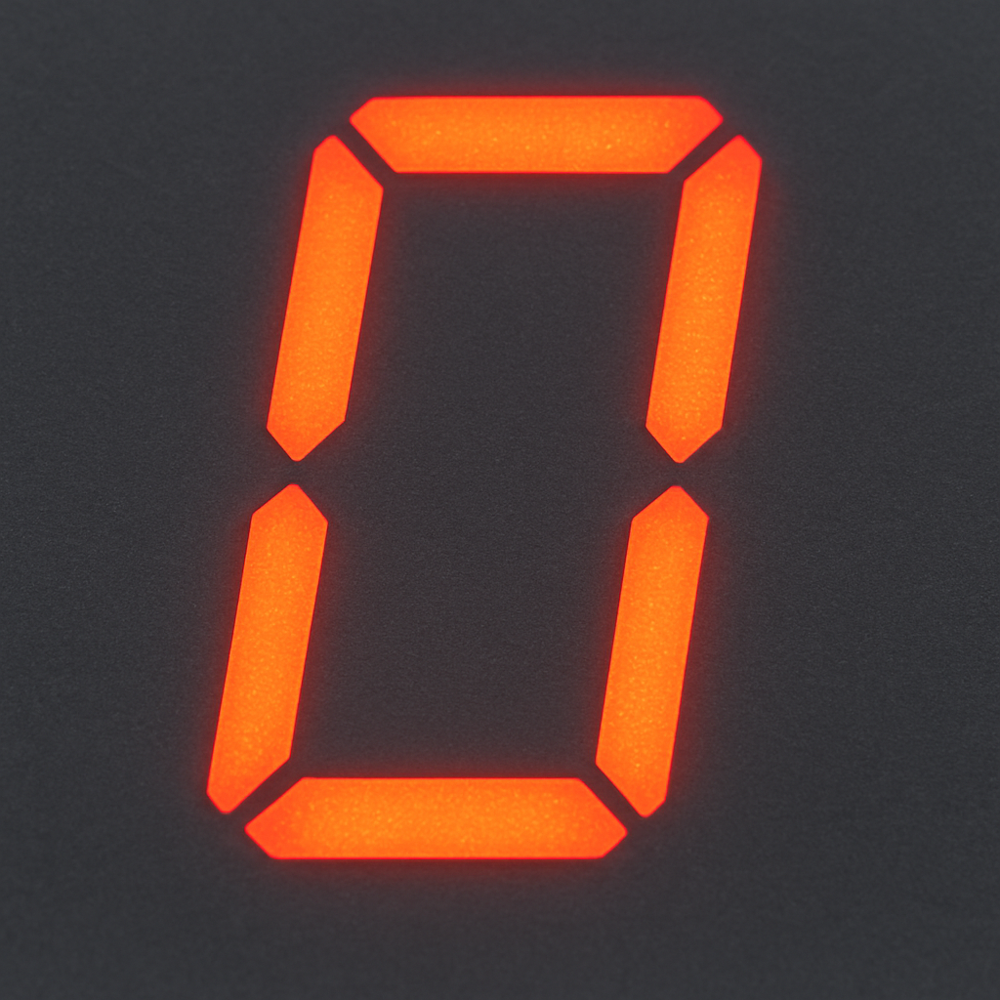

<!-- Generated by Sociable Weaver (https://github.com/albertattard/sw). Manual edits will be overwritten when regenerated. -->

# Simple Neural Network

This example trains a small Java neural network to classify the digits `0` to
`9` from their seven-segment display patterns. It demonstrates supervised
learning with seven numeric input features and a ten-class, one-hot target
vector. The example deliberately avoids an AI framework or external model so
that the training and classification flow remain visible in the source code.

It is an educational classifier, not an optical-character-recognition system: it
recognises only the ten predefined seven-segment patterns with small random
perturbations.



| Input pattern         | Target output                  | Digit |
| --------------------- | ------------------------------ | ----: |
| `1, 1, 1, 1, 1, 1, 0` | `1, 0, 0, 0, 0, 0, 0, 0, 0, 0` |   `0` |
| `0, 1, 1, 0, 0, 0, 0` | `0, 1, 0, 0, 0, 0, 0, 0, 0, 0` |   `1` |
| `1, 1, 0, 1, 1, 0, 1` | `0, 0, 1, 0, 0, 0, 0, 0, 0, 0` |   `2` |
| `1, 1, 1, 1, 0, 0, 1` | `0, 0, 0, 1, 0, 0, 0, 0, 0, 0` |   `3` |
| `0, 1, 1, 0, 0, 1, 1` | `0, 0, 0, 0, 1, 0, 0, 0, 0, 0` |   `4` |
| `1, 0, 1, 1, 0, 1, 1` | `0, 0, 0, 0, 0, 1, 0, 0, 0, 0` |   `5` |
| `1, 0, 1, 1, 1, 1, 1` | `0, 0, 0, 0, 0, 0, 1, 0, 0, 0` |   `6` |
| `1, 1, 1, 0, 0, 0, 0` | `0, 0, 0, 0, 0, 0, 0, 1, 0, 0` |   `7` |
| `1, 1, 1, 1, 1, 1, 1` | `0, 0, 0, 0, 0, 0, 0, 0, 1, 0` |   `8` |
| `1, 1, 1, 1, 0, 1, 1` | `0, 0, 0, 0, 0, 0, 0, 0, 0, 1` |   `9` |

---

## Disclaimer

The examples provided in this repository are for **educational purposes only**
and are intended to be used **exclusively within this workshop**. While every
effort has been made to ensure accuracy and reliability, these examples are
provided **“as is”**, without any warranties, express or implied.

By using these examples, you acknowledge that you do so **at your own risk**.
The authors and contributors shall **not be held liable** for any direct,
indirect, incidental, or consequential damages resulting from the use, misuse,
or inability to use these examples.

It is the responsibility of the user to **review, test, and validate** any code
before applying it in a production or commercial environment.

### Performance disclaimer

The performance values shown in this workshop are for reference only and should
not be treated as absolute. Results can vary depending on hardware, system
configuration, runtime environment, and other factors. Readers are encouraged to
conduct their own tests under controlled conditions to obtain accurate
measurements relevant to their specific use case.

---

## Learning objectives

By the end of this example, attendees can:

- identify the input features and one-hot target vector used for a digit;
- explain the forward pass, backpropagation, and argmax classification flow;
- train and persist the model parameters locally;
- verify the classifier against all ten known patterns; and
- compare results from complete and intentionally incomplete training data.

## Prerequisites and environment

- [Oracle Java 25](https://www.oracle.com/java/technologies/downloads/#java25)

The Maven Wrapper downloads build dependencies if they are not already cached.
Training and testing run entirely on the local machine: no API key, network
service, downloaded model, or environment variable is required. Training writes
the serialised parameters to `target/data/model.data`, keeping the generated
model out of the source tree.

## The program to inspect

`Main` supplies the ten seven-segment patterns and creates a model with seven
input neurons and ten output neurons, with no hidden layer. During training,
each pattern is perturbed with small random noise and used in repeated forward
and backward passes. The target vector has one active position for the expected
digit. At test time, `Model.classify` returns the index with the largest output
score.

The sigmoid activation function produces continuous values between zero and one;
it does not itself produce a one-hot output. The classifier’s discrete digit is
the position of the highest score.

```java
package demo;

import java.nio.file.Files;
import java.nio.file.Path;
import java.util.function.IntPredicate;

import static demo.MathUtils.noise;

public final class Main {

    // 7-segment patterns for digits 0–9 (A-G: 1=on, 0=off)
    private final static double[][] inputs = {
            {1, 1, 1, 1, 1, 1, 0}, // 0
            {0, 1, 1, 0, 0, 0, 0}, // 1
            {1, 1, 0, 1, 1, 0, 1}, // 2
            {1, 1, 1, 1, 0, 0, 1}, // 3
            {0, 1, 1, 0, 0, 1, 1}, // 4
            {1, 0, 1, 1, 0, 1, 1}, // 5
            {1, 0, 1, 1, 1, 1, 1}, // 6
            {1, 1, 1, 0, 0, 0, 0}, // 7
            {1, 1, 1, 1, 1, 1, 1}, // 8
            {1, 1, 1, 1, 0, 1, 1}  // 9
    };

    /* In this example, the sigmoid function is used to normalise the output, resulting in values of either 0 or 1. For
        simplicity, the output layer consists of 10 neurons, with only one active (1) at a time to represent a specific
        digit. For instance, if the first neuron is active, the input corresponds to 0; if the last neuron is active,
        the input corresponds to 9. This approach can be improved by using binary representation with only four output
        neurons, or by switching to a ReLU activation function with a single output neuron. */
    private final static double[][] targets = createExpectedOutputs();

    public static void main(final String[] args) {
        final CommandLineArguments cla = CommandLineArguments.parse(args);

        if (cla.printHelp()) {
            CommandLineArguments.printHelp(System.out);
            return;
        }

        final Path modelFile = Path.of("data", "model.data");

        if (cla.trainModel()) {
            trainModel(modelFile, cla.skipInputPredicate());
        }

        if (cla.testModel()) {
            if (!Files.isRegularFile(modelFile)) {
                System.out.println("Missing model file. Use the --train to train the model first.");
                return;
            }
            testModel(modelFile);
        }
    }

    private static void trainModel(final Path path, final IntPredicate skipInputPredicate) {
        final Model model = Model.createWithoutHiddenLayers(7, 10);

        /* Training */
        System.out.println("Trained network using Supervised Learning");
        for (int epoch = 0; epoch < 1_000; epoch++) {
            for (int i = 0; i < inputs.length; i++) {
                if (skipInputPredicate.test(i)) {
                    /* Print this for the first epoch and not for all otherwise it will pollute the output */
                    if (epoch == 0) {System.out.println("Skipping training for input " + i);}
                    continue;
                }
                for (int j = 0; j < 10; j++) {
                    model.train(noise(inputs[i]), targets[i], 0.1);
                }
            }
        }

        model.writeTo(path);
    }

    private static void testModel(final Path path) {
        final Model model = Model.readFrom(path);

        /* Testing */
        System.out.println("Testing trained network");
        for (int i = 0; i < inputs.length; i++) {
            System.out.println("Input (" + i + ") predicted as: " + model.classify(noise(inputs[i])));
        }
    }

    private static double[][] createExpectedOutputs() {
        final double[][] targets = new double[10][10];
        for (int i = 0; i < 10; i++) {
            targets[i][i] = 1;
        }
        return targets;
    }

    private Main() {}
}
```

## Guided walkthrough

1. Build and run the unit tests. This creates
   `target/libs/simple-neural-network.jar`.

   ```shell
   ./mvnw clean package
   ```

   (*Optional*) Verify that the application was created.

   ```shell
   tree --sort=name './target/libs'
   ```

   The application JAR file and its dependencies.

   ```
   ./target/libs
   └── simple-neural-network.jar

   1 directory, 1 file
   ```

2. Train the model using all ten patterns. The command writes the generated
   parameters to `target/data/model.data`. This small model normally trains in
   a few seconds.

   ```shell
   java \
     -Xms128M -Xmx128M \
     --class-path './target/libs/*' \
     demo.Main --train
   ```

   The training mode confirms that supervised learning has started.

   ```
   Trained network using Supervised Learning
   ```

3. Test the saved model. Each input should be classified as its corresponding
   digit; the output is the evidence that the model has learned the supplied
   patterns.

   ```shell
   java \
     -Xms128M -Xmx128M \
     --class-path './target/libs/*' \
     demo.Main --test
   ```

   A fully trained model should classify the ten supplied patterns correctly.

   ```
   Testing trained network
   Input (0) predicted as: 0
   Input (1) predicted as: 1
   Input (2) predicted as: 2
   Input (3) predicted as: 3
   Input (4) predicted as: 4
   Input (5) predicted as: 5
   Input (6) predicted as: 6
   Input (7) predicted as: 7
   Input (8) predicted as: 8
   Input (9) predicted as: 9
   ```

4. Retrain while excluding digits `0` and `8`, then test again. This deliberately
   overwrites the previous model so the final test exposes the effect of missing
   examples in the training data.

   ```shell
   java \
     -Xms128M -Xmx128M \
     --class-path './target/libs/*' \
     demo.Main --train --skip=0,8
   ```

   The first training epoch reports the intentionally skipped inputs.

   ```
   Trained network using Supervised Learning
   Skipping training for input 0
   Skipping training for input 8
   ```

   Test the model again, and see how this performs with the skipped numbers `0`
   and `8`.

   ```shell
   java \
     -Xms128M -Xmx128M \
     --class-path './target/libs/*' \
     demo.Main --test
   ```

   The skipped digits are likely to be misclassified; exact incorrect
   predictions vary between runs.

   ```
   Testing trained network
   Input (0) predicted as: 2
   Input (1) predicted as: 1
   Input (2) predicted as: 2
   Input (3) predicted as: 3
   Input (4) predicted as: 4
   Input (5) predicted as: 5
   Input (6) predicted as: 6
   Input (7) predicted as: 7
   Input (8) predicted as: 2
   Input (9) predicted as: 9
   ```

## Interpretation and limitations

Successful classification after the first training run shows that the model can
fit these ten labelled patterns. The second run demonstrates the more important
boundary: a classifier cannot learn a class for which it has received no
training examples. The exact predictions for skipped digits vary because weights
and input noise are random.

The generated model remains under `target/data/` for inspection or retesting;
the next `./mvnw clean` removes it.

This is not evidence that the model generalises to handwritten digits, images,
damaged displays, or patterns outside the supplied data. The fixed input shape,
tiny training set, and absence of a held-out evaluation set make this a compact
demonstration of supervised learning rather than a reliable recognition model.

## References

- [Neural networks and deep learning](https://www.deeplearningbook.org/)
- [Understanding neural networks and deep learning](https://arxiv.org/abs/1412.1897)
