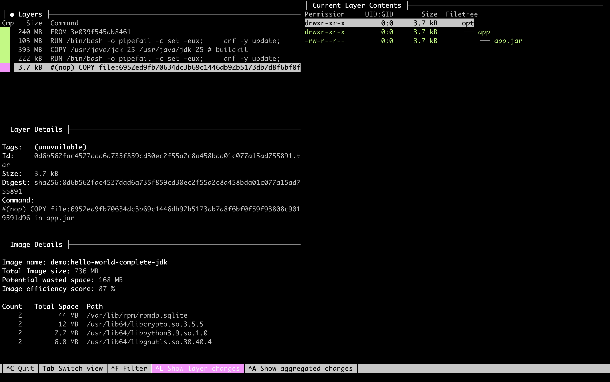
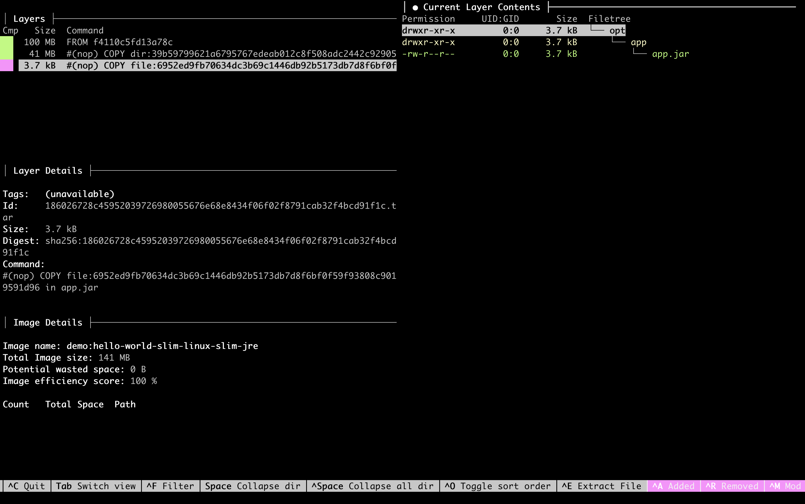
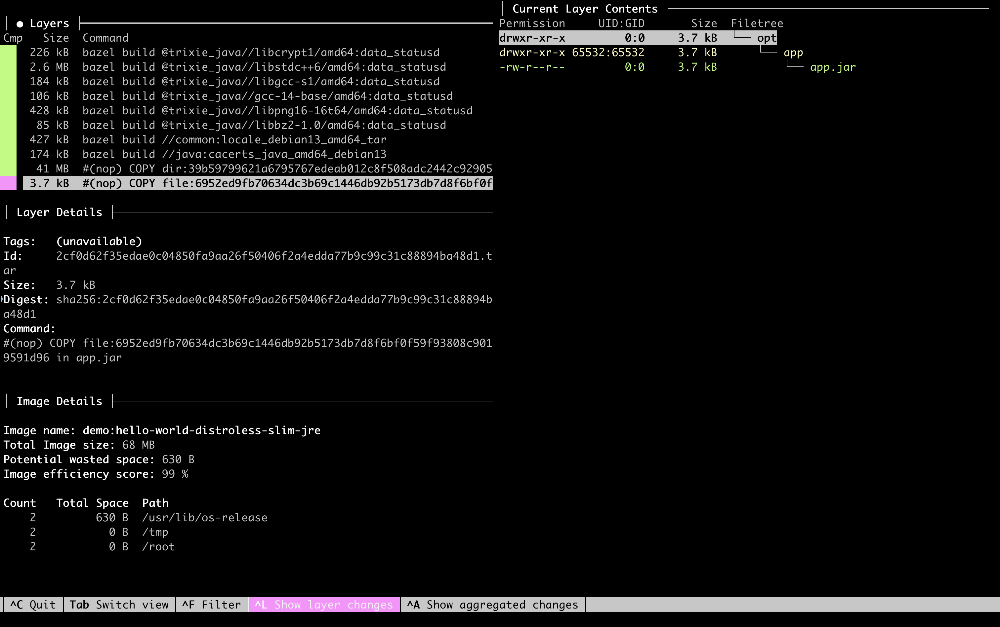

<!-- Generated by Sociable Weaver (https://github.com/albertattard/sw). Manual edits will be overwritten when regenerated. -->

# Slim Java runtime image with jlink

This example demonstrates how to build a container image that runs a Java
application with a custom runtime created by
[`jlink`](https://docs.oracle.com/en/java/javase/25/docs/specs/man/jlink.html).

The starting point is deliberately small: a modular Hello World application that
only needs `java.base`. That keeps the mechanics visible. The important idea is
the same for larger services: identify the Java modules the application needs,
create a runtime with only those modules, and copy that runtime into the final
container image instead of shipping a complete JDK.

Why do this in a container?

- A complete JDK contains development tools and modules that the running
  application does not use.
- A smaller runtime can reduce the final image size and the amount of software
  distributed with the application. Transfer effects depend on the environment
  and are not measured here.
- The custom runtime has to be regenerated when the Java version or module
  requirements change, so this is a build-time optimisation, not a reason to
  skip Java security updates.


This example is intentionally focused on one topic: using `jlink` to build a
custom Java runtime and comparing its container image with one that retains the
complete JDK.

It does not cover every aspect of running Java in containers. It omits concerns
such as running as a non-root user, image signing, vulnerability scanning,
runtime configuration, observability, and deployment-specific hardening. Those
topics are important, but they are outside the scope of this example so the
`jlink` mechanics remain easy to follow.

For a more complete Spring Boot container example that combines several of these
concerns, see [all-in-one-spring-boot](../all-in-one-spring-boot/README.md).

---

## Disclaimer

The examples provided in this repository are for **educational purposes only**
and are intended to be used **exclusively within this workshop**. While every
effort has been made to ensure accuracy and reliability, these examples are
provided **“as is”**, without any warranties, express or implied.

By using these examples, you acknowledge that you do so **at your own risk**.
The authors and contributors shall **not be held liable** for any direct,
indirect, incidental, or consequential damages resulting from the use, misuse,
or inability to use these examples.

It is the responsibility of the user to **review, test, and validate** any code
before applying it in a production or commercial environment.

### Performance Disclaimer

The performance values shown in this workshop are for reference only and should
not be treated as absolute. Results can vary depending on hardware, system
configuration, runtime environment, and other factors. Readers are encouraged to
conduct their own tests under controlled conditions to obtain accurate
measurements relevant to their specific use case.

---

## Learning objectives

By the end of this example, attendees can:

- inspect the application’s module dependency and the four Dockerfiles;
- build and inspect a runtime containing only the required Java module;
- compare the resulting container image with the complete JDK image; and
- explain the size benefit and the maintenance cost of a custom runtime.

## Prerequisites

- [Oracle Java 25](https://www.oracle.com/java/technologies/downloads/#java25)

- [Docker](https://docs.docker.com/get-docker/) runtime

Optional inspection commands use `tree` and
[Dive](https://github.com/wagoodman/dive). The optional full JDK size comparison
also expects `JAVA_25_HOME` to point to the JDK 25 installation.

### Oracle Container Registry access

Before pulling an Oracle Java base image, sign in to Oracle Container Registry
and accept the terms for the
[Oracle Java JDK repository](https://container-registry.oracle.com/ords/ocr/ba/java/jdk).

1. Accept the Oracle Container Registry terms.

2. Authenticate your container engine with your own Oracle Container Registry
   username and authentication token.

   Pass the token through standard input so it is neither recorded in shell
   history nor copied into the project or image layers. If you use Podman, use
   its equivalent `login --password-stdin` command.

   ```shell
   docker login container-registry.oracle.com \
     --username 'ALBERT.ATTARD@ORACLE.COM' \
     --password-stdin < ~/.ocr/auth-token
   ```

   This should print the login succeeded message.

   ```
   Login Succeeded!
   ```

3. Verify that the container engine can pull and run the Oracle Java JDK image.

   ```shell
   docker run --rm 'container-registry.oracle.com/java/jdk:25.0.4.1' java --version
   ```

   Docker pulls the image if necessary, then prints the Java runtime version.

   ```
   java 25.0.4.1 2026-08-18 LTS
   Java(TM) SE Runtime Environment (build 25.0.4.1+1-LTS-5)
   Java HotSpot(TM) 64-Bit Server VM (build 25.0.4.1+1-LTS-5, mixed mode, sharing)
   ```

## The artefacts to inspect

`module-info.java` declares the small `demo` module. `Main.java` prints a
message and the Java version, so its output can confirm which runtime starts the
application. Maven packages these sources as
`target/libs/jlink-slim-image-hello-world-1.0.0.jar`.

The slim Dockerfile builds a custom runtime in a JDK builder stage and copies it
with that JAR into an Oracle Linux slim final stage. The comparison Dockerfile
starts from the full JDK image and copies in the same JAR. This keeps the
application artefact constant while changing the runtime packaging.

An additional distroless Dockerfile uses the same Oracle JDK builder and `jlink`
options, then copies the custom runtime and JAR into a Debian 13 distroless Java
base image. That base contains native libraries needed by Java, but no
pre-installed Java runtime. The final image runs as a non-root user and has no
shell or package manager. Rebuild it when either the Oracle JDK or the
distroless base is updated.

The scratch Dockerfile takes the same custom runtime but starts the final stage
from an empty filesystem. It explicitly copies the native libraries required by
the runtime from the Oracle Linux builder, rather than relying on a prepared
operating system base. Rebuilding the builder image updates both the custom
runtime and the copied native libraries.

- The Java module definition

  ```java
  module demo {
  }
  ```

- The complete JDK container

  ```dockerfile
  FROM container-registry.oracle.com/java/jdk:25.0.4.1
  WORKDIR "/opt/app"

  ARG JAR_FILE="./target/libs/jlink-slim-image-hello-world-*.jar"
  COPY ["${JAR_FILE}", "app.jar"]

  ENTRYPOINT ["java", "-jar", "app.jar"]
  ```

- The slim container

  ```dockerfile
  FROM container-registry.oracle.com/java/jdk:25.0.4.1 AS builder

  # binutils are needed by the `--strip-debug` command line option
  RUN dnf install -y binutils && dnf clean all

  ARG JAVA_MODULES=java.base
  RUN jlink \
        --output "/opt/jre" \
        --no-header-files \
        --no-man-pages \
        --strip-debug \
        --add-modules "${JAVA_MODULES}" \
        --compress=zip-9

  FROM container-registry.oracle.com/os/oraclelinux:10-slim
  WORKDIR "/opt/app"

  # Copy the custom Java image
  COPY --from=builder ["/opt/jre", "/opt/jre"]

  ARG JAR_FILE="./target/libs/jlink-slim-image-hello-world-*.jar"
  COPY ["${JAR_FILE}", "app.jar"]

  ENTRYPOINT ["/opt/jre/bin/java", "-jar", "app.jar"]
  ```

- The distroless container with a custom Oracle Java runtime

  ```dockerfile
  FROM container-registry.oracle.com/java/jdk:25.0.4.1 AS builder

  # binutils are needed by the `--strip-debug` command line option
  RUN dnf install -y binutils && dnf clean all

  ARG JAVA_MODULES=java.base
  RUN jlink \
        --output "/opt/jre" \
        --no-header-files \
        --no-man-pages \
        --strip-debug \
        --add-modules "${JAVA_MODULES}" \
        --compress=zip-9

  FROM gcr.io/distroless/java-base-debian13:nonroot
  WORKDIR "/opt/app"

  # Copy the custom Java image
  COPY --from=builder ["/opt/jre", "/opt/jre"]

  ARG JAR_FILE="./target/libs/jlink-slim-image-hello-world-*.jar"
  COPY ["${JAR_FILE}", "app.jar"]

  ENTRYPOINT ["/opt/jre/bin/java", "-jar", "app.jar"]
  ```

- The scratch container with a custom Oracle Java runtime

  ```dockerfile
  FROM container-registry.oracle.com/java/jdk:25.0.4.1 AS builder

  # binutils provides the tools needed by --strip-debug and to inspect ELF files.
  RUN dnf install -y binutils && dnf clean all

  ARG JAVA_MODULES=java.base
  RUN jlink \
        --output "/opt/jre" \
        --no-header-files \
        --no-man-pages \
        --strip-debug \
        --add-modules "${JAVA_MODULES}" \
        --compress=zip-9

  # Copy only native dependencies outside the custom runtime from the same
  # Oracle Linux image as the JDK. Preserve their absolute paths for the loader.
  ENV LD_LIBRARY_PATH="/opt/jre/lib:/opt/jre/lib/server:/opt/jre/lib/jli"
  RUN mkdir -p "/opt/rootfs" && \
      find "/opt/jre" -type f -exec sh -ec 'for binary do \
        if readelf -h "$binary" >/dev/null 2>&1; then \
          ldd "$binary" 2>/dev/null | awk '\''/not found/ { print "Missing native library: " $0 > "/dev/stderr"; exit 1 } /=> \// { print $3 } /^[[:space:]]*\// { print $1 }'\''; \
        fi; \
      done' sh {} + | sort -u | while IFS= read -r library; do \
        case "$library" in \
          /opt/jre/*) ;; \
          *) cp -L --parents "$library" "/opt/rootfs" ;; \
        esac; \
      done

  FROM scratch
  WORKDIR "/opt/app"

  # Copy the libraries required by the Java custom image
  COPY --from=builder ["/opt/rootfs/", "/"]

  # Copy the custom Java image
  COPY --from=builder ["/opt/jre", "/opt/jre"]

  ARG JAR_FILE="./target/libs/jlink-slim-image-hello-world-*.jar"
  COPY ["${JAR_FILE}", "app.jar"]

  ENTRYPOINT ["/opt/jre/bin/java", "-jar", "app.jar"]
  ```

## Build the application

Run the build from this example directory. It creates
`target/libs/jlink-slim-image-hello-world-1.0.0.jar`, which the local runtime
checks and all four container builds use. Keeping the JAR constant isolates the
runtime packaging choice in the image comparison.

1. Build the application

   ```shell
   ./mvnw clean package
   ```

   (*Optional*) Verify that the application was created.

   ```shell
   tree './target/libs'
   ```

   The build has produced the JAR used in the following steps.

   ```
   ./target/libs
   └── jlink-slim-image-hello-world-1.0.0.jar

   1 directory, 1 file
   ```

2. (*Optional*) Run the application

   ```shell
   java -jar './target/libs/jlink-slim-image-hello-world-1.0.0.jar'
   ```

   The application prints its message and the version of the host Java runtime.

   ```
   Building smaller image using JLink
   Using Java 25.0.4.1
   ```

## Guided walkthrough

Continue from this example directory. The local checks show how the runtime is
assembled; the container builds then compare four ways of packaging the same
application JAR. Size results depend on the host and image versions. A fresh
Maven build replaces `target/`, and a repeated Docker build updates the local
image tags. The built files and images remain available for inspection after the
walkthrough.

### Build and inspect a custom Java runtime

Use the JAR built above as the input to `jdeps`. The `jlink` command then
creates the local custom runtime in `target/slim-jre`.

A custom runtime is built in two steps:

1. Use `jdeps` to identify the Java modules required by the application.
2. Use `jlink` to assemble a runtime image containing those modules.

The result is not a general-purpose JDK. It is a runtime directory with the
`java` launcher and the selected modules.

1. (*Optional*) Print the `jdeps` version (which will match that of the JDK).

   ```shell
   jdeps --version
   ```

   Prints the version of the `jdeps` tool from the selected JDK.

   ```
   25.0.4.1
   ```

2. Determine the modules required by our application.

   The
   [`jdeps`](https://docs.oracle.com/en/java/javase/25/docs/specs/man/jdeps.html)
   command can help us with that.

   ```shell
   jdeps \
     --multi-release 25 \
     --ignore-missing-deps \
     --print-module-deps \
     './target/libs/jlink-slim-image-hello-world-1.0.0.jar'
   ```

   Our application is very simple, and it only uses the base module.

   ```
   java.base
   ```

3. (*Optional*) Print the `jlink` version (which will match that of the JDK).

   ```shell
   jlink --version
   ```

   Prints the version of the `jlink` tool from the selected JDK.

   ```
   25.0.4.1
   ```

4. Create a custom Java runtime (JRE) image using the modules listed in a prior
   step.

   The options remove development-time material that is not needed at runtime:

   - `--no-header-files` removes C header files.
   - `--no-man-pages` removes manual pages.
   - `--strip-debug` removes debug information.
   - `--compress=zip-9` compresses resources in the runtime image.

   ```shell
   rm -rf './target/slim-jre'
   jlink \
     --output './target/slim-jre' \
     --no-header-files \
     --no-man-pages \
     --add-modules java.base \
     --strip-debug \
     --compress=zip-9
   ```

   (*Optional*) Measure the size of the custom runtime and compare it with
   `JAVA_25_HOME`. These are local directory sizes, not container image sizes;
   the difference illustrates how much of this JDK installation the example
   leaves out.

   ```shell
   du -sh './target/slim-jre'
   ```

   The local custom runtime occupies `40M` on this host.

   ```
   40M	./target/slim-jre
   ```

   ```shell
   du -sh "${JAVA_25_HOME}"
   ```

   The JDK installation at `JAVA_25_HOME` occupies `376M` on this host.

   ```
   376M	/usr/lib/jvm/jdk-25
   ```

   This image contains only the Java modules that are required by this
   application. Different applications may require different modules, so do not
   copy `--add-modules java.base` blindly into another service. Re-run `jdeps`
   for the application you are packaging.

   (*Optional*) List the extracted modules.

   ```shell
   './target/slim-jre/bin/java' --list-modules
   ```

   The local custom runtime lists `java.base` as its only Java module.

   ```
   java.base@25.0.4.1
   ```

   (*Optional*) List the custom Java runtime (JRE) image directory structure.

   ```shell
   tree --dirsfirst --sort=name -L 1 './target/slim-jre'
   ```

   The results are limited to the top level for brevity.

   ```
   ./target/slim-jre
   ├── bin
   ├── conf
   ├── legal
   ├── lib
   └── release

   5 directories, 1 file
   ```

5. (*Optional*) Run the application using the custom Java runtime (JRE) image

   ```shell
   './target/slim-jre/bin/java' -jar './target/libs/jlink-slim-image-hello-world-1.0.0.jar'
   ```

   The application prints its message and the version of the host Java runtime.

   ```
   Building smaller image using JLink
   Using Java 25.0.4.1
   ```

### Compare container images

This section uses the JAR from [Build the application](#build-the-application)
as input. Rebuild that JAR if you change the application.

The local `jlink` command above showed the mechanics. In a container build, the
same work happens inside a builder stage so the local machine does not have to
contribute files from its own JDK installation.

All three JLink Dockerfiles use two stages:

- The builder stage starts from the Oracle JDK image, installs `binutils`
  because `jlink --strip-debug` needs it, and creates `/opt/jre` from the
  modules passed through `JAVA_MODULES`.
- The final stage starts from Oracle Linux slim, Debian distroless, or
  `scratch`, copies `/opt/jre` and the application JAR, and runs the application
  with `/opt/jre/bin/java`. The scratch variant also copies the native libraries
  required by the custom runtime.

#### Complete Oracle JDK

1. Build the complete JDK container image.

   This comparison image keeps the complete JDK in the final image. It is a
   useful baseline because it runs the same JAR with a much simpler Dockerfile.

   This baseline also leaves the production concerns named in the introduction
   outside the example’s scope.

   ```dockerfile
   FROM container-registry.oracle.com/java/jdk:25.0.4.1
   WORKDIR "/opt/app"

   ARG JAR_FILE="./target/libs/jlink-slim-image-hello-world-*.jar"
   COPY ["${JAR_FILE}", "app.jar"]

   ENTRYPOINT ["java", "-jar", "app.jar"]
   ```

   This Dockerfile retains the complete JDK base image and copies the same JAR
   to a fixed path in the final image.

   Build the container image and load it into the local Docker image store.

   ```shell
   docker build \
     --file './containers/Dockerfile-Complete-JDK' \
     --tag 'demo:hello-world-complete-jdk' \
     --load \
     .
   ```

   Build time depends on the host, registry access, and cached layers.

2. (*Optional*) Run the complete JDK container image

   ```shell
   docker run \
     --rm \
     --name 'hello-world-complete-jdk' \
     'demo:hello-world-complete-jdk'
   ```

   The application prints its message and the Java version in the complete JDK
   image.

   ```
   Building smaller image using JLink
   Using Java 25.0.4.1
   ```

3. Analyse the complete JDK container image

   ```shell
   docker images 'demo:hello-world-complete-jdk' \
     --format "{{.Repository}}:{{.Tag}} -> {{.Size}}"
   ```

   This reports the local size of the complete JDK image, including the
   application and base image layers. Compare it with the JLink image sizes
   below; the difference depends on these image versions.

   ```
   localhost/demo:hello-world-complete-jdk -> 747 MB
   ```

   Inspect the image history. The complete JDK is part of the base image, so
   this Dockerfile does not create a separate JDK copy layer.

   ```shell
   docker history 'demo:hello-world-complete-jdk'
   ```

   This image retains the complete JDK base image; its history includes base
   layers and the application JAR copy.

   ```
   ID            CREATED                 CREATED BY                                     SIZE        COMMENT
   862b7ac45061  Less than a second ago  /bin/sh -c #(nop) ENTRYPOINT ["java", "-ja...  0B
   <missing>     1 second ago            /bin/sh -c #(nop) COPY file:a790450786df35...  6.66kB
   2c630dad489c  6 hours ago             /bin/sh -c #(nop) ARG JAR_FILE                 0B
   <missing>     6 hours ago             /bin/sh -c #(nop) WORKDIR "/opt/app"           0B          FROM container-registry.oracle.com/java/jdk:25.0.4.1
   <missing>     7 weeks ago             CMD ["jshell"]                                 0B          buildkit.dockerfile.v0
   <missing>     7 weeks ago             RUN /bin/bash -o pipefail -c set -eux;    ...  294kB       buildkit.dockerfile.v0
   <missing>     7 weeks ago             COPY /usr/java/jdk-25 /usr/java/jdk-25 # b...  394MB       buildkit.dockerfile.v0
   <missing>     7 weeks ago             ENV PATH=/usr/java/jdk-25/bin:/usr/local/s...  0B          buildkit.dockerfile.v0
   <missing>     7 weeks ago             ENV JAVA_HOME=/usr/java/jdk-25                 0B          buildkit.dockerfile.v0
   <missing>     7 weeks ago             ENV LANG=en_US.UTF-8                           0B          buildkit.dockerfile.v0
   <missing>     7 weeks ago             RUN /bin/bash -o pipefail -c set -eux;         dn...       106MB       buildkit.dockerfile.v0
   <missing>     7 weeks ago             SHELL [/bin/bash -o pipefail -c]               0B          buildkit.dockerfile.v0
   <missing>     2 months ago            /bin/sh -c #(nop) CMD ["/bin/bash"]            0B          FROM 408c2f02d337
   <missing>     2 months ago            /bin/sh -c #(nop) ADD file:0ba597b37b1062b...  247MB
   ```

   Analyse the container image using Dive.

   ```shell
   dive 'demo:hello-world-complete-jdk'
   ```

   

   The full JDK layer inherited from the base image is about `394MB` in this
   build. Start the comparison with the complete JDK image:

   | Image                      | Java layer size               | Total image size             |
   | -------------------------- | ----------------------------: | ---------------------------: |
   | Complete Oracle JDK        | `394MB`  | `747 MB` |

#### JLink on Oracle Linux slim

1. Build the Slim container image.

   This example uses a multi-stage Docker build, where the custom Java runtime
   (JRE) image is created and used to run the application.

   ```dockerfile
   FROM container-registry.oracle.com/java/jdk:25.0.4.1 AS builder

   # binutils are needed by the `--strip-debug` command line option
   RUN dnf install -y binutils && dnf clean all

   ARG JAVA_MODULES=java.base
   RUN jlink \
         --output "/opt/jre" \
         --no-header-files \
         --no-man-pages \
         --strip-debug \
         --add-modules "${JAVA_MODULES}" \
         --compress=zip-9

   FROM container-registry.oracle.com/os/oraclelinux:10-slim
   WORKDIR "/opt/app"

   # Copy the custom Java image
   COPY --from=builder ["/opt/jre", "/opt/jre"]

   ARG JAR_FILE="./target/libs/jlink-slim-image-hello-world-*.jar"
   COPY ["${JAR_FILE}", "app.jar"]

   ENTRYPOINT ["/opt/jre/bin/java", "-jar", "app.jar"]
   ```

   Rebuild the image with an updated JDK base image when Java security updates
   are released. A custom runtime reduces what is copied into the final image,
   but it still needs to be rebuilt and patched. See Oracle’s
   [Critical Patch Updates](https://www.oracle.com/security-alerts/#CriticalPatchUpdates).

   The Dockerfile defaults `JAVA_MODULES` to `java.base` because this Hello
   World application only depends on that module. For another application, use
   the module list reported by `jdeps --print-module-deps` instead of reusing
   this default blindly.

   Build the container image and load it into the local Docker image store.

   ```shell
   docker build \
     --file './containers/Dockerfile-Slim-Linux-Slim-JRE' \
     --tag 'demo:hello-world-slim-linux-slim-jre' \
     --load \
     .
   ```

   Build time depends on the host, registry access, and cached layers.

2. (*Optional*) Run the Slim JRE container image

   ```shell
   docker run \
     --rm \
     --name 'hello-world-slim-linux-slim-jre' \
     'demo:hello-world-slim-linux-slim-jre'
   ```

   The application prints its message and the Java version in the slim image.

   ```
   Building smaller image using JLink
   Using Java 25.0.4.1
   ```

3. Analyse the Slim JRE container image

   ```shell
   docker images 'demo:hello-world-slim-linux-slim-jre' \
     --format "{{.Repository}}:{{.Tag}} -> {{.Size}}"
   ```

   This reports the local size of the slim image, including the runtime,
   application, and base operating system layers.

   ```
   localhost/demo:hello-world-slim-linux-slim-jre -> 143 MB
   ```

   Inspect the image history to see the layers produced by the Dockerfile.

   ```shell
   docker history 'demo:hello-world-slim-linux-slim-jre'
   ```

   The history of the `hello-world-slim-linux-slim-jre` image.

   ```
   ID            CREATED                 CREATED BY                                     SIZE        COMMENT
   895af0452a54  Less than a second ago  /bin/sh -c #(nop) ENTRYPOINT ["/opt/jre/bi...  0B
   <missing>     1 second ago            /bin/sh -c #(nop) COPY file:a790450786df35...  6.66kB
   df6dfd34dd90  4 hours ago             /bin/sh -c #(nop) ARG JAR_FILE                 0B
   <missing>     4 hours ago             /bin/sh -c #(nop) COPY dir:39b59799621a679...  41.4MB
   d4804e5ea0ca  5 hours ago             /bin/sh -c #(nop) WORKDIR "/opt/app"           0B          FROM container-registry.oracle.com/os/oraclelinux:10-slim
   <missing>     2 weeks ago             /bin/sh -c #(nop) CMD ["/bin/bash"]            0B
   <missing>     2 weeks ago             /bin/sh -c #(nop) ADD file:325ee2e18605f4f...  102MB
   ```

   Analyse the container image using Dive.

   ```shell
   dive 'demo:hello-world-slim-linux-slim-jre'
   ```

   

   The copied custom runtime layer is about `41.4MB` in this build. This is a
   layer size, not the size of the entire final image.

   Add the Oracle Linux slim image to the comparison:

   | Image                      | Java layer size                | Total image size             |
   | -------------------------- | -----------------------------: | ---------------------------: |
   | Complete Oracle JDK        | `394MB`   | `747 MB` |
   | JLink on Oracle Linux slim | `41.4MB`  | `143 MB`     |

#### JLink on Debian distroless

1. Build the distroless container image.

   This example uses a multi-stage Docker build, where the custom Java runtime
   (JRE) image is created and used to run the application.

   ```dockerfile
   FROM container-registry.oracle.com/java/jdk:25.0.4.1 AS builder

   # binutils are needed by the `--strip-debug` command line option
   RUN dnf install -y binutils && dnf clean all

   ARG JAVA_MODULES=java.base
   RUN jlink \
         --output "/opt/jre" \
         --no-header-files \
         --no-man-pages \
         --strip-debug \
         --add-modules "${JAVA_MODULES}" \
         --compress=zip-9

   FROM gcr.io/distroless/java-base-debian13:nonroot
   WORKDIR "/opt/app"

   # Copy the custom Java image
   COPY --from=builder ["/opt/jre", "/opt/jre"]

   ARG JAR_FILE="./target/libs/jlink-slim-image-hello-world-*.jar"
   COPY ["${JAR_FILE}", "app.jar"]

   ENTRYPOINT ["/opt/jre/bin/java", "-jar", "app.jar"]
   ```

   Rebuild the image with an updated JDK base image when Java security updates
   are released. A custom runtime reduces what is copied into the final image,
   but it still needs to be rebuilt and patched. See Oracle’s
   [Critical Patch Updates](https://www.oracle.com/security-alerts/#CriticalPatchUpdates).

   The Dockerfile defaults `JAVA_MODULES` to `java.base` because this Hello
   World application only depends on that module. For another application, use
   the module list reported by `jdeps --print-module-deps` instead of reusing
   this default blindly.

   Build the container image and load it into the local Docker image store.

   ```shell
   docker build \
     --file './containers/Dockerfile-Distroless-Slim-JRE' \
     --tag 'demo:hello-world-distroless-slim-jre' \
     --load \
     .
   ```

   Build time depends on the host, registry access, and cached layers.

2. (*Optional*) Run the distroless container image

   ```shell
   docker run \
     --rm \
     --name 'hello-world-distroless-slim-jre' \
     'demo:hello-world-distroless-slim-jre'
   ```

   The application prints its message and the Java version in the distroless
   image.

   ```
   Building smaller image using JLink
   Using Java 25.0.4.1
   ```

3. Analyse the distroless container image

   ```shell
   docker images 'demo:hello-world-distroless-slim-jre' \
     --format "{{.Repository}}:{{.Tag}} -> {{.Size}}"
   ```

   This reports the local size of the distroless image, including the runtime,
   application, and distroless operating system layers.

   ```
   localhost/demo:hello-world-distroless-slim-jre -> 69.7 MB
   ```

   Inspect the image history to see the layers produced by the Dockerfile.

   ```shell
   docker history 'demo:hello-world-distroless-slim-jre'
   ```

   The history of the `hello-world-distroless-slim-jre` image.

   ```
   ID            CREATED       CREATED BY                                     SIZE        COMMENT
   7cf41ad5a179  1 second ago  /bin/sh -c #(nop) ENTRYPOINT ["/opt/jre/bi...  0B
   <missing>     1 second ago  /bin/sh -c #(nop) COPY file:a790450786df35...  6.66kB
   459dc5cac7bc  4 hours ago   /bin/sh -c #(nop) ARG JAR_FILE                 0B
   <missing>     4 hours ago   /bin/sh -c #(nop) COPY dir:39b59799621a679...  41.4MB
   cf31ec7e5bc4  4 hours ago   /bin/sh -c #(nop) WORKDIR "/opt/app"           0B          FROM gcr.io/distroless/java-base-debian13:nonroot
   <missing>     56 years ago  bazel build //java:cacerts_java_amd64_debi...  178kB
   <missing>     56 years ago  bazel build //common:locale_debian13_amd64...  451kB
   <missing>     56 years ago  bazel build @trixie_java//libbz2-1.0/amd64...  102kB
   <missing>     56 years ago  bazel build @trixie_java//libpng16-16t64/a...  451kB
   <missing>     56 years ago  bazel build @trixie_java//gcc-14-base/amd6...  123kB
   <missing>     56 years ago  bazel build @trixie_java//libgcc-s1/amd64:...  195kB
   <missing>     56 years ago  bazel build @trixie_java//libstdc++6/amd64...  2.66MB
   <missing>     56 years ago  bazel build @trixie_java//libcrypt1/amd64:...  246kB
   <missing>     56 years ago  bazel build @trixie_java//libbrotli1/amd64...  891kB
   <missing>     56 years ago  bazel build @trixie_java//libuuid1/amd64:d...  102kB
   <missing>     56 years ago  bazel build @trixie_java//libfontconfig1/a...  604kB
   <missing>     56 years ago  bazel build @trixie_java//libexpat1/amd64:...  430kB
   <missing>     56 years ago  bazel build @trixie_java//fontconfig-confi...  492kB
   <missing>     56 years ago  bazel build @trixie_java//fonts-dejavu-cor...  2.34MB
   <missing>     56 years ago  bazel build @trixie_java//libfreetype6/amd...  983kB
   <missing>     56 years ago  bazel build @trixie_java//liblcms2-2/amd64...  451kB
   <missing>     56 years ago  bazel build @trixie_java//libjpeg62-turbo/...  707kB
   <missing>     56 years ago  bazel build @trixie_java//zlib1g/amd64:dat...  174kB
   <missing>     56 years ago  bazel build @trixie//libc6/amd64:data_statusd  13.3MB
   <missing>     56 years ago  bazel build //common:cacerts_debian13_amd6...  276kB
   <missing>     56 years ago  bazel build //common:os_release_debian13       3.07kB
   <missing>     56 years ago  bazel build //static:nsswitch                  2.05kB
   <missing>     56 years ago  bazel build //common:tmp                       1.54kB
   <missing>     56 years ago  bazel build //common:group                     2.56kB
   <missing>     56 years ago  bazel build //common:home                      2.56kB
   <missing>     56 years ago  bazel build //common:passwd                    2.56kB
   <missing>     56 years ago  bazel build //common:rootfs                    1.54kB
   <missing>     56 years ago  bazel build @trixie//media-types/amd64:dat...  102kB
   <missing>     56 years ago  bazel build @trixie//tzdata-legacy/amd64:d...  1.33MB
   <missing>     56 years ago  bazel build @trixie//tzdata/amd64:data_sta...  1.16MB
   <missing>     56 years ago  bazel build @trixie//netbase/amd64:data_st...  41kB
   <missing>     56 years ago  bazel build @trixie//base-files/amd64:data...  492kB
   ```

   Analyse the container image using Dive.

   ```shell
   dive 'demo:hello-world-distroless-slim-jre'
   ```

   

   The copied custom runtime layer is about `41.4MB` in this build. This is a
   layer size, not the size of the entire final image.

   Add the Debian distroless image to the comparison:

   | Image                        | Java layer size                | Total image size              |
   | ---------------------------- | -----------------------------: | ----------------------------: |
   | Complete Oracle JDK          | `394MB`   | `747 MB`  |
   | JLink on Oracle Linux slim   | `41.4MB`  | `143 MB`      |
   | JLink on Debian distroless   | `41.4MB`     | `69.7 MB`    |

   The Java layer shows the runtime packaging difference. The images also use
   different operating system bases, so their total size differences cannot
   be attributed solely to JLink or distroless.

#### JLink on scratch

1. Build the scratch container image.

   This example uses a multi-stage Docker build, where the custom Java runtime
   (JRE) image is created and used to run the application.

   ```dockerfile
   FROM container-registry.oracle.com/java/jdk:25.0.4.1 AS builder

   # binutils provides the tools needed by --strip-debug and to inspect ELF files.
   RUN dnf install -y binutils && dnf clean all

   ARG JAVA_MODULES=java.base
   RUN jlink \
         --output "/opt/jre" \
         --no-header-files \
         --no-man-pages \
         --strip-debug \
         --add-modules "${JAVA_MODULES}" \
         --compress=zip-9

   # Copy only native dependencies outside the custom runtime from the same
   # Oracle Linux image as the JDK. Preserve their absolute paths for the loader.
   ENV LD_LIBRARY_PATH="/opt/jre/lib:/opt/jre/lib/server:/opt/jre/lib/jli"
   RUN mkdir -p "/opt/rootfs" && \
       find "/opt/jre" -type f -exec sh -ec 'for binary do \
         if readelf -h "$binary" >/dev/null 2>&1; then \
           ldd "$binary" 2>/dev/null | awk '\''/not found/ { print "Missing native library: " $0 > "/dev/stderr"; exit 1 } /=> \// { print $3 } /^[[:space:]]*\// { print $1 }'\''; \
         fi; \
       done' sh {} + | sort -u | while IFS= read -r library; do \
         case "$library" in \
           /opt/jre/*) ;; \
           *) cp -L --parents "$library" "/opt/rootfs" ;; \
         esac; \
       done

   FROM scratch
   WORKDIR "/opt/app"

   # Copy the libraries required by the Java custom image
   COPY --from=builder ["/opt/rootfs/", "/"]

   # Copy the custom Java image
   COPY --from=builder ["/opt/jre", "/opt/jre"]

   ARG JAR_FILE="./target/libs/jlink-slim-image-hello-world-*.jar"
   COPY ["${JAR_FILE}", "app.jar"]

   ENTRYPOINT ["/opt/jre/bin/java", "-jar", "app.jar"]
   ```

   `scratch` starts with an empty filesystem. The final stage therefore copies
   both the custom Java runtime and its native dependencies from the builder.
   The builder uses `readelf` to identify ELF files and `ldd` to list their
   linked libraries. Libraries outside `/opt/jre`, including the dynamic loader,
   are copied with their absolute paths preserved.

   This keeps the runtime and native libraries from the same Oracle Linux
   builder. The final image has no shell or package manager, and this Dockerfile
   does not configure a non-root user. The dependency scan covers linked
   libraries; it does not provide every file or library another application
   might need at runtime, such as timezone data or libraries loaded dynamically.
   Test those requirements when extending the example.

   Rebuild the image with an updated JDK base image when Java security updates
   are released. A custom runtime reduces what is copied into the final image,
   but it still needs to be rebuilt and patched. See Oracle’s
   [Critical Patch Updates](https://www.oracle.com/security-alerts/#CriticalPatchUpdates).

   The Dockerfile defaults `JAVA_MODULES` to `java.base` because this Hello
   World application only depends on that module. For another application, use
   the module list reported by `jdeps --print-module-deps` instead of reusing
   this default blindly.

   Build the container image and load it into the local Docker image store.

   ```shell
   docker build \
     --file './containers/Dockerfile-Scratch-Slim-JRE' \
     --tag 'demo:hello-world-scratch-slim-jre' \
     --load \
     .
   ```

   Build time depends on the host, registry access, and cached layers.

2. (*Optional*) Run the scratch container image

   ```shell
   docker run \
     --rm \
     --name 'hello-world-scratch-slim-jre' \
     'demo:hello-world-scratch-slim-jre'
   ```

   The application prints its message and the Java version in the scratch image.

   ```
   Building smaller image using JLink
   Using Java 25.0.4.1
   ```

3. Analyse the scratch container image

   ```shell
   docker images 'demo:hello-world-scratch-slim-jre' \
     --format "{{.Repository}}:{{.Tag}} -> {{.Size}}"
   ```

   This reports the local size of the scratch image, including the runtime,
   application, and copied native libraries. There are no inherited base image
   layers.

   ```
   localhost/demo:hello-world-scratch-slim-jre -> 45.9 MB
   ```

   Inspect the image history to see the layers produced by the Dockerfile.

   ```shell
   docker history 'demo:hello-world-scratch-slim-jre'
   ```

   The history of the `hello-world-scratch-slim-jre` image.

   ```
   ID            CREATED                 CREATED BY                                     SIZE        COMMENT
   74469016e87c  Less than a second ago  /bin/sh -c #(nop) ENTRYPOINT ["/opt/jre/bi...  0B
   <missing>     1 second ago            /bin/sh -c #(nop) COPY file:a790450786df35...  6.66kB
   c029db615e8b  4 hours ago             /bin/sh -c #(nop) ARG JAR_FILE                 0B
   <missing>     4 hours ago             /bin/sh -c #(nop) COPY dir:39b59799621a679...  41.4MB
   40e3497fa35d  4 hours ago             /bin/sh -c #(nop) COPY dir:f3fbb4c9d4600fb...  4.56MB
   <missing>     4 hours ago             /bin/sh -c #(nop) WORKDIR "/opt/app"           0B
   ```

   Analyse the container image using Dive.

   ```shell
   dive 'demo:hello-world-scratch-slim-jre'
   ```

   The copied custom runtime layer is about `41.4MB` in this build. This is a
   layer size, not the size of the entire final image.

   Add the scratch image to complete the comparison:

   | Image                        | Java layer size                | Total image size              |
   | ---------------------------- | -----------------------------: | ----------------------------: |
   | Complete Oracle JDK          | `394MB`   | `747 MB`  |
   | JLink on Oracle Linux slim   | `41.4MB`  | `143 MB`      |
   | JLink on Debian distroless   | `41.4MB`     | `69.7 MB`    |
   | JLink on scratch             | `41.4MB`        | `45.9 MB`       |

   The Java layer excludes the separate native-library layer copied from
   `/opt/rootfs`. Compare total image sizes to see the effect of the final
   filesystem contents. Starting from `scratch` removes inherited base image
   layers, but Java still depends on native operating system libraries, which
   must be maintained along with the custom runtime.

## References

- [Oracle JDK 25 `jdeps` documentation](https://docs.oracle.com/en/java/javase/25/docs/specs/man/jdeps.html)
- [Oracle JDK 25 `jlink` documentation](https://docs.oracle.com/en/java/javase/25/docs/specs/man/jlink.html)
- [Docker multi-stage builds](https://docs.docker.com/build/building/multi-stage/)
- [Docker image history](https://docs.docker.com/reference/cli/docker/image/history/)

## Key takeaways and trade-offs

- `jdeps` reports `java.base` for this application; the local `jlink` runtime
  contains that module rather than the complete JDK.
- The four Dockerfiles package the same JAR with either the complete Oracle JDK
  or a custom JLink runtime. Compare their local image sizes while accounting
  for the different operating system bases.
- A custom runtime can reduce image size, but its module list and JDK base image
  must be revisited when the application or Java version changes.
- This comparison does not measure transfer time, startup time, or production
  suitability. Assess those separately for your deployment.
