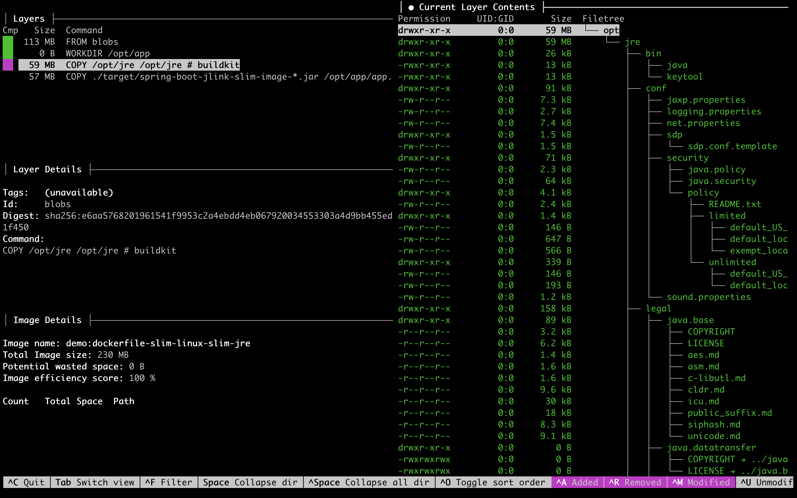

<!-- Generated by Sociable Weaver (https://github.com/albertattard/sw). Manual edits will be overwritten when regenerated. -->

# Spring Boot container image with a custom Java runtime

A working Spring Boot image does not show whether the full JDK is needed at
runtime. This example builds one executable JAR, identifies the Java modules
needed to run it, and compares a container with a custom `jlink` runtime against
one that retains the complete JDK. The application uses Spring MVC, Spring Data
JPA, Flyway, H2, and Guava, so its nested dependencies make module discovery
more involved than for a small standalone application.

This focused example does not cover every aspect of running Java in containers.
In particular, it does not demonstrate non-root execution, image signing,
vulnerability scanning, observability, or deployment hardening. See
[all-in-one-spring-boot](../all-in-one-spring-boot/README.md) for a more
holistic example that combines several container concerns.

---

## Disclaimer

The examples provided in this repository are for **educational purposes only**
and are intended to be used **exclusively within this workshop**. While every
effort has been made to ensure accuracy and reliability, these examples are
provided **“as is”**, without any warranties, express or implied.

By using these examples, you acknowledge that you do so **at your own risk**.
The authors and contributors shall **not be held liable** for any direct,
indirect, incidental, or consequential damages resulting from the use, misuse,
or inability to use these examples.

It is the responsibility of the user to **review, test, and validate** any code
before applying it in a production or commercial environment.

### Performance Disclaimer

The performance values shown in this workshop are for reference only and should
not be treated as absolute. Results can vary depending on hardware, system
configuration, runtime environment, and other factors. Readers are encouraged to
conduct their own tests under controlled conditions to obtain accurate
measurements relevant to their specific use case.

---

## Learning objectives

By the end of this example, attendees can:

- inspect the Spring Boot JAR and explain why its nested dependencies affect
  `jdeps` analysis;
- build and verify a custom Java runtime with `jlink`;
- compare the custom-runtime image with a complete-JDK image built from the same
  application JAR; and
- explain the module-selection and update responsibilities that remain.

## Prerequisites

Run the commands from this example directory. Java 25, a running Docker daemon,
`curl`, `jq`, and `tree` are required by the recorded steps. Maven is provided
by `./mvnw`. The image builds need access to Oracle Container Registry; `Dive`
is optional for interactive layer inspection.

- [Oracle Java 25](https://www.oracle.com/java/technologies/downloads/#java25)

- [Docker](https://docs.docker.com/get-docker/) runtime

- `curl`, used to call the Spring Boot endpoint.

- `jq`, used to format the JSON response returned by the application.

- `tree`, used to inspect generated directories in the walkthrough.

### Oracle Container Registry access

Before pulling an Oracle Java base image, sign in to Oracle Container Registry
and accept the terms for the
[Oracle Java JDK repository](https://container-registry.oracle.com/ords/ocr/ba/java/jdk).

1. Accept the Oracle Container Registry terms.

2. Authenticate your container engine with your own Oracle Container Registry
   username and authentication token.

   Pass the token through standard input so it is neither recorded in shell
   history nor copied into the project or image layers. If you use Podman, use
   its equivalent `login --password-stdin` command.

   ```shell
   docker login container-registry.oracle.com \
     --username 'ALBERT.ATTARD@ORACLE.COM' \
     --password-stdin < ~/.ocr/auth-token
   ```

   This should print the login succeeded message.

   ```
   Login Succeeded!
   ```

3. Verify that the container engine can pull and run the Oracle Java JDK image.

   ```shell
   docker run --rm 'container-registry.oracle.com/java/jdk:25.0.4.1' java --version
   ```

   Docker pulls the image if necessary, then prints the Java runtime version.

   ```
   java 25.0.4.1 2026-08-18 LTS
   Java(TM) SE Runtime Environment (build 25.0.4.1+1-LTS-5)
   Java HotSpot(TM) 64-Bit Server VM (build 25.0.4.1+1-LTS-5, mixed mode, sharing)
   ```

## The artefacts to inspect

The application exposes `/quote/random` and reads quotes from an H2 database
initialised by Flyway. Maven packages its classes and dependencies as a Spring
Boot executable JAR. Both Dockerfiles copy that same JAR: one uses the full
Oracle JDK image, while the other builds a custom runtime with `jlink` and
copies it into an Oracle Linux slim image. Inspect the packaging and the two
image definitions before building them.

- The slim container

  ```dockerfile
  FROM container-registry.oracle.com/java/jdk:25.0.4.1 AS builder

  # binutils are needed by the `--strip-debug` command line option
  RUN dnf install -y binutils && dnf clean all

  ARG JAVA_MODULES=java.base,java.compiler,java.desktop,java.instrument,java.management,java.naming,java.sql,java.security.jgss
  RUN jlink \
        --output "/opt/jre" \
        --no-header-files \
        --no-man-pages \
        --strip-debug \
        --add-modules "${JAVA_MODULES}" \
        --compress=zip-9

  FROM container-registry.oracle.com/os/oraclelinux:10-slim
  WORKDIR "/opt/app"

  # Copy the custom Java image
  COPY --from=builder ["/opt/jre", "/opt/jre"]

  ARG JAR_FILE="./target/jlink-slim-image-spring-boot-*.jar"
  COPY ["${JAR_FILE}", "app.jar"]

  EXPOSE 8080

  ENTRYPOINT ["/opt/jre/bin/java", "-jar", "app.jar"]
  ```

- The container with the complete JDK used for comparison

  ```dockerfile
  FROM container-registry.oracle.com/java/jdk:25.0.4.1
  WORKDIR "/opt/app"

  ARG JAR_FILE="./target/jlink-slim-image-spring-boot-*.jar"
  COPY ["${JAR_FILE}", "app.jar"]

  EXPOSE 8080

  ENTRYPOINT ["java", "-jar", "app.jar"]
  ```

## Build the application

The application is built once and then reused for the local runtime checks and
both container images. This matters because the comparison should isolate the
runtime packaging choice, not a different application build. The build writes
`target/jlink-slim-image-spring-boot-1.0.0.jar`, which both Dockerfiles copy.

1. Build the executable Spring Boot JAR.

   ```shell
   ./mvnw clean package
   ```

   (*Optional*) Inspect `target/` to confirm that the executable JAR exists.

   ```shell
   tree --dirsfirst --sort=name -L 1 --prune './target/'
   ```

   Spring Boot creates one executable JAR containing the application classes,
   Spring Boot launcher, and nested dependency JARs.

   ```
   ./target/
   ├── jlink-slim-image-spring-boot-1.0.0.jar
   └── jlink-slim-image-spring-boot-1.0.0.jar.original

   1 directory, 2 files
   ```

2. (*Optional*) Run the JAR with the full JDK to establish that the application
   works before changing its runtime.

   The application is started in the background for convenience, otherwise the
   subsequent commands need to be executed in another terminal.

   ```shell
   java -jar './target/jlink-slim-image-spring-boot-1.0.0.jar' > './target/output.txt' 2>&1 &
   echo $! > './target/application.pid'
   ```

   Wait until `/quote/random` responds before checking its output.

   ```shell
   until curl --silent --fail 'http://localhost:8080/quote/random' >/dev/null; do sleep 1; done
   ```

   Fetch a random quote. A JSON response confirms the web endpoint, database
   access, and application startup on the full JDK.

   ```shell
   curl --silent 'http://localhost:8080/quote/random' | jq
   ```

   The response should be similar to the following.

   ```json
   {
     "author": "Albert Einstein",
     "id": 12,
     "quote": "Life is like riding a bicycle. To keep your balance, you must keep moving."
   }
   ```

   Stop the application.

   ```shell
   kill "$(cat './target/application.pid')"
   ```

## Guided walkthrough

Run these commands from `examples/jlink-slim-image-spring-boot`. Use the JAR
built above for both the local runtime test and the two container images. Keep
the observed sizes as local comparison data: base image versions, architecture,
and layer reuse affect the result.

### Custom JRE

The JAR from [Build the application](#build-the-application) is the input to
this section. A `jlink` image is a Java runtime directory, not a container
image. The module list needs verification with the running application: omitting
a module used through reflection or by a framework can cause a failure that
static analysis alone does not reveal.

1. (*Optional*) Confirm that `jdeps` is from the expected JDK.

   ```shell
   jdeps --version
   ```

   The `jdeps` version should match the installed JDK version.

   ```
   25.0.4.1
   ```

2. First, inspect the executable JAR with
   [`jdeps`](https://docs.oracle.com/en/java/javase/25/docs/specs/man/jdeps.html).
   Compare this incomplete view with the result after dependencies are put on
   its class path.

   ```shell
   jdeps \
     --multi-release 25 \
     --ignore-missing-deps \
     --print-module-deps \
     './target/jlink-slim-image-spring-boot-1.0.0.jar'
   ```

   The outer executable JAR reports only `java.base,java.management` here. That
   is an incomplete view of this application’s runtime dependencies.

   ```
   java.base,java.management
   ```

   This result is misleading because the artefact is a repackaged Spring Boot
   executable JAR. The application classes are placed under `BOOT-INF/classes`,
   dependencies are stored as nested JARs under `BOOT-INF/lib`, and the Spring
   Boot launcher builds the runtime classpath when the JAR starts. That layout
   is convenient for `java -jar`, but it is not the normal flat classpath layout
   that static analysis tools such as `jdeps` expect when they inspect the outer
   JAR.

   (*Optional*) Inspect the executable Spring Boot JAR layout.

   ```shell
   jar --list \
     --file './target/jlink-slim-image-spring-boot-1.0.0.jar' |
     grep -E '^(BOOT-INF/classes|BOOT-INF/lib)' |
     head -40
   ```

   The listing shows the application classes and nested dependency JARs inside
   the Spring Boot executable JAR.

   ```
   BOOT-INF/classes/
   BOOT-INF/classes/db/
   BOOT-INF/classes/db/migration/
   BOOT-INF/classes/demo/
   BOOT-INF/classes/demo/quote/
   BOOT-INF/classes/application.yml
   BOOT-INF/classes/db/migration/V1__create_database.sql
   BOOT-INF/classes/banner.txt
   BOOT-INF/classes/demo/Main.class
   BOOT-INF/classes/demo/quote/Quote.class
   BOOT-INF/classes/demo/quote/QuoteController.class
   BOOT-INF/classes/demo/quote/QuoteService.class
   BOOT-INF/classes/demo/quote/QuoteRepository.class
   BOOT-INF/lib/
   BOOT-INF/lib/spring-boot-jackson-4.1.1.jar
   BOOT-INF/lib/jackson-databind-3.1.5.jar
   BOOT-INF/lib/jackson-annotations-2.21.jar
   BOOT-INF/lib/jackson-core-3.1.5.jar
   BOOT-INF/lib/tomcat-embed-core-11.0.24.jar
   BOOT-INF/lib/tomcat-embed-el-11.0.24.jar
   BOOT-INF/lib/tomcat-embed-websocket-11.0.24.jar
   BOOT-INF/lib/spring-boot-tomcat-4.1.1.jar
   BOOT-INF/lib/spring-boot-http-converter-4.1.1.jar
   BOOT-INF/lib/spring-boot-4.1.1.jar
   BOOT-INF/lib/spring-context-7.0.9.jar
   BOOT-INF/lib/spring-web-7.0.9.jar
   BOOT-INF/lib/spring-beans-7.0.9.jar
   BOOT-INF/lib/micrometer-observation-1.17.1.jar
   BOOT-INF/lib/micrometer-commons-1.17.1.jar
   BOOT-INF/lib/spring-boot-webmvc-4.1.1.jar
   BOOT-INF/lib/spring-boot-servlet-4.1.1.jar
   BOOT-INF/lib/spring-webmvc-7.0.9.jar
   BOOT-INF/lib/spring-aop-7.0.9.jar
   BOOT-INF/lib/spring-expression-7.0.9.jar
   BOOT-INF/lib/h2-2.4.240.jar
   BOOT-INF/lib/logback-classic-1.5.38.jar
   BOOT-INF/lib/logback-core-1.5.38.jar
   BOOT-INF/lib/log4j-to-slf4j-2.25.5.jar
   BOOT-INF/lib/log4j-api-2.25.5.jar
   BOOT-INF/lib/jul-to-slf4j-2.0.18.jar
   ```

   Generate a dependency class path with Maven and pass it to `jdeps`. This
   exposes more of the dependencies hidden inside the executable JAR, although
   dynamically loaded code can still require additional modules.

   ```shell
   ./mvnw \
     dependency:build-classpath \
     -Dmdep.outputFile='./target/classpath.txt'
   ```

   (*Optional*) Verify that the class path is saved to file.

   ```shell
   tree --dirsfirst --sort=name -L 1 --prune -P 'classpath.txt' './target'
   ```

   The file containing the runtime classpath

   ```
   ./target
   └── classpath.txt

   1 directory, 1 file
   ```

   Use this file to provide the class path to `jdeps`.

   ```shell
   jdeps \
     --class-path "$(cat './target/classpath.txt')" \
     --multi-release 25 \
     --ignore-missing-deps \
     --print-module-deps \
     './target/jlink-slim-image-spring-boot-1.0.0.jar'
   ```

   The dependency class path reveals more modules than inspection of the outer
   executable JAR alone. Treat the output as a candidate list to test.

   ```
   java.base,java.compiler,java.desktop,java.instrument,java.management,java.naming,java.net.http,java.prefs,java.rmi,java.scripting,java.security.jgss,java.sql,jdk.jfr,jdk.unsupported
   ```

   `jdeps` reports the modules it can see from the application classes and the
   dependency class path. Treat that output as the starting point, then verify
   the reduced module list by running the application with the custom runtime.
   For this application, the runtime can be trimmed to:

   ```
   java.base,java.compiler,java.desktop,java.instrument,java.management,java.naming,java.sql,java.security.jgss
   ```

   The `java.compiler` module is required because Spring Data’s AOT repository
   processor uses `javax.lang.model.SourceVersion` at runtime. This is a useful
   reminder that framework applications can have runtime dependencies that are
   not obvious from your own code.

   If you are using an older update of Java 21, please note that there is a
   [bug](https://bugs.openjdk.org/browse/JDK-8330005), which does not load the
   random number service provider and fails with the following example. In that
   case, add the `jdk.random` module as a workaround. This runbook uses Java 25,
   where that workaround should not be needed.

   ```
   java.lang.IllegalArgumentException: No implementation of the random number generator algorithm "L32X64MixRandom" is available
     at java.base/java.util.random.RandomGeneratorFactory.findProvider(Unknown Source) ~[na:na]
     at java.base/java.util.random.RandomGeneratorFactory.of(Unknown Source) ~[na:na]
     at java.base/java.util.random.RandomGenerator.of(Unknown Source) ~[na:na]
     at java.base/java.util.random.RandomGenerator.getDefault(Unknown Source) ~[na:na]
   ...
   ```

3. (*Optional*) Confirm that `jlink` is from the expected JDK.

   ```shell
   jlink --version
   ```

   The `jlink` version should match the installed JDK version.

   ```
   25.0.4.1
   ```

4. Create a custom runtime using the module list above. The command replaces any
   earlier `target/slim-jre` directory; its output is a local runtime for
   functional verification before the container build.

   ```shell
   rm -rf './target/slim-jre'
   jlink \
     --output './target/slim-jre' \
     --no-header-files \
     --no-man-pages \
     --add-modules java.base,java.compiler,java.desktop,java.instrument,java.management,java.naming,java.sql,java.security.jgss \
     --strip-debug \
     --compress=zip-9
   ```

   (*Optional*) Record the size of the local custom runtime. This is a runtime
   directory measurement, not the size of the final container image.

   ```shell
   du -sh './target/slim-jre'
   ```

   The local custom runtime occupies about `59M` on this host.

   ```
   59M	./target/slim-jre
   ```

   The listed modules are those included in this custom runtime. The quote
   endpoint test below checks the exercised application path; it cannot prove
   that every possible application path has all the modules it needs.

   (*Optional*) List the extracted modules.

   ```shell
   './target/slim-jre/bin/java' --list-modules
   ```

   This lists the modules included in the custom runtime.

   ```
   java.base@25.0.4.1
   java.compiler@25.0.4.1
   java.datatransfer@25.0.4.1
   java.desktop@25.0.4.1
   java.instrument@25.0.4.1
   java.logging@25.0.4.1
   java.management@25.0.4.1
   java.naming@25.0.4.1
   java.prefs@25.0.4.1
   java.security.jgss@25.0.4.1
   java.security.sasl@25.0.4.1
   java.sql@25.0.4.1
   java.transaction.xa@25.0.4.1
   java.xml@25.0.4.1
   ```

   (*Optional*) List the custom Java runtime (JRE) image directory structure.

   ```shell
   tree --dirsfirst --sort=name -L 1 './target/slim-jre'
   ```

   The results are limited to the top level for brevity.

   ```
   ./target/slim-jre
   ├── bin
   ├── conf
   ├── legal
   ├── lib
   └── release

   5 directories, 1 file
   ```

5. Run the application with the custom runtime and call its endpoint.

   The application is started in the background for convenience, otherwise the
   subsequent commands need to be executed in another terminal.

   ```shell
   './target/slim-jre/bin/java' \
     -jar './target/jlink-slim-image-spring-boot-1.0.0.jar' > './target/output.txt' 2>&1 &
   echo $! > './target/application.pid'
   ```

   Wait for the application to start.

   ```shell
   until curl --silent --fail 'http://localhost:8080/quote/random' >/dev/null; do sleep 1; done
   ```

   Fetch a random quote. A JSON response verifies that this application path
   works with the selected modules.

   ```shell
   curl --silent 'http://localhost:8080/quote/random' | jq
   ```

   The response should be similar to the following.

   ```json
   {
     "author": "Winston Churchill",
     "id": 187,
     "quote": "If you are going through hell, keep going."
   }
   ```

   Stop the application.

   ```shell
   kill "$(cat './target/application.pid')"
   ```

### Container images

Both images copy the JAR produced in
[Build the application](#build-the-application). The custom module list was
tested against the quote endpoint in [Custom JRE](#custom-jre).

The local `jlink` command showed the mechanics. In the container build, the same
work happens inside a builder stage so the final image does not depend on files
from the local JDK installation.

The slim Dockerfile uses two stages:

- The builder stage starts from the Oracle JDK image, installs `binutils`
  because `jlink --strip-debug` needs it, and creates `/opt/jre` from the Spring
  Boot module list passed through `JAVA_MODULES`.
- The final stage starts from Oracle Linux slim, copies only `/opt/jre` and the
  executable Spring Boot JAR, and runs the application with `/opt/jre/bin/java`.

1. Build the slim container image with the Dockerfile inspected above. Its
   builder stage creates the custom runtime; the final stage contains that
   runtime and the same application JAR used by the baseline image.

   Java receives security updates at least once every three months, as described
   in the
   [Critical Patch Updates](https://www.oracle.com/security-alerts/#CriticalPatchUpdates).
   Rebuild this image when the JDK base image changes. A custom runtime reduces
   what is copied into the final image, but it does not remove the need to keep
   that runtime patched.

   The Dockerfile defaults `JAVA_MODULES` to the module list verified earlier in
   this runbook:

   ```
   java.base,java.compiler,java.desktop,java.instrument,java.management,java.naming,java.sql,java.security.jgss
   ```

   For another Spring Boot service, re-run `jdeps`, inspect the result, and test
   the custom runtime before copying this list. Dependencies, starters, database
   drivers, and framework features can change the modules required at runtime.

   Build the image and load it into the local Docker daemon. The resulting
   `demo:dockerfile-slim-linux-slim-jre` tag is the input to the next checks.

   ```shell
   docker build \
     --file './containers/Dockerfile-Slim-Linux-Slim-JRE' \
     --tag 'demo:dockerfile-slim-linux-slim-jre' \
     --load \
     .
   ```

   Build time depends on registry access, cached layers, and the host. A
   successful build confirms that Docker assembled the image; the runtime check
   below confirms that the tested application path starts in it.

2. Inspect the slim image size and history. Record the reported image size and
   locate the runtime copy layer for comparison with the full JDK image.

   ```shell
   docker images 'demo:dockerfile-slim-linux-slim-jre' \
     --format "{{.Repository}}:{{.Tag}} -> {{.Size}}"
   ```

   Docker reports the local image size, including the application and base image
   layers. It is not a measure of runtime memory use.

   ```
   localhost/demo:dockerfile-slim-linux-slim-jre -> 219 MB
   ```

   Inspect the image history to identify the copied custom runtime layer.

   ```shell
   docker history 'demo:dockerfile-slim-linux-slim-jre'
   ```

   The history shows the slim image layers and the captured runtime-copy layer
   size when the local Docker output matches the pattern.

   ```
   ID            CREATED                 CREATED BY                                     SIZE        COMMENT
   c6eb03a30833  Less than a second ago  /bin/sh -c #(nop) ENTRYPOINT ["/opt/jre/bi...  0B
   <missing>     Less than a second ago  /bin/sh -c #(nop) EXPOSE 8080                  0B
   <missing>     1 second ago            /bin/sh -c #(nop) COPY file:e6188d030efc05...  56.5MB
   70068e3edd1c  4 hours ago             /bin/sh -c #(nop) ARG JAR_FILE                 0B
   <missing>     6 hours ago             /bin/sh -c #(nop) COPY dir:bae17faa4bcc295...  61.4MB
   d4804e5ea0ca  6 hours ago             /bin/sh -c #(nop) WORKDIR "/opt/app"           0B          FROM container-registry.oracle.com/os/oraclelinux:10-slim
   <missing>     2 weeks ago             /bin/sh -c #(nop) CMD ["/bin/bash"]            0B
   <missing>     2 weeks ago             /bin/sh -c #(nop) ADD file:325ee2e18605f4f...  102MB
   ```

   (*Optional*) Inspect the slim image interactively with Dive.

   ```shell
   dive 'demo:dockerfile-slim-linux-slim-jre'
   ```

   

   In this local build, the runtime-copy layer is reported as about `61.4MB`.
   This layer figure differs from both the uncompressed runtime directory and
   the full image size.

   

3. (*Optional*) Run the slim image to check that the endpoint responds after the
   custom runtime has been copied into the final image.

   ```shell
   docker run \
     --rm \
     --detach \
     --name 'slim-jre' \
     --publish 8080:8080 \
     'demo:dockerfile-slim-linux-slim-jre'
   ```

   Wait for the container to start.

   ```shell
   until curl --silent --fail 'http://localhost:8080/quote/random' >/dev/null; do sleep 1; done
   ```

   Fetch a random quote. A JSON response confirms the exercised endpoint works
   in the slim image.

   ```shell
   curl --silent 'http://localhost:8080/quote/random' | jq
   ```

   The response should be similar to the following.

   ```json
   {
     "author": "Abraham Lincoln",
     "id": 4,
     "quote": "You can fool all of the people some of the time, and some of the people all of the time, but you can’t fool all of the people all of the time."
   }
   ```

   Stop the container to release port 8080 before testing the baseline image.

   ```shell
   docker stop 'slim-jre'
   ```

4. Build the complete JDK container image.

   This comparison image keeps the complete JDK in the final image. It runs the
   same executable Spring Boot JAR with a simpler Dockerfile, which makes it a
   useful baseline for the slim-runtime version.

   The Dockerfile inspected above copies the same JAR into the full Oracle JDK
   image. Build and load it locally, then compare its size and history with the
   slim image. The different base images mean this comparison is illustrative,
   not an isolated measurement of the JDK files alone.

   ```shell
   docker build \
     --file './containers/Dockerfile-Complete-JDK' \
     --tag 'demo:complete-jdk' \
     --load \
     .
   ```

   Build time depends on registry access, cached layers, and the host.

5. Inspect the complete JDK image size and history using the same Docker views
   as for the slim image.

   ```shell
   docker images 'demo:complete-jdk' \
     --format "{{.Repository}}:{{.Tag}} -> {{.Size}}"
   ```

   Docker reports the local image size, including the JDK and application.
   Compare it with the slim image result from this host.

   ```
   localhost/demo:complete-jdk -> 804 MB
   ```

   Inspect the image history to locate the layer containing the full JDK.

   ```shell
   docker history 'demo:complete-jdk'
   ```

   The image history shows the full JDK layer when the local Docker output
   matches the capture pattern.

   ```
   ID            CREATED                 CREATED BY                                     SIZE        COMMENT
   7211d277cb86  Less than a second ago  /bin/sh -c #(nop) ENTRYPOINT ["java", "-ja...  0B
   <missing>     Less than a second ago  /bin/sh -c #(nop) EXPOSE 8080                  0B
   <missing>     1 second ago            /bin/sh -c #(nop) COPY file:e6188d030efc05...  56.5MB
   2c630dad489c  6 hours ago             /bin/sh -c #(nop) ARG JAR_FILE                 0B
   <missing>     6 hours ago             /bin/sh -c #(nop) WORKDIR "/opt/app"           0B          FROM container-registry.oracle.com/java/jdk:25.0.4.1
   <missing>     7 weeks ago             CMD ["jshell"]                                 0B          buildkit.dockerfile.v0
   <missing>     7 weeks ago             RUN /bin/bash -o pipefail -c set -eux;    ...  294kB       buildkit.dockerfile.v0
   <missing>     7 weeks ago             COPY /usr/java/jdk-25 /usr/java/jdk-25 # b...  394MB       buildkit.dockerfile.v0
   <missing>     7 weeks ago             ENV PATH=/usr/java/jdk-25/bin:/usr/local/s...  0B          buildkit.dockerfile.v0
   <missing>     7 weeks ago             ENV JAVA_HOME=/usr/java/jdk-25                 0B          buildkit.dockerfile.v0
   <missing>     7 weeks ago             ENV LANG=en_US.UTF-8                           0B          buildkit.dockerfile.v0
   <missing>     7 weeks ago             RUN /bin/bash -o pipefail -c set -eux;         dn...       106MB       buildkit.dockerfile.v0
   <missing>     7 weeks ago             SHELL [/bin/bash -o pipefail -c]               0B          buildkit.dockerfile.v0
   <missing>     2 months ago            /bin/sh -c #(nop) CMD ["/bin/bash"]            0B          FROM 408c2f02d337
   <missing>     2 months ago            /bin/sh -c #(nop) ADD file:0ba597b37b1062b...  247MB
   ```

   (*Optional*) Inspect the complete JDK image interactively with Dive.

   ```shell
   dive 'demo:complete-jdk'
   ```

   

   In this local build, the complete JDK layer is reported as about `394MB`.
   Compare like measurements from the same Docker  host; layer sizes and overall
   image sizes answer different questions.

   

6. (*Optional*) Run the complete JDK image and check the same quote endpoint.

   ```shell
   docker run \
     --rm \
     --detach \
     --name 'complete-jdk' \
     --publish 8080:8080 \
     'demo:complete-jdk'
   ```

   Wait for the container to start.

   ```shell
   until curl --silent --fail 'http://localhost:8080/quote/random' >/dev/null; do sleep 1; done
   ```

   Fetch a random quote. A JSON response verifies the same exercised path in the
   baseline image.

   ```shell
   curl --silent 'http://localhost:8080/quote/random' | jq
   ```

   The response should be similar to the following.

   ```json
   {
     "author": "Benjamin Franklin",
     "id": 33,
     "quote": "Early to bed and early to rise makes a man healthy, wealthy, and wise."
   }
   ```

   Stop the baseline container to release port 8080.

   ```shell
   docker stop 'complete-jdk'
   ```

## References

- [Oracle JDK 25 `jdeps` documentation](https://docs.oracle.com/en/java/javase/25/docs/specs/man/jdeps.html)
- [Oracle JDK 25 `jlink` documentation](https://docs.oracle.com/en/java/javase/25/docs/specs/man/jlink.html)
- [Spring Boot executable JAR specification](https://docs.spring.io/spring-boot/specification/executable-jar/nested-jars.html)
- [Docker multi-stage builds](https://docs.docker.com/build/building/multi-stage/)
- [Oracle Critical Patch Updates](https://www.oracle.com/security-alerts/#CriticalPatchUpdates)

## Key takeaways and trade-offs

- The executable Spring Boot JAR hides nested dependencies from a simple `jdeps`
  inspection; the module list needs testing against the application.
- `jlink` builds a runtime containing selected modules, which the slim
  Dockerfile copies alongside the same JAR used by the complete JDK image.
- Compare local image sizes and layers to see the packaging difference, but do
  not treat those figures as portable performance or security guarantees.
- A custom runtime needs module checks when dependencies change and a new build
  when the JDK base image receives updates. The endpoint checks here cover only
  the path exercised in this runbook.
