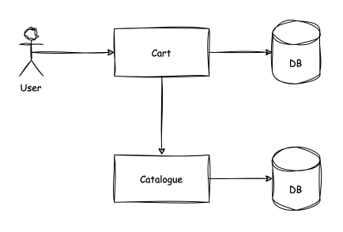
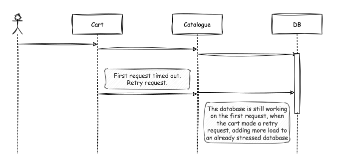
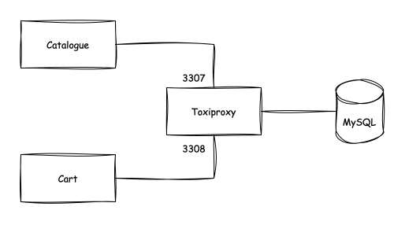
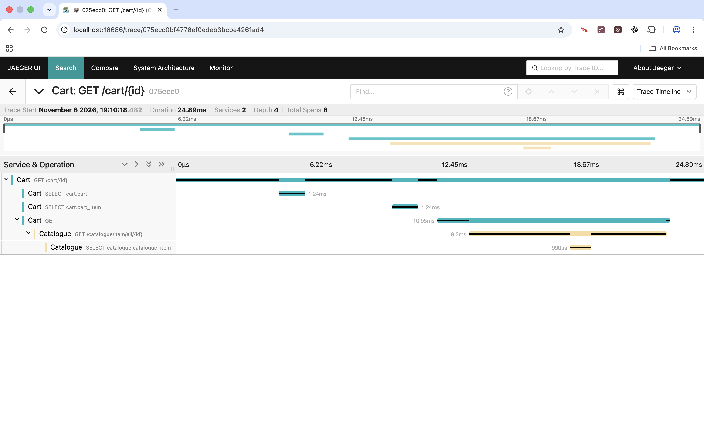
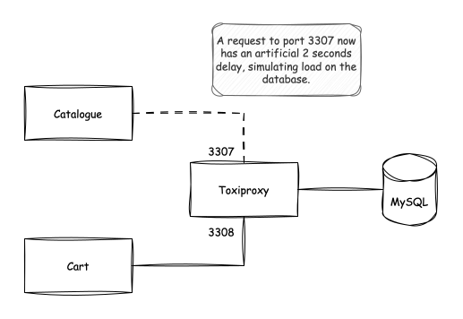
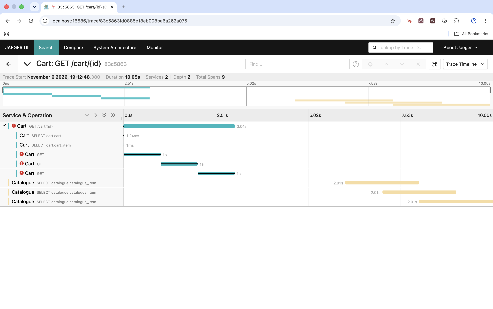

<!-- Generated by Sociable Weaver (https://github.com/albertattard/sw). Manual edits will be overwritten when regenerated. -->

# Cascading failures with synchronous REST

A slow dependency can cause failures in an otherwise healthy service. In this
example, the cart service retrieves product details from the catalogue over
synchronous HTTP. If the catalogue is slow, the cart cannot complete its
response, even when its own database is responding normally.



The services own separate databases. For this local experiment, both databases
run in one disposable MySQL container, with separate users and proxy routes.
[Toxiproxy](https://github.com/shopify/toxiproxy) introduces latency only on the
catalogue database route, allowing us to observe how a downstream slowdown
propagates through the catalogue to the cart.

The cart’s HTTP client has a one-second read timeout and retries a timed-out
catalogue call twice immediately: up to three attempts for one cart request. A
timeout limits the caller’s wait; it does not guarantee that the catalogue has
stopped processing the previous attempt. A retry can therefore add work while
the earlier request is still using catalogue resources.



This deliberately fragile retry policy makes overlapping work visible. Under
sustained traffic, extra attempts can increase contention and spread failures
upstream. One slow request demonstrates the amplification mechanism; it does
not establish that the system has suffered a sustained cascading failure.

The walkthrough first establishes a healthy baseline, then adds latency, and
finally adds a circuit breaker to the cart while keeping that latency enabled.
This comparison shows how rejecting calls to a failing dependency limits new
work, although it does not repair the dependency or make cart requests succeed.

## Learning objectives

By the end of the exercise, you should be able to:

- Distinguish one cart request from its multiple catalogue attempts.
- Use timings, logs and traces to identify timeout-driven retries and
  overlapping work.
- Explain why a database network delay can fail a request across service
  boundaries.
- Compare retries alone with retries guarded by a circuit breaker, including the
  difference between failing quickly and recovering successfully.

## Prerequisites

- Java 25 (for example, [Oracle Java 25](https://www.oracle.com/java/technologies/downloads/#java25))

- `rsync` to apply the circuit-breaker fixture

- [`jq`](https://jqlang.org/)

- [`curl`](https://curl.se/)

- [Docker](https://docs.docker.com/get-docker/)

- A POSIX shell and network access to download Maven dependencies and container images.

- For the optional JAR listings, `tree` with support for `--sort=name`, `-L`
  and `--prune`.

Run all commands from `examples/application-distributed-rest-cascading-failure/`
in the same shell so that relative paths and the selected MySQL image tag remain
valid. Ports 8081, 8082, 3307, 3308, 8474, 4318 and 16686 must be free.

The commands create named containers, a Docker network and disposable database
data. No database volume is mounted, so removing the MySQL container discards
both databases. The fixture later overwrites cart source, configuration and test
files; preserve local changes before applying it. Use a trusted local
environment: the commands publish proxy and Jaeger ports without an explicit
host-address restriction, and the database credentials are for this exercise
only.

If a startup wait does not complete, inspect the relevant container or
application log before continuing. The shell wait loops have no deadline of
their own; the runbook runner supplies the declared command timeouts.

## Architecture and experiment

The request path is `cart → HTTP → catalogue → Toxiproxy → MySQL`. The cart also
accesses its own database through a separate Toxiproxy route:
`3307 → catalogue database` and `3308 → cart database`. Both routes forward to
`mysql:3306` inside Docker, but only the catalogue route receives injected
latency. This keeps the cart database route unchanged during the comparison,
although sharing one MySQL server does not provide database-server resource
isolation.



Each service has a HikariCP pool capped at four connections. Delayed database
responses can hold connections for longer, and overlapping requests can then
compete for the pool. The proxy delays stream data travelling from MySQL towards
the catalogue; it does not slow query execution inside MySQL or add an exact
per-query delay.

The implementation points to inspect are `CatalogueItemGateway` and
`CatalogueConfiguration` in the cart, `RequestLoggingFilter` in the catalogue,
and each service’s `application.properties`. Cart logs identify catalogue
attempts; catalogue logs record request starts, finishes and active request
counts. Jaeger adds request and JDBC timing context. Together these observations
distinguish caller timeouts from work still running downstream.

## Guided walkthrough

1. Build and test both applications before introducing any faults.

   The Maven wrapper cleans previous build output, runs the tests and packages
   executable Spring Boot JARs. Expect both modules to succeed and Maven to end
   with `BUILD SUCCESS`; resolve any failure before starting the experiment.
   Tests use in-memory H2 databases, so a successful build does not yet verify
   the MySQL containers, proxy routes or cross-service HTTP calls.

   ```shell
   ./mvnw clean package
   ```

   (*Optional*) List the catalogue build directory to confirm the executable
   JAR exists at the path used by the startup command. The tree output also
   shows other build artefacts; it verifies packaging, not application health.

   ```shell
   tree --sort=name -L 1 --prune './catalogue/target'
   ```

   Catalogue build artefacts, including the executable JAR used to start the
   service

   ```
   ./catalogue/target
   ├── application-distributed-rest-cascading-failure-catalogue-1.0.0.jar
   └── application-distributed-rest-cascading-failure-catalogue-1.0.0.jar.original

   1 directory, 2 files
   ```

   List the cart build directory for the same packaging check. Its executable
   JAR is started separately from the catalogue, reflecting the two deployment
   units.

   ```shell
   tree --sort=name -L 1 --prune './cart/target'
   ```

   Cart build artefacts, including its separately deployable executable JAR

   ```
   ./cart/target
   ├── application-distributed-rest-cascading-failure-cart-1.0.0.jar
   └── application-distributed-rest-cascading-failure-cart-1.0.0.jar.original

   1 directory, 2 files
   ```

2. Prepare the database, proxy and tracing infrastructure.

   Create a dedicated Docker network so Toxiproxy can resolve the database by
   its `mysql` network alias. Docker prints the new network identifier on
   success. An existing network with this name causes creation to fail; check
   for resources left by an earlier run before continuing.

   ```shell
   docker network create workshop-cascading-errors
   ```

   Select the MySQL Community Server image tag for the local machine and start
   one disposable server on the dedicated network. The architecture check
   appends `-aarch64` for `uname -m` equal to `arm64`; otherwise it uses the
   base tag. This selection assumes an ARM Mac or an AMD64 Linux host with a
   local Docker daemon.

   Docker prints a container identifier, with image-download progress on first
   use. The following loop waits for Docker’s MySQL health check to report
   `healthy`; it produces no success message. This confirms the server is
   responding before we create the application databases; it does not create
   those databases itself.

   ```shell
   # Determine the image tag based on the architecture
   MYSQL_IMAGE_TAG='container-registry.oracle.com/mysql/community-server:9.7.4'
   if [ "$(uname -m)" = 'arm64' ]; then
     MYSQL_IMAGE_TAG="${MYSQL_IMAGE_TAG}-aarch64"
   fi

   # Start the database container
   docker run \
     --rm \
     --detach \
     --name 'workshop-cascading-errors-mysql' \
     --network workshop-cascading-errors \
     --network-alias mysql \
     --env MYSQL_ROOT_PASSWORD='Cascading Errors' \
     --health-cmd='mysqladmin ping --silent' \
     "${MYSQL_IMAGE_TAG}"

   # Wait for the database container to become healthy
   until [ "$(docker inspect --format '{{.State.Health.Status}}' 'workshop-cascading-errors-mysql')" = "healthy" ]; do sleep 1; done
   ```

   Create the catalogue database and a dedicated user through the MySQL client
   inside the container. The user receives privileges only on `catalogue.*`,
   matching the catalogue datasource configuration. Flyway will create the
   tables and seed data when the service starts. Successful SQL execution
   normally produces no output; an SQL error must be resolved before proceeding.
   These creation statements assume a fresh container and are not safe to repeat
   against existing databases.

   ```shell
   docker exec \
     --interactive \
     --env MYSQL_PWD='Cascading Errors' \
     'workshop-cascading-errors-mysql' \
     mysql --user=root <<'SQL'
   CREATE DATABASE catalogue;
   CREATE USER 'catalogue'@'%' IDENTIFIED BY 'catalogue password';
   GRANT ALL PRIVILEGES ON catalogue.* TO 'catalogue'@'%';
   SQL
   ```

   Create the cart database and its separate user, restricted to `cart.*`. The
   cart’s Flyway migration will create carts and cart items on startup.
   Successful execution is normally silent. Separate credentials express
   database ownership, although both databases still share the same MySQL server
   in this local setup.

   ```shell
   docker exec \
     --interactive \
     --env MYSQL_PWD='Cascading Errors' \
     'workshop-cascading-errors-mysql' \
     mysql --user=root <<'SQL'
   CREATE DATABASE cart;
   CREATE USER 'cart'@'%' IDENTIFIED BY 'cart password';
   GRANT ALL PRIVILEGES ON cart.* TO 'cart'@'%';
   SQL
   ```

   Start Toxiproxy on the same Docker network as MySQL. Publish port 3307 for
   catalogue database traffic, 3308 for cart database traffic and 8474 for the
   proxy control API. Docker prints the container identifier; that alone does
   not verify any forwarding routes, which are created next. Keeping the proxy
   in place for both the healthy and delayed runs makes latency the deliberate
   change.

   ```shell
   docker run \
     --rm \
     --detach \
     --name workshop-cascading-errors-proxy \
     --network workshop-cascading-errors \
     --publish 3307:3307 \
     --publish 3308:3308 \
     --publish 8474:8474 \
     ghcr.io/shopify/toxiproxy:2.13.0
   ```

   Create the catalogue proxy route: host port `3307` forwards to `mysql:3306`.
   The curl retries allow the newly started control API time to become
   available; they are setup retries, separate from the cart's catalogue retry
   policy. The formatted JSON should identify `catalogue-mysql`, its listener
   and upstream, and show `enabled: true` with an empty `toxics` list. No
   latency is configured yet.

   ```shell
   # Catalogue database route
   curl \
     --silent \
     --show-error \
     --fail \
     --retry 20 \
     --retry-connrefused \
     --retry-delay 1 \
     --request POST http://127.0.0.1:8474/proxies \
     --header 'Content-Type: application/json' \
     --data '{"name":"catalogue-mysql","listen":"0.0.0.0:3307","upstream":"mysql:3306"}' | jq
   ```

   Catalogue database route enabled on port 3307 with no latency toxic

   ```json
   {
     "name": "catalogue-mysql",
     "listen": "[::]:3307",
     "upstream": "mysql:3306",
     "enabled": true,
     "Logger": {},
     "toxics": []
   }
   ```

   Create a second route on host port `3308` for the cart database. It forwards
   to the same MySQL server, where the JDBC database name and credentials select
   `cart`. The JSON should show `cart-mysql`, `enabled: true` and no toxics. A
   separate route lets us delay catalogue database traffic without delaying this
   route.

   ```shell
   # Cart database route
   curl \
     --silent \
     --show-error \
     --fail \
     --retry 20 \
     --retry-connrefused \
     --retry-delay 1 \
     --request POST http://127.0.0.1:8474/proxies \
     --header 'Content-Type: application/json' \
     --data '{"name":"cart-mysql","listen":"0.0.0.0:3308","upstream":"mysql:3306"}' | jq
   ```

   Cart database route enabled on port 3308 with no latency toxic

   ```json
   {
     "name": "cart-mysql",
     "listen": "[::]:3308",
     "upstream": "mysql:3306",
     "enabled": true,
     "Logger": {},
     "toxics": []
   }
   ```

   Read back both proxy routes before starting the applications. In the JSON,
   check that `catalogue-mysql` listens on 3307 and `cart-mysql` on 3308, that
   both forward to `mysql:3306`, and that both have `enabled: true` and empty
   `toxics` lists. This establishes the fault-free network configuration for the
   baseline.

   ```shell
   curl \
     --silent \
     --show-error \
     --fail \
     http://127.0.0.1:8474/proxies | jq
   ```

   Both enabled database routes before fault injection; both toxics lists are
   empty

   ```json
   {
     "cart-mysql": {
       "name": "cart-mysql",
       "listen": "[::]:3308",
       "upstream": "mysql:3306",
       "enabled": true,
       "Logger": {},
       "toxics": []
     },
     "catalogue-mysql": {
       "name": "catalogue-mysql",
       "listen": "[::]:3307",
       "upstream": "mysql:3306",
       "enabled": true,
       "Logger": {},
       "toxics": []
     }
   }
   ```

   Start Jaeger to collect traces from both services. Port 4318 receives OTLP
   exports and port 16686 serves the [Jaeger UI](http://localhost:16686/search).
   Docker prints the container identifier; the following silent loop waits for
   the UI to respond successfully. Traces appear only after the applications
   send them, so an initially empty search result does not mean startup failed.

   ```shell
   docker run \
     --rm \
     --detach \
     --name workshop-cascading-errors-jaeger \
     --publish 4318:4318 \
     --publish 16686:16686 \
     docker.io/jaegertracing/all-in-one:1.74.0

   until curl --fail --silent 'http://localhost:16686/search' > /dev/null; do sleep 1; done
   ```

3. Start the catalogue and verify it before starting its caller.

   The catalogue starts on port 8081, connects through proxy port 3307 and
   applies its Flyway migration to create and seed the catalogue tables.
   Standard output and errors go to `catalogue/target/application.log`; the
   shell saves the PID in `catalogue/target/application.pid` for shutdown. The
   startup loop discards successful response bodies and exits when item 1 can be
   retrieved. Connection errors may appear while the process is starting;
   persistent errors require inspecting the application log.

   ```shell
   # Start the Catalogue application in the background
   java -jar 'catalogue/target/application-distributed-rest-cascading-failure-catalogue-1.0.0.jar' > 'catalogue/target/application.log' 2>&1 &

   # Capture the PID for later use.
   echo "$!" > 'catalogue/target/application.pid'

   # Wait until the application starts
   until curl --fail --silent --show-error 'http://localhost:8081/catalogue/item/1' > /dev/null; do sleep 1; done
   ```

   Retrieve catalogue item 1 and format the response with jq. The JSON should
   contain the seeded Leather Sofa's ID, caption and description. This confirms
   the catalogue can read its database through the proxy before the cart is
   involved.

   ```shell
   curl --fail --silent --show-error 'http://localhost:8081/catalogue/item/1' | jq
   ```

   Seeded catalogue item 1 retrieved through the fault-free database proxy

   ```json
   {
     "id": 1,
     "caption": "Leather Sofa",
     "description": "A very nice and comfortable sofa"
   }
   ```

   Start the cart on port 8082 with `CATALOGUE_ROOT_URI` pointing to the
   catalogue on port 8081. It migrates its own database through proxy port 3308.
   Logs go to `cart/target/application.log`, and its PID is saved for later
   shutdown. The silent success condition is a successful `/cart/1` response: at
   this stage the probe intentionally checks a complete business request while
   dependencies are healthy.

   ```shell
   # Start the Cart application in the background
   CATALOGUE_ROOT_URI=http://localhost:8081 \
     java -jar 'cart/target/application-distributed-rest-cascading-failure-cart-1.0.0.jar' > 'cart/target/application.log' 2>&1 &

   # Capture the PID for later use.
   echo "$!" > 'cart/target/application.pid'

   # Wait until the application starts
   until curl --fail --silent --show-error 'http://localhost:8082/cart/1' > /dev/null; do sleep 1; done
   ```

   Retrieve cart 1 and format its response with jq. The JSON should include its
   items, quantities and product captions for the seeded Leather Sofa and LED
   TV. Those details come from the catalogue, demonstrating that the complete
   synchronous request path works before we inject a fault.

   ```shell
   curl --fail --silent --show-error 'http://localhost:8082/cart/1' | jq
   ```

   Healthy cart 1 response with quantities and product details obtained from the
   catalogue

   ```json
   {
     "id": 1,
     "items": [
       {
         "id": 1,
         "caption": "Leather Sofa",
         "quantity": 1
       },
       {
         "id": 5,
         "caption": "LED TV",
         "quantity": 1
       }
     ]
   }
   ```

4. Measure a healthy cart request before changing the proxy.

   The command discards the response body and prints only the HTTP status and
   total elapsed time. Expect `HTTP 200` with a duration well below the combined
   timeout-and-retry path observed later; the exact time depends on the machine.
   In `cart/target/application.log`, this request normally adds
   `Catalogue attempt 1`. In `catalogue/target/application.log`, it normally
   adds one matching request start and finish. The startup probes and preceding
   JSON checks also generated traffic, so compare the new log entries rather
   than counting the whole files.

   ```shell
   curl \
     --silent \
     --show-error \
     --output /dev/null \
     --write-out 'HTTP %{http_code} in %{time_total}s\n' \
     'http://localhost:8082/cart/1'
   ```

   Healthy baseline: HTTP 200 and the elapsed time for one complete cart request

   ```
   HTTP 200 in 0.023814s
   ```

   In Jaeger, select the `Cart` service and open a trace for `GET /cart/{id}`.
   The timeline below shows a healthy request completing in about 25 ms across
   the cart and catalogue services. The cart reads its database, then makes one
   HTTP call to the catalogue, whose database query appears as a nested span.
   The cart’s HTTP client span encloses the catalogue’s server span, showing
   where the cart waits for the catalogue response. Use this trace as the
   baseline when comparing the delayed requests and retries in the next step.

   

5. Delay catalogue database responses, then repeat the same cart request.

   Create a Toxiproxy latency toxic on `catalogue-mysql`. `downstream` means
   data travelling from MySQL towards the catalogue; `latency: 2000` specifies a
   two-second stream delay and `jitter: 0` disables random variation.

   

   This exceeds the cart client’s one-second read timeout, making retries likely
   while earlier catalogue requests are still waiting. The cart database route
   remains unchanged. The returned JSON confirms the toxic’s name, type, stream
   and attributes; it confirms configuration, not that a business request has
   already timed out.

   ```shell
   curl \
     --fail \
     --silent \
     --show-error \
     --request POST http://127.0.0.1:8474/proxies/catalogue-mysql/toxics \
     -H 'Content-Type: application/json' \
     -d '{"name":"latency","type":"latency","stream":"downstream","attributes":{"latency":2000,"jitter":0}}' | jq
   ```

   Catalogue-only downstream latency toxic: 2000 milliseconds with no jitter

   ```json
   {
     "attributes": {
       "latency": 2000,
       "jitter": 0
     },
     "name": "latency",
     "type": "latency",
     "stream": "downstream",
     "toxicity": 1
   }
   ```

   Read both routes again to check the scope of the injected fault. The JSON
   should show the latency toxic only under `catalogue-mysql`; `cart-mysql`
   should still have an empty `toxics` list. This rules out accidentally
   delaying both application database routes in the configuration.

   ```shell
   curl \
     --silent \
     --show-error \
     --fail \
     http://127.0.0.1:8474/proxies | jq
   ```

   Catalogue route with the latency toxic; cart database route remains
   fault-free

   ```json
   {
     "cart-mysql": {
       "name": "cart-mysql",
       "listen": "[::]:3308",
       "upstream": "mysql:3306",
       "enabled": true,
       "Logger": {},
       "toxics": []
     },
     "catalogue-mysql": {
       "name": "catalogue-mysql",
       "listen": "[::]:3307",
       "upstream": "mysql:3306",
       "enabled": true,
       "Logger": {},
       "toxics": [
         {
           "attributes": {
             "latency": 2000,
             "jitter": 0
           },
           "name": "latency",
           "type": "latency",
           "stream": "downstream",
           "toxicity": 1
         }
       ]
     }
   }
   ```

   Repeat the baseline request with the same status-and-duration output. Expect
   a server error, normally HTTP 500, after the cart exhausts its three
   attempts; the elapsed time is typically around three read-timeout periods
   plus overhead, not a fixed assertion. The command omits `--fail` so curl can
   print this HTTP error status as an observation. `HTTP 000` indicates a
   transport failure and is not the expected application error.

   ```shell
   curl \
     --silent \
     --show-error \
     --output /dev/null \
     --write-out 'HTTP %{http_code} in %{time_total}s\n' \
     'http://localhost:8082/cart/1'
   ```

   Cart response status and elapsed time after catalogue timeouts and immediate
   retries

   ```
   HTTP 500 in 3.038386s
   ```

   Inspect the new entries in both application logs. Cart messages should show
   attempts 1, 2 and 3 with timeouts before retries. Catalogue start messages
   with `active` greater than one show overlapping requests; finish messages may
   continue after the cart has returned an error. Counts represent active HTTP
   requests, not database connections, so they do not alone prove pool
   exhaustion.

   In Jaeger, select the Cart service and inspect the delayed request’s
   catalogue attempts and JDBC spans. A JDBC span can include delay experienced
   through the proxy; it does not prove MySQL executed a query slowly.
   Connection acquisition may occur outside a query span. Correlate traces with
   logs rather than treating HTTP duration alone as proof of overlapping work.

   

6. Guard each catalogue attempt with a circuit breaker inside the retry
   operation.

   The fixture uses Spring Cloud CircuitBreaker with Resilience4j. Its two-call
   sliding window requires at least two completed calls and opens at a failure
   rate of 50% or more. With the injected delay, two timed-out attempts should
   open it. The next retry encounters the open breaker and is rejected before
   making an HTTP call; that rejection does not meet the timeout-only retry
   rule. After 30 seconds open, a subsequent call can trigger a single half-open
   trial. This is a deliberately small window for observation, not a production
   tuning recommendation.

   Stop the current cart using its saved PID before rebuilding it, so the next
   process can bind port 8082 and use the changed code. A successful `kill` is
   normally silent. Keep the catalogue, proxy and latency running: the
   comparison should change the caller’s protection while retaining the same
   downstream fault.

   ```shell
   kill "$(cat 'cart/target/application.pid')"
   ```

   Copy the circuit-breaker fixture over the example using rsync. This updates
   the cart POM, gateway, configuration, application properties and tests; it is
   normally silent and does not rebuild or start anything. Preserve local
   changes to those files first. The catalogue source and running process are
   unaffected.

   ```shell
   rsync --archive 'fixtures/01-circuit-breaker/' .
   ```

   Rebuild only the cart module to package the circuit-breaker implementation
   and run its tests. Expect `BUILD SUCCESS` before restarting it. The original
   one-second HTTP timeout and immediate retries remain; the fixture disables
   the circuit-breaker time limiter to avoid introducing a second timeout
   mechanism.

   The fixture also adds Spring Boot Actuator. The original startup probe calls
   `/cart/1`, which exercises the catalogue. With latency still enabled, that
   business request is expected to fail and would affect the breaker before
   measurement. The replacement probe uses `/actuator/health/readiness` on the
   same HTTP port. Its group includes only `readinessState`: it reports that
   Spring Boot has finished startup and is accepting traffic without querying
   the catalogue or databases. A ready cart can therefore still fail
   catalogue-backed requests. The aggregate `/actuator/health` can include
   database health and serves a different purpose.

   ```shell
   ./mvnw clean package --projects cart
   ```

   Start the rebuilt cart, replace its saved PID and wait for the
   dependency-free readiness endpoint to return HTTP 200. Successful probe
   responses are discarded; startup errors are in `cart/target/application.log`.
   Restarting also gives this process a fresh breaker state, and the readiness
   probe does not consume any catalogue attempts before the comparison.

   ```shell
   # Start the Cart application in the background
   CATALOGUE_ROOT_URI=http://localhost:8081 \
     java -jar 'cart/target/application-distributed-rest-cascading-failure-cart-1.0.0.jar' > 'cart/target/application.log' 2>&1 &

   # Capture the PID for later use.
   echo "$!" > 'cart/target/application.pid'

   # Wait for application readiness without calling the catalogue.
   until curl --fail --silent --show-error 'http://localhost:8082/actuator/health/readiness' > /dev/null; do sleep 1; done
   ```

7. Compare three consecutive cart requests while the same latency remains
   enabled.

   Run the loop promptly after startup so all three requests fall within the
   breaker’s 30-second open period. For the first request, expect two catalogue
   timeouts followed by an open-circuit rejection, rather than a third HTTP
   call. The next two cart requests should fail quickly without contacting the
   catalogue. No fallback is configured, so the responses are expected to be
   server errors, normally HTTP 500; failing quickly does not mean returning
   successful cart data.

   Each output line labels the cart request and reports its HTTP status and
   total duration. Compare the first duration with the earlier retry-only run,
   then compare it with the much shorter second and third durations. This is a
   timing comparison rather than a benchmark. Opening the breaker does not
   cancel catalogue work already in flight, and scheduling or pool contention
   can affect the exact results.

   ```shell
   for request in 1 2 3; do
     curl \
       --silent \
       --show-error \
       --output /dev/null \
       --write-out "Request ${request}: HTTP %{http_code} in %{time_total}s\n" \
       "http://localhost:8082/cart/1"
   done
   ```

   Filter the cart log for actual catalogue attempts and circuit-breaker events.
   Expect attempts 1 and 2, a transition from closed to open, and rejected-call
   messages for the next retry and subsequent cart requests. Attempt numbers
   restart for each cart request, but no attempt message is logged for a call
   rejected by the open breaker. These events explain why the later HTTP
   responses are fast: they bypass the catalogue rather than indicating that its
   database recovered.

   ```shell
   grep -E 'Catalogue attempt|Catalogue circuit breaker' 'cart/target/application.log'
   ```

   Catalogue attempts, circuit opening and rejected calls explain the faster
   failures

   ```
   2077-04-27T11:34:56.789Z  INFO 1042936 --- [Cart] [pool-4-thread-1] d.e.catalogue.CatalogueItemGateway       : Catalogue attempt 1
   2077-04-27T11:34:57.835Z  INFO 1042936 --- [Cart] [nio-8082-exec-2] d.e.catalogue.CatalogueItemGateway       : Catalogue attempt 1 timed out; retrying
   2077-04-27T11:34:57.835Z  INFO 1042936 --- [Cart] [pool-4-thread-1] d.e.catalogue.CatalogueItemGateway       : Catalogue attempt 2
   2077-04-27T11:34:58.839Z  INFO 1042936 --- [Cart] [nio-8082-exec-2] d.e.catalogue.CatalogueConfiguration     : Catalogue circuit breaker State transition from CLOSED to OPEN
   2077-04-27T11:34:58.840Z  INFO 1042936 --- [Cart] [nio-8082-exec-2] d.e.catalogue.CatalogueItemGateway       : Catalogue attempt 2 timed out; retrying
   2077-04-27T11:34:58.840Z  INFO 1042936 --- [Cart] [nio-8082-exec-2] d.e.catalogue.CatalogueConfiguration     : Catalogue circuit breaker rejected a call
   2077-04-27T11:34:58.879Z  INFO 1042936 --- [Cart] [nio-8082-exec-3] d.e.catalogue.CatalogueConfiguration     : Catalogue circuit breaker rejected a call
   2077-04-27T11:34:58.901Z  INFO 1042936 --- [Cart] [nio-8082-exec-4] d.e.catalogue.CatalogueConfiguration     : Catalogue circuit breaker rejected a call
   ```

8. Stop the experiment and release its resources.

   Stop both Java processes using the saved PIDs before removing their database
   connections and trace collector. Successful `kill` commands normally produce
   no output. If a process has already exited, check that its PID has not been
   reused before repeating the shutdown command.

   ```shell
   kill "$(cat 'cart/target/application.pid')"
   kill "$(cat 'catalogue/target/application.pid')"
   ```

   Remove the proxy, MySQL and Jaeger containers. `--force` stops any that are
   still running; Docker normally prints each removed container’s name. Removing
   MySQL discards both databases and their data. If a container was already
   removed by registered cleanup, Docker may report that it cannot find it;
   verify that the named resource is absent before proceeding.

   ```shell
   docker rm --force workshop-cascading-errors-proxy
   docker rm --force workshop-cascading-errors-mysql
   docker rm --force workshop-cascading-errors-jaeger
   ```

   Remove the dedicated network after its containers have been removed. Docker
   prints the network name on success; an active-endpoint error means a
   container is still attached and needs investigation. The commands leave build
   output, logs, PID files and the applied circuit-breaker fixture on disk. They
   do not restore the original retry-only cart sources, so restore those files
   before repeating the baseline, taking care to preserve any unrelated local
   edits.

   ```shell
   docker network rm workshop-cascading-errors
   ```

## Trade-offs and reflection

Compare cart requests with catalogue attempts and active catalogue request
counts. A timeout bounds a caller’s wait, but does not establish that downstream
work stopped. Immediate retries add traffic during a slowdown; connections held
for longer can then increase pool contention. A delay alone does not guarantee a
cascade: traffic, timeouts, available capacity and retry policies determine
whether the extra work overwhelms the system.

The breaker limits new catalogue work after observing failures and reduces how
long later cart requests wait. It neither cancels existing work nor provides
missing product details. Because latency remains enabled, waiting for the
half-open trial alone will not repair the fault. This walkthrough demonstrates
opening and rejection; it does not verify successful recovery or sustained-load
behaviour. Production choices need representative load tests, dependency
recovery tests, suitable thresholds and observability of pool usage and breaker
state.

Retries can help with transient faults when bounded and appropriate to the
operation. Here they apply only to catalogue GET calls whose deepest cause is
`SocketTimeoutException` or `HttpTimeoutException`. Retrying writes would also
require controlling duplicate effects. Backoff, jitter and retry budgets are
further policy choices; the breaker complements those decisions rather than
replacing them. Use this pattern when rejecting calls to a struggling dependency
is preferable to repeatedly waiting; decide separately whether the business can
offer a valid degraded response.

Independent deployment leaves synchronous runtime coupling in place. Testing
must cover caller and dependency failures together, and operations must
correlate logs, traces and resource metrics across services. Repeated failures
and difficult recovery may affect delivery and team experience, but the HTTP
timings here are not DORA or SPACE measurements. Assess delivery outcomes and
developer experience separately before attributing improvement to the
architecture.

## References

- [Synchronous REST example](../application-distributed-rest-synchronous/README.md)
- [Toxiproxy](https://github.com/Shopify/toxiproxy)
- [MySQL Connector/J](https://dev.mysql.com/doc/connector-j/en/)
