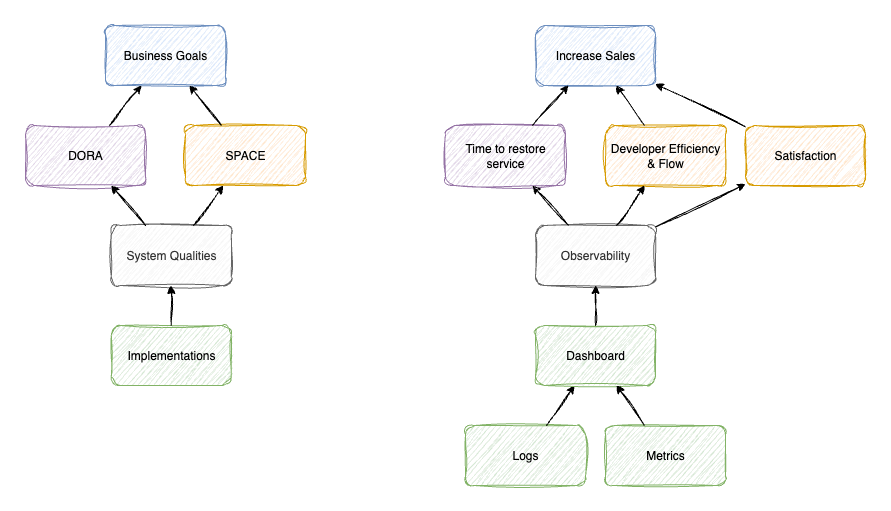

<!-- Generated by Sociable Weaver (https://github.com/albertattard/sw). Manual edits will be overwritten when regenerated. -->

# Software Architecture and Microservice Workshop

*Building effective software efficiently*

## Domain

Welcome to our software architecture and microservices workshop. During this
session, we will build a simple web application composed of two components: a
shopping cart service (referred to as *cart*) and a product catalogue service.
We will explore multiple architectural styles when implementing these
components. The aim is to give you practical insight into the challenges and
advantages associated with each approach, enabling you to make more informed
architectural decisions in the future.

This application has the following capabilities:

- Provide item information (primarily the *name* and its *description*) from the
  catalogue.
- Allow new catalogue items to be added.
- Display the contents of a cart.
- Allow new items to be added to a shopping cart.

The application does not support creating new carts or removing items from a
cart. This choice reflects the workshop’s focus on comparing software
architecture styles; creating carts or removing items does not contribute to
that goal. However, adding new catalogue items does, as this information must be
communicated to the cart component. We will discuss this in more detail later.

### The data

The data has the following properties and constraints:

- A cart may contain zero or many items.
- Each item in the cart must correspond to an item in the catalogue.
- Each item in the cart has a quantity. The same item cannot appear more than
  once; instead, its quantity is adjusted.

This is represented using three tables:

- `catalogue_item`: stores details of catalogue items.
- `cart`: stores information about each cart.
- `cart_item`: stores the items in each cart and their quantities. It contains
  foreign keys to both `catalogue_item` and `cart`.

The following diagram shows these three tables and their relationships:


#### Preloaded data

The [H2](https://www.h2database.com/html/main.html) in-memory database is used
in this example, preloaded with initial data. This avoids external database
setup.

- **Catalogue Items**

  | `id` | `caption`     | `description`                                                         |
  | ---: | ------------- | --------------------------------------------------------------------- |
  |    1 | Leather Sofa  | A very nice and comfortable sofa                                      |
  |    2 | Wooden Table  | A large table ideal for 6 to 8 people                                 |
  |    3 | Plastic Chair | A robust plastic chair suitable for children and adults alike         |
  |    4 | Mug           | The ideal way to start the day                                        |
  |    5 | LED TV        | A very large TV set, ideal for those who love binge-watching TV shows |

- **Carts**

  | `id` |
  | ---: |
  |    1 |
  |    2 |
  |    3 |

- **Cart Items**

  | `cart_id` | `item_id` | `quantity` |
  | --------: | --------: | ---------: |
  |         1 |         1 |          1 |
  |         1 |         5 |          1 |
  |         2 |         2 |          1 |
  |         2 |         3 |          6 |
  |         3 |         4 |          4 |

  The `cart_id` and `item_id` columns in the `cart_item` table are foreign keys
  to the `cart` and `catalogue_item` tables, respectively.

#### A quick note on databases

Although in-memory databases are not typical in production, they allow us to
focus on software architecture. Most real-world applications use persistent
databases with much larger datasets, and database migration is itself a complex
topic worthy of a dedicated workshop.

The process of splitting the data when refactoring from a monolithic to a
distributed architecture can be very challenging and demands meticulous
planning. First, you must analyze the existing data model to identify logical
boundaries, often based on business domains or ownership (such as the catalogue
and cart). This domain-driven approach guides you in mapping tables and
relationships to future service-based databases. However, nontrivial challenges
arise—especially with shared tables, strong foreign key dependencies, or legacy
join-heavy queries—which may require data duplication or redesigning data models
to minimize inter-database coupling.

Next, you’ll design a migration strategy. This often begins with creating new
database schemas for each identified domain, possibly in parallel with the
monolithic schema. Data must be extracted, transformed, and loaded (ETL) into
the new databases while verifying consistency and completeness. Techniques like
change data capture (CDC) or dual writes are sometimes employed to keep the
monolith and new services in sync during a transition period. Special care is
needed for referential integrity, as foreign key constraints can rarely span
physical databases—necessitating either eventual consistency patterns, service
calls to validate references, or redundant metadata.

The process concludes with migrating application code to interact exclusively
with the new databases, gradually disabling dependencies on the monolith. This
approach is typically performed incrementally—splitting one domain at a time to
reduce risk and facilitate thorough testing. Success here involves close
collaboration with cross-functional teams to ensure minimal disruption and
robust data governance throughout the process.

### Meet the components

From the data and its relationships, we can define two components:

- **Catalogue**: Manages information about the items in the store, such as their
  names and descriptions.
- **Cart**: Manages shopping carts and
  <u>relies on the catalogue for catalogue item details</u>.

Note the dependency between the cart and catalogue components, illustrated
below.


This dependency highlights data ownership. Catalogue items are managed by the
catalogue team. The cart team, or any other team, does not own catalogue data
but simply uses it.

### The big picture

Our application will look like the following diagram:


Now that we have an overview, let us begin with the simplest (and probably most
common) architectural style: the *layered monolithic architecture*. Don’t worry
if you are not familiar with this term; we will explain it in detail in the
sections that follow.

But first, let us cover the prerequisites.

## Prerequisites

To get the most out of this workshop, we recommend following along and trying
the examples provided. The prerequisites are outlined below.

### Knowledge

This workshop assumes that you are comfortable using a terminal and have a good
understanding of Java. While you need not be an expert, you should be familiar
with creating classes and interfaces, as well as writing basic Java code.

Although we will use [Maven](https://maven.apache.org/) to build and package the
project, prior experience with Maven is not required; the accompanying
descriptions before or after the examples should be sufficient.

All necessary code and commands are provided, though explanations may not be
exhaustive.

### Terminal commands

The commands in this workshop are demonstrated using
[Linux](https://en.wikipedia.org/wiki/Linux) and
[macOS](https://www.apple.com/macos/).
If you are using [Windows](https://www.microsoft.com/en-us/windows), you can
install the
[Windows Subsystem for Linux](https://learn.microsoft.com/en-us/windows/wsl/install).

Please note that the commands shown may not work in the
[Windows Console](https://en.wikipedia.org/wiki/Windows_Console),
[Windows Terminal](https://github.com/microsoft/terminal), or
[PowerShell](https://learn.microsoft.com/en-us/powershell/).

### Internet access

Some resources will be downloaded from the internet. A reliable internet
connection is required, although it need not be especially fast.

### Java

These examples require
[Java 25](https://www.oracle.com/java/technologies/downloads/) (or newer), which
can be freely downloaded from
[Oracle](https://www.oracle.com/java/technologies/downloads/#java25).

The examples will use [Maven](https://maven.apache.org/), but you do not need to
install it, as the included [Maven Wrapper](https://maven.apache.org/wrapper/)
will be used.

```shell
java --version
```

The Java version should be at least 25. Later versions will also work.

```
java 25.0.2 2026-01-20 LTS
Java(TM) SE Runtime Environment (build 25.0.2+10-LTS-69)
Java HotSpot(TM) 64-Bit Server VM (build 25.0.2+10-LTS-69, mixed mode, sharing)
```

### Container runtime

A container runtime such as [Docker](https://www.docker.com/) or
[Docker Desktop](https://www.docker.com/products/docker-desktop/) (note that
Docker Desktop is not free), [Podman](https://podman.io/), or
[Colima](https://github.com/abiosoft/colima), is required. This is necessary to
run:

- the [Nginx reverse proxy](https://nginx.org/en/) that will act as a gateway
  for different microservices,
- [Jaeger](https://www.jaegertracing.io/) for capturing and displaying
  distributed tracing, and
- [RabbitMQ](https://www.rabbitmq.com/) for exchanging messages between
  microservices.

These are more advanced topics, and you do not need to know how each works yet;
we will cover them later.

Verify that your container runtime is running by pulling the Nginx reverse proxy
image from the container registry.

```shell
docker pull nginx:1.28.0
```

> **Why use a specific version of Nginx instead of `latest`?**
>
> The `latest` tag always refers to the most recently released version, and this
> will change over time. Although keeping software up to date is generally good
> practice, ensuring build reproducibility is equally important.
>
> When we build an artefact (such as a JAR file or a container image) from
> source, we expect it to remain consistent unless the source code itself
> changes. By relying on the `latest` tag, we risk generating different build
> outputs even  when our code has not changed, which compromises
> reproducibility.
>
> *Note*: Docker repositories allow tags to be reassigned. This means a tag such
> as `latest` may point to different image contents at different times, further
> increasing the risk of unexpected changes.

### Working directory

You can create the examples in any working directory, for example:
`~/workshops/software-architecture-and-microservices`.
All commands shown are executed from the same working directory as this file.
Some commands will start a
[subshell](https://en.wikipedia.org/wiki/Child_process) and switch to a new
directory if required, as shown below:

```
(cd child-dir
 # Running commands from within the 'child-dir' directory
 pwd
)
```

Copy and paste the entire snippet into your terminal at the working directory.

> **What is a subshell and why use it?**
>
> A subshell is a child process launched by a shell or shell script. Some
> changes made inside a subshell (such as changing directories with `cd`) do not
> affect the parent shell. This means you do not need to repeatedly navigate
> back to your original directory.
>
> For example, if you need to run commands from a subdirectory `a`, you could
> either:
>
> ```
> cd a
> # Running commands from within the 'a' directory
> command 1
> command 2
> cd ..
> ```
>
> or you could run:
>
> ```
> (cd a
>  # Running commands from within the 'a' directory
>  command 1
>  command 2
> )
> ```
>
> In the second example, there is no need to run `cd ..`, because the directory
> change applies only inside the subshell.

## Layered monolithic architecture

Software architecture is not easy to define in a single sentence.
[Ralph Johnson](https://en.wikipedia.org/wiki/Ralph_Johnson_%28computer_scientist%29)
captured it well when he said:

> “*Architecture is about the important stuff. Whatever that is.*”
> ([source](https://martinfowler.com/architecture/))

A useful analogy is city planning. When designing a city, we must decide where
residential, commercial, and industrial areas will be, and how they will be
connected by transport links, as shown below:


In contrast, how individual houses are decorated is not part of city planning;
residents are free to do as they wish.

The same principle applies to software. Architecture deals with the bigger
picture — for example, how components interact — but not with implementation
details such as whether data is represented using classes or
[records](https://openjdk.org/jeps/395).

If this feels abstract, do not worry. Things will become clearer as we walk
through examples

### Monolithic architecture

A **monolithic architecture** is one in which all components of an application
are packaged together as a single, self-contained unit. This means the user
interface, business logic, and data access code are all built and deployed
together.

In our case, the cart and catalogue components would be implemented within the
same application. We would create a single Java project containing all the code
for both, build it, and then run it as one process (application).

There is a distinction between an *application* and a *process*, but for now we
will set that aside to keep the focus on monolithic architecture.


Monolithic applications are often easier to develop initially because everything
is contained within one codebase, making them straightforward to manage and
deploy.

### Distributed architecture

The opposite of monolithic design is a **distributed architecture**. Here,
components are deployed as independent services, each running in its own process
— possibly on different machines.

In our example, the catalogue and cart would each be separate services running
independently. While they still form a single application, individual parts run
in separate processes.


Distributed architectures introduce extra complexity: multiple codebases,
multiple services, and the need to manage their communication. They do bring
benefits — and certainly look impressive on a CV — but for most cases it is
better to start with a monolithic architecture. Monoliths have far fewer moving
parts and are easier to understand, as everything is in one place.

### Layered architecture

So far, we have spoken about monolithic design without mentioning “*layered*”.
Returning to the city planning analogy: once a residential area is identified,
we still need to organise it internally. The diagram below shows how housing
might be grouped into four categories:


Similarly, our application will include database code, web request handling, and
business logic. Should all classes be put in a single package? Clearly not.

A **layered monolithic architecture** organises classes by their role in the
technology stack. For example:

- database-related classes in one package,
- web-related classes in another,
- business logic in another.


This style has historically been very common. In larger (often older)
organisations, teams were usually structured around technology: database
specialists worked together, front-end developers formed another team, and so
on. Organising applications by technology stack aligned naturally with team
structure.

[Melvin E. Conway](https://en.wikipedia.org/wiki/Melvin_Conway) observed this
relationship in 1967, a principle later known as
[Conway’s law](https://en.wikipedia.org/wiki/Conway%27s_law):

> “*Organisations which design systems (in the broad sense used here) are
> constrained to produce designs which are copies of the communication
> structures of these organisations.*”
> — Melvin E. Conway, *How Do Committees Invent?*

There are, of course, other ways to organise a monolithic application, which we
will explore later.

For now, let us proceed to the next section where we will create our project.

### The framework

While it is possible to build the entire application from scratch, this is
rarely necessary today. Modern frameworks allow us to work more productively and
avoid reinventing the wheel. Popular options include:

- [Spring Boot](https://spring.io/projects/spring-boot)
- [Micronaut](https://micronaut.io/)
- [Quarkus](https://quarkus.io/)
- [Helidon](https://helidon.io/)

You may already be familiar with Spring Boot, which is by far the most popular
framework according to
[Google Trends](https://trends.google.com/trends/explore?cat=32&date=today%203-m&q=Spring%20Boot,Micronaut,Quarkus,Helidon&hl=en-US),
as shown below.


([source](https://trends.google.com/trends/explore?cat=32&date=today%203-m&q=Spring%20Boot,Micronaut,Quarkus,Helidon&hl=en-US))

Given its popularity and the wealth of resources available, we will use Spring
Boot as the foundation for our application.

> **Why use Spring Boot if we are not building microservices?**
>
> This is a common misconception. While Spring Boot is often associated with
> microservices, it is simply a highly productive framework for building Java
> applications of all kinds.
>
> Spring Boot provides strong defaults and eliminates boilerplate code through
> its
> [starter projects](https://github.com/spring-projects/spring-boot/tree/main/spring-boot-project/spring-boot-starters).
> For example, if you want database access, you can add the
> [Spring Data JPA starter](https://spring.io/projects/spring-data-jpa) and
> interact with the database without writing SQL queries yourself.
>
> This convenience is independent of architecture style. The same framework can
> be used in both monolithic and distributed systems.
>
> By the end of this workshop, you will be able to clearly distinguish between a
> **framework** (like Spring Boot) and a **software architecture style**
> (such as layered monolithic or microservices).

Spring Boot also provides a convenient tool called the
[Spring Initializr](https://start.spring.io/). This web-based generator allows
you to select project dependencies and then produces a ZIP file containing a
ready-to-use project.

### The architecture

The catalogue feature will persist the data in the database and will make this
data available through a REST/HTTP endpoint. We will have three layers as shown
below.


Note that each layer is expected to communicate with the layer underneath it,
and it cannot bypass it. For example, the business layer is not expected to
interact with the database directly.

> **How do we document architectural decisions, such as the architectural style used?**
>
> That is an excellent question. While documentation for packages, classes, and
> methods—through
> [JavaDoc](https://docs.oracle.com/javase/8/docs/technotes/tools/windows/javadoc.html)
> or comments—is common practice, architectural decisions, such as the rationale
> for selecting one technology stack over another, are often overlooked. One
> effective technique that has proven valuable is the use of Architecture
> Decision Records (ADRs), which are described next.

#### Architecture Decision Records (ADR)

Architecture Decision Records (ADRs) are concise documents that capture
important decisions made while designing a software system’s architecture. Each
ADR outlines the context, the considered options, the chosen solution, and the
reasoning behind that choice, along with any consequences or trade-offs. Their
importance lies in providing traceability, transparency, and context for
architectural decisions—helping teams understand the rationale behind specific
choices, facilitating knowledge transfer for new team members, and supporting
future maintenance and evolution of the system. ADRs ensure that critical
architectural knowledge is preserved beyond the tenure of individual architects,
reducing the risk of repeating mistakes or making contradictory decisions over
time.

Each architectural decision is documented in a separate ADR. Markdown is a
common format for recording this information, as it is text-based and integrates
effectively with version control systems. Below is a simple ADR template.

```markdown
# Architecture Decision Record: [Title of Decision]

| **Status**          | [Proposed, Accepted, Deprecated, Superseded, or Rejected] |
| ------------------- | --------------------------------------------------------- |
| **Date**            | [DD.MM.YYYY]                                              |
| **Decision Number** | [ADR-###]                                                 |

## Context

Provide a brief background of the situation or problem that led to this
decision. Include any relevant requirements, constraints, or historical factors.

## Decision

Clearly state the architecture decision that has been made.

## Rationale

Explain the reasoning behind the decision, including any alternatives considered
and why they were not chosen. Outline the benefits, risks, and trade-offs.

## Consequences

Describe the outcomes, both positive and negative, of this decision. Note any
follow-up actions, impacts on other areas, or future considerations.

## Related Decisions

(Optional) List any related ADRs or reference materials.
```

> **Where are the ADRs saved?**
>
> A common practice is to save ADRs in a separate repository. While they can be
> stored within the same repository as the project, this may not be suitable if
> the architecture spans multiple projects. In such cases, it is advisable to
> maintain a centralised repository for ADRs, ensuring consistent access and
> management across all related projects.

In this example, we will place the ADRs in a directory called `adrs`.

We have made several architectural decisions since the project began. These
decisions are documented in the following ADRs:

- [**Framework:** Spring Boot](./adrs/ADR-001-Framework.md)
- [**Database:** H2 in-memory](./adrs/ADR-002-Database.md)
- [**Database Migration:** FlywayDB](./adrs/ADR-003-Database-Migration.md)
- [**Data Access Layer:** Spring Data JPA](./adrs/ADR-004-Data-Access-Layer.md)
- [**Architecture Style:** Layered Monolithic Architecture](./adrs/ADR-005-Architecture-Style.md)

We have a landing page ([`README.md`](./adrs/README.md)) that contains links to
each ADR and provides a brief overview. Although this may seem somewhat
redundant at present, it becomes highly beneficial as the project expands and
the number of ADRs increases.

> **Can we use a ready-made application?**
>
> Yes. Although I am not aware of any specific applications, a straightforward
> approach that has proven effective in the past involves using markdown files.
> Typically, only a handful of ADRs are required, and these can be easily
> documented in this format.

### The catalogue feature

The catalogue provides the following capabilities:

- Provide item information (mainly the *name* and its *description*) from our
  catalogue.
- Allow new catalogue items to be added.

To achieve these, the catalogue uses:

- A database migration script, `V1__create_catalogue.sql`, to create and
  populate the catalogue item table called `catalogue_item`.
- An entity class, `CatalogueItemEntity`, to represent this table in the
  database.
- A repository interface, `CatalogueItemRepository`, to read (and write) data
  from the `catalogue_item` table for us.
- A service, `CatalogueItemService`, to fetch data from the repository and
  return it to the rest layer.
- Transfer objects (*TO*), `CatalogueItemTo` and `NewCatalogueItemTo`, to
  represent the JSON objects exchanged between the user and the application.
- A REST controller, `CatalogueItemController`, to receive web requests from the
  user and reply with JSON objects.

The interaction between these classes is illustrated in the following diagram.


#### The data access object (DAO) layer

The catalogue entity comprises a *caption* and a *description* together with an
*id*. This information will be saved into a database table, named
`catalogue_item`. For simplicity and practicality, this table will also be
pre-populated with some records so that we can then query the data and verify
that everything is working as expected.

In this workshop, we will be using [Flyway DB](https://flywaydb.org/) to create
and update the database using version control mechanisms.
[Liquibase](https://www.liquibase.com/) is an alternative to FlywayDB that
perform similar functionalities. Both of these are great tools and I simply
default to FlywayDB just because I am more familiar with it.

Flyway DB, by default, looks under the `./src/main/resources/db/migration`
directory and execute any pending scripts to keep the database up to date.

The
[Java Persistence API (JPA)](https://www.oracle.com/java/technologies/persistence-jsp.html)
reduces the boilerplate code required to read and write from and to a database.
[Spring Data JPA](https://spring.io/projects/spring-data-jpa) takes this a step
further as all we need to define are the entities and the repositories
interfaces (without implementation).

In this workshop we will make use of the Spring Data JPA to keep the boilerplate
code to minimums. With that said, I am not a big fan of JPA and I prefer writing
the code instead.

The catalogue items are saved in the `catalogue_item` table which is mapped to
the entity class, called `CatalogueItemEntity`.

> **Why does the `CatalogueItemEntity` class have a protected no-argument constructor?**
>
> A JPA entity must have a protected no-argument constructor, as specified in
> section
> [2.1. The Entity Class](https://jakarta.ee/specifications/persistence/3.1/jakarta-persistence-spec-3.1.html#a18)
> of the JPA specification.

The DAO repository class (interface), `CatalogueItemRepository`, extends the
Spring JPA
[`ListCrudRepository<>` interface](https://docs.spring.io/spring-data/commons/docs/current/api/org/springframework/data/repository/ListCrudRepository.html).

The `ListCrudRepository` in Spring Data JPA is an interface that provides CRUD
(Create, Read, Update, Delete) operations for managing entities in a database.
It extends the
[`CrudRepository` interface](https://docs.spring.io/spring-data/commons/docs/current/api/org/springframework/data/repository/CrudRepository.html)
and adds methods that return `List` of entities instead of `Iterable`, which can
be more convenient to use in many scenarios. This repository interface
simplifies database interactions by offering a set of methods for common
operations without requiring custom implementations.

Note that despite having no methods, the implementation provided by Spring Data
JPA will be able to read and write entities to the database. This simplifies the
data access a lot as we don’t have to worry about it.

We rarely expose the repositories to the external users. Instead, we hide the
data access behind a service layer where we also put any business logic.

> **Why do we separate data access from business logic?**
>
> Testing the data layer requires a database. While in-memory databases such as
> [H2](https://www.h2database.com/html/main.html) or
> [HSQLDB](https://hsqldb.org/) are useful substitutes during development, they
> are rarely used in production environments. When testing database-related
> code, it is always recommended to run tests against the same type of database
> that will be used in production, as there may be subtle differences between
> in-memory databases and the production database. These differences can lead to
> unexpected behaviour under certain circumstances.
>
> Running numerous tests that require database connectivity can be slow,
> increasing overall testing time. Additionally, some tests may require the
> database to be in a specific state to produce the desired scenario. Managing
> insertions, updates, and deletions can therefore become difficult to maintain.
> As previously mentioned, we want to keep testing time to a minimum while
> retaining the ability to test and simulate all conditions.
>
> Separating the database layer from the business logic or service layer allows
> us to mock the database layer, enabling us to simulate various scenarios
> without having to connect to the actual database and setting up its state.

#### The service layer

Code related with the business logic, such as withdrawing money from a bank
account, is usually saved in the business (or service) layer of the application.
The bank service, in our example, will use the repository from the DAO layer to
read the account balance and only allow the withdrawal if there is enough money.
The service layer will determine whether the withdrawal should go through and
then it should update the database accordingly using the repository from the DAO
layer.

The business logic does not deal with data rendering to the users. The mobile
phone app, for example, will send a request to a controller (something that
needs to be yet covered) which will intern delegate the request to the business
layer. Then the business layer will simply reply back with the outcome. The
controller is responsible for transmitting the result back to the mobile phone
app.

We have organised all the classes related with the data access under the
`demo.dao` package. The business logic related classes are saved under the
`demo.service` package.

As previously noted, the `CatalogueItemService` class resides between the
presentation layer (where our web controllers operate) and the data access layer
(which contains the code responsible for retrieving data from the database). The
presentation layer interacts exclusively with the business/service layer and
does not communicate directly with the data access layer.

> **Why is the `CatalogueItemService` class final?**
>
> This service class is not intended to be extended. By marking it as `final`,
> you clearly communicate to other developers that inheritance is not supported
> or expected. This concept is discussed in detail in Chapter 4, Classes and
> Interfaces, of *Effective Java* by Josh Bloch.
>
> There are cases, such as with entity classes, where although a class should
> not be extended, it cannot be marked as `final` because certain libraries or
> frameworks—such as those used for object-relational mapping—may require
> subclassing for features like proxying or decoration. This is one of the
> reasons I prefer to avoid using JPA.

The `CatalogueItemService` class takes an instance to the repository and exposes
only two methods.

- `findById()`: that given an id, it returns the catalogue item from the
  database if found, otherwise an
  [empty `Optional`](https://docs.oracle.com/en%2Fjava%2Fjavase%2F22%2Fdocs%2Fapi%2F%2F/java.base/java/util/Optional.html#empty()).
  The caller then decides what to do with this. This addresses the first task
  that we need to perform, that is *Provide item information (mainly the name
  and its description) from our catalogue*.
- `add()`: which adds the given catalogue item to the database. This addresses
  the second task that we need to perform, that is *Allow new catalogue items to
  be added*.

> **How come are we returning an empty `Optional` when the item with the give
> id is not found instead of throwing an exception?**"
>
> This is a design decision and frameworks, such as
> [Spring MVC](https://docs.spring.io/spring-framework/reference/web/webmvc.html),
> also provide ways to centrally manage exceptions and reply back to the caller
> (user applications) with canned responses instead having to deal with these
> cases one by one. There is no one good way of implementing this.
>
> I went for this approach for two reasons.
> - I prefer to delegate decision-making until the last moment. With the empty
>   `Optional`, the caller can then decide what to do, whether to throw an
>   exception or not. It also works well with functional programming style which
>   I like a lot.
> - Exceptions can be expensive and also tend to disrupt the program flow. Thus,
>   I prefer a result object instead.
>
> Note that in this case we have two types of outcomes, either we find the item
> or not. In cases when we have more than two outcomes, then we can use the
> sealed types ([JEP 409: Sealed Classes](https://openjdk.org/jeps/409)) which
> work well with the switch statement following the implementation of
> [JEP 441: Pattern Matching for switch](https://openjdk.org/jeps/441).

As hinted before, the business (or service) layer will not be dealing with the
users requests. A controller will be handling that, which will in turn invoke
the service layer. A request from a user will first hit the controller, which
takes all the data the user sent and deserialises this into Java objects. These
Java objects are then passed to the business layer, which will in turn pass them
to the database layer. The database layer interacts with the database and passes
the results back to the service layer, which in turn will pass the data up to
the controller. Finally, the control will take the Java objects it received from
the business layer and serialise them to then be sent to the user.

#### The REST layer

Our catalogue component exposes two REST endpoints. It is not intended to be a
fully-fledged web application; rather, it has been deliberately simplified to
focus solely on the elements relevant to this workshop.

This application takes advantage of the
[Spring Web](https://docs.spring.io/spring-framework/reference/web.html) to
reduce our boilerplate code. Spring Web provides a series of annotations, such
as the
[`@RestController` annotation](https://docs.spring.io/spring-framework/docs/current/javadoc-api/org/springframework/web/bind/annotation/RestController.html)
and the
[`@GetMapping` annotation](https://docs.spring.io/spring-framework/docs/current/javadoc-api/org/springframework/web/bind/annotation/GetMapping.html)
that instruct Spring Web to do a lot of things on our behalf allowing us to just
focus on our application.

The user will be able to fetch an item from the catalogue giving its id and add
an item to the catalogue. A common practice when dealing with data coming into
and going out from the application is to introduce an anti-corruption layer.


An anti-corruption layer represents a set of classes that model the data coming
into the application and then convert it to the business (domain or entity) data
and vice versa. These classes allow us to shape the business data independent of
the data being exchanged.

> **Why introduce so much complexity?**
>
> This is a fair question especially when starting a new project. The data that
> is being exchanged is identical to the entity class. Many will argue that we
> should only introduce an anti corruption layer when this is required. And
> that’s a fair point.
>
> The data that the application exposes rarely maps the domain to 100%. While,
> yes it starts like that, once the application starts evolving and new
> columns/fields are added, these two views start digressing. What happens if we
> add sensitive information to one of our domain models (or entities) which is
> then exposed by mistake by another endpoint that we were not aware of?
>
> By having two sets of classes, one representing the business object,
> `CatalogueItemEntity` in our case, and the transfer objects (*TO*) we avoid
> this problem. Also, we can shape the data as needed by each end without
> affecting the other.

> **What is a Transfer Object (*TO*)?**
>
> A Transfer Object (*TO*), also known as a Data Transfer Object (*DTO*), is a
> simple Java object used to encapsulate and transfer data between different
> layers or components of an application. It primarily serves to carry data
> without containing any business logic, facilitating communication and reducing
> the number of method calls in distributed systems.
>
> For example, when the user fetches a catalogue item, the catalogue item entity
> is transformed into a transfer object which is then serialised as a JSON
> object and sent over the network.

> **Would you recommend creating a method within the `CatalogueItemEntity`, such
> as `CatalogueItemEntity.asTo()`, that creates an instance of the
> `CatalogueItemTo`?**
>
> No. The business entities should not be aware of the transfer objects. The
> business entities should only be aware of the business logic and independent
> of outward facing classes.

The `CatalogueItemTo` comprises three fields, the `id`, `caption` and
`description` and is returned by the application when fetching a catalogue item.
The `id` is auto incremented and this is only known once the entity is persisted
in the database. Therefore, when a new item is added, the `id` is not known to
the caller.

This means that we need to have a new transfer object that represents the object
being created. This object will only have a `caption` and a `description` but
will not have an `id`. Create a new transfer object, named `NewCatalogueItemTo`,
with only these two fields.

Notice the difference between these two classes, or records. The
`NewCatalogueItemTo` is an input class and has a `toEntity()` method that
creates a business entity (`CatalogueItemEntity`). On the other hand, the
`CatalogueItemTo` class does not have a `toEntity()` method as this is an output
class. It has a static factory method (`of()`) that creates the transfer object
from a given entity. The following table captures these differences.

| Transfer Object      | Type   | Mapping method                            | Return Type           |
| -------------------- | ------ | ----------------------------------------- | --------------------- |
| `CatalogueItemTo`    | Output | `CatalogueItemTo.of(CatalogueItemEntity)` | `CatalogueItemTo`     |
| `NewCatalogueItemTo` | Input  | `NewCatalogueItemTo.toEntity()`           | `CatalogueItemEntity` |

> **Why do we need two transfer objects here? Could we use just one instead?**
>
> When adding a new item to the catalogue, its ID will not yet be available, as
> this is generated by the database (or another service) to ensure uniqueness.
> The `CatalogueItemTo` class requires this field to be set. By using a
> different class, we specify only the fields relevant to this scenario,
> omitting the `id`.

The transfer objects just represent the data being transferred. We need to add a
controller that receives the REST requests and pass these to the business
(service) layer. Create the REST controller.

Our controller exposes two endpoints, the get item (`GET /catalogue/item/{ID}`)
and the add item (`POST /catalogue/item`). The get item
(`GET /catalogue/item/{ID}`) endpoint fetches the item from the service, then
converts the `CatalogueItemEntity` to `CatalogueItemTo`, which is then returned
to the caller as a JSON object, and if it is not found it returns a `404` error.

The add item (`POST /catalogue/item`) endpoint converts the `NewCatalogueItemTo`
to a `CatalogueItemEntity` (without an `id`) and then passes this to the
service. The service adds the item to the database through the repository and
then returns the item back. The service returns a new instance of
`CatalogueItemEntity` with the created `id`, which is converted to
`CatalogueItemTo` and returned to the caller. Note that the post request also
returns the path that the caller can use to get this item.

As you can tell, I like functional programming, and it is my go-to style when
possible. I am not saying that this is the best style, it is just a preference I
have. Note that functional programming tends to perform worse that traditional
programming (using ifs and loops) as it tend to become hard for the CPU to
optimise such code.

When working in a production environment I tend to start with the test and then
walk my way back, in a
[test driven development](https://martinfowler.com/bliki/TestDrivenDevelopment.html)
approach. Given that this can be hard to digest, I left testing to the end.

> **How effective is Test-Driven Development (TDD)?**
>
> Kent Beck, a prominent advocate of Test-Driven Development (TDD), shared
> insights from his time at Facebook that led him to reconsider the
> effectiveness of TDD in certain contexts. Upon joining Facebook in 2011, Beck
> observed that the company did not emphasize traditional unit testing or TDD
> practices. Instead, Facebook relied on alternative feedback mechanisms, such
> as extensive monitoring, feature flags, and staged rollouts to smaller markets
> like New Zealand. These strategies provided rapid feedback loops without the
> overhead associated with TDD. Beck noted that in large-scale environments like
> Facebook, traditional TDD might not be the most cost-effective method for
> obtaining feedback.
>
> In a 2019 interview, Beck reflected on his initial surprise at Facebook’s
> lack of unit testing. He came to appreciate the company’s unique approach,
> which included developers taking personal responsibility for their code,
> promptly addressing issues regardless of origin, and utilizing feature flags
> and staged rollouts to manage risk.
>
> These experiences led Beck to recognize that while TDD can be beneficial, its
> applicability may vary depending on the organization’s scale, culture, and
> specific needs.
>
> Testing the code is important as it provides assurance that the code behaves
> as expected. However, code testing falls short of addressing the most
> important metric—it does not encompass business objectives. What is the value
> of a perfectly written, bug-free application if no one uses it? Zero. Code
> testing is only one aspect of the safety net that helps us mitigate the risk
> of deploying faulty code into production, which could negatively impact
> business objectives.
>
> For example, if our application leaks sensitive information due to a bug,
> users may stop using it and the organisation could face fines, resulting in
> negative financial consequences. This is why we test our code: to ensure we
> meet our goals and do not inadvertently make matters worse. Nevertheless, code
> testing is limited to detecting known issues and does not measure the
> application’s effectiveness in achieving business objectives.

The application contains two integration tests. Spring will start our
application on a random port, and we will be making actual REST/HTTP requests to
our application.

Note that there is no reference to the controller (`CatalogueItemController`) or
the services (`CatalogueItemService`) or repository (`CatalogueItemRepository`).
In some cases, these classes are mocked so that we can simulate all paths. Given
that this is a small application that uses an in-memory database, I decided not
to mock any layers and test everything. While convenient, mocking external
aspects is normally discouraged as we tent to test against assumptions rather
than the real thing.

If the test passes, we know that all layers are working well, and that’s all
good. But if the test fails, the issue can be in any of the involved layers.
Thus, this type of test, given its broad scope, does not help you identify
where the issue is. Nevertheless, these types of tests tend to provide the best
assurance that the application is performing as expected.

> **Should we have more unit tests than integration tests like this one?**
>
> Some may argue that integration tests, such as this one, tend to be slow.
> Indeed, integration tests that involve databases or external systems can be
> slower, so I recommend monitoring their performance, mocking out slow
> components when necessary, and reducing the testing scope where possible. In
> our case, we are using an in-memory database, which means the database runs in
> the same process as our application. If we measure the performance of this
> test, we will find that it is not as slow. Therefore, we can start with this
> simple approach and evolve our testing strategy as needed.

Spring tests will create and wire an instance of
[`TestRestTemplate`](https://docs.spring.io/spring-boot/api/java/org/springframework/boot/test/web/client/TestRestTemplate.html)
for us. We will be using this to make requests to our application and then
convert the response from JSON to Java objects.

The
[Spring MVC Test framework](https://docs.spring.io/spring-framework/reference/testing/spring-mvc-test-framework.html)
is an alternative approach which will not start the whole application and
provide useful hooks to make requests and assert responses. I prefer to limit
the amount of mocking and test the real things as much as possible. With that
being said, I do refactor the tests and adopt mocking when these improve the
test performance without hindering the test coverage.

The catalogue component has two endpoints, the get item
(`GET /catalogue/item/{ID}`) endpoint and the add item (`POST /catalogue/item`)
endpoint. We will be testing these separately, each in their respective
[nested (`@Nested`) Junit class](https://junit.org/junit5/docs/current/api/org.junit.jupiter.api/org/junit/jupiter/api/Nested.html).
This allows us to group and organise our tests. An alternative approach is to
create a test class for every endpoint. I usually start with one test class,
organise the tests by nested classes and refactor when the test classes get too
long.

Our test is testing both scenarios, one when the item is found and another when
the item is not found.

The add item endpoint “always” succeeds. We have no validations whatsoever and
the request will always work. In a real application we will have validation, in
which case it is recommended testing all validations to make sure that invalid
entries do not make it through.

> **If we validate the input in the UI, should we validate the input on the
> backend as well?**"
>
> **YES**. I didn’t forget the caps lock. You cannot trust the frontend with the
> validation. As you will see with the testing, we can simply make a
> [cURL](https://curl.se/) request to the application and push in invalid input.
>
> Frontend validation improves users experience as the user is prompted
> immediately whether their input is invalid and provides hints on how to
> address this. On the other hand the backend validation improves the data
> integrity as it ensures that the data coming into the application is valid and
> meets all validations criteria.

> **What happens if we pass a very long caption?**
>
> That is a very good question. The application will fail to save the entry to
> the database. The database is not expecting a caption not longer than 128
> letters (defined as `VARCHAR(128)`) and it will fail if we pass something
> longer.
>
> Ideally we have validation to ensure that this does not happen and in such
> cases we should test that these validations are working well. I left this out
> to keep this workshop focused, but I would not do that in real life. Always
> make sure that the transfer object is validated and all validations are
> tested.

> **What is the recommended approach to test the application against corner case
> such as a user providing a very long caption?**"
>
> Exploratory testing is highly effective in such scenarios. This software
> testing approach involves a human tester simultaneously learning about the
> application, designing tests, and executing them—often without relying on
> predefined test cases. It places emphasis on the tester’s autonomy and
> responsibility to explore the software, uncover defects, and enhance overall
> quality through active investigation.
>
> On one project, our QA engineer responsible for exploratory testing submitted
> a regular expression that caused our server to crash. This vulnerability is
> known as
> [ReDoS (Regular Expression Denial of Service)](https://owasp.org/www-community/attacks/Regular_expression_Denial_of_Service_-_ReDoS).
> ReDoS occurs when an attacker provides a specially crafted regular expression
> or input that exploits the performance characteristics of certain patterns,
> leading to excessive backtracking and high CPU usage. This can significantly
> slow down or even crash the application or server. We identified and resolved
> this issue before production release, and have not encountered a similar
> incident since.
>
> In this example, we benefited from a shift-left approach, whereby testing is
> conducted by the same team that develops the code. We all learned from this
> experience and have not repeated the same mistake.

### The cart feature

Similar to the catalogue, the cart feature persists the data in the database and
makes this data available through a REST/HTTP endpoint. It uses the same three
layers we as the catalogue.

The cart feature provides the following capabilities:

- View the contents of a cart.
- Allow new items to be added to a shopping cart.

To achieve these, the cart uses:

- A database migration script, `V2__create_cart.sql`, to create and populate the
  cart and cart item tables called `cart` and `cart_item` respectively.
- An entity class, `CartEntity`, to represent cart table in the database.
- An entity class, `CartItemEntity`, to represent cart item table in the
  database.
- A composite primary key class, `CartItemEntityPrimaryKey`, to represent cart
  item table composite primary key.
- A repository interface, `CartRepository`, to read (and write) data from the
  `cart` and `cart_item` tables for us.
- A service, `CartService`, to fetch data from the repository and return it to
  the rest layer.
- Transfer objects (*TO*), `CartTo` and `CartItemTo`, to represent the JSON
  objects exchanged between the user and the application.
- A REST controller, `CartController`, to receive web requests from the user and
  reply with JSON objects.

#### The data access object (DAO) layer

The cart entity comprises a list of items and their respective quantities. This
information will be saved into two database tables, named `cart` and
`cart_item`. For simplicity and practicality, this table will also be
pre-populated with some records so that we can then query the data and verify
that everything is working as expected.

> **Can we edit the existing file (`V1__create_catalogue.sql`)?**
>
> Flyway keeps track of what files have been played and applied. If we modify a
> file that was already played, then flyway will raise an error (throw an
> exception) and our application will fail to start.
>
> With that being said, we are using an in-memory database, which means that our
> database is created every time the application starts. So in our case, we
> could have simply modified the first version of the SQL file. Furthermore, the
> same files are usually updated during development, but before these are pushed
> to the central repository and applied to production.
>
> Here I am assuming that the catalogue made it to production and the
> `V1__create_catalogue.sql` SQL file cannot be changed without causing any
> issues.

> **Why is the `Mapper` class final and does it have a private constructor?**
>
> The `Mapper` class is marked as `final` because it is not intended to be
> extended. This signals to other developers that subclassing is not supported.
> Additionally, as no instances of this class should be created, its constructor
> is declared `private`, preventing unintended instantiation.
>
> For further examples of good programming practices, please refer to Chapter 4,
> Classes and Interfaces, of *Effective Java* by Josh Bloch.

#### The service layer

The cart service provides two functions. It fetches a cart given its id, and
it adds an item to the cart. Create the cart service.

> **Why is the `CartService` class not final similar to the
> `CatalogueItemService` class?**
>
> The `CartService` utilises the `@Transactional` annotation to ensure that
> interactions with both repositories are performed atomically. This guarantees
> data integrity, which is highly important. However, while this approach
> secures transactional consistency, it is not synonymous with pessimistic
> locking.
>
> Pessimistic locking is a concurrency control mechanism used in database
> operations to prevent conflicts when multiple transactions attempt to access
> the same data simultaneously. In the context of your Spring service
> interacting with Cart and CatalogueItem repositories, pessimistic locking
> involves locking a specific database row (for example, a cart or cart item) so
> that it is reserved exclusively for the current transaction until completion
> (either commit or rollback). This prevents other transactions from
> concurrently modifying the same data.
>
> Returning to the main point, Spring proxies this class to provide
> transactional behaviour, which requires the class to be non-final. Marking
> this class as `final` would prevent the application from starting.

#### The REST layer

Our cart component exposes two REST endpoints without a user interface, similar
to the catalogue component.

### Test the application

Build the application and run the tests

```shell
./mvnw clean verify
```

The test should pass

```
...
[INFO] ------------------------------------------------------------------------
[INFO] BUILD SUCCESS
[INFO] ------------------------------------------------------------------------
...
```

Try the catalogue and cart features in the application

```shell
# Start the application in the background
java -jar './target/application-monolithic-layered-single-project-1.0.0.jar' > './target/application-monolithic-layered-single-project.log' 2>&1 &

# Save the PID so later steps can reuse it after this entry finishes.
echo "$!" > './target/application-monolithic-layered-single-project.pid'

# Wait for the application to start
while [ "$(curl --silent --output /dev/null --write-out '%{http_code}' 'http://localhost:8080/cart/1')" -ne '200' ]; do echo 'Waiting for the application to start'; sleep 1; done
```

This starts our application in the background and waits until it is ready to
handle requests. The application is now running on localhost and listening on
port `8080`.

Make a few requests to the catalogue items endpoint. We have the following
catalogue items in the database.

| `id` | `caption`     | `description`                                                         |
| ---: | ------------- | --------------------------------------------------------------------- |
|    1 | Leather Sofa  | A very nice and comfortable sofa                                      |
|    2 | Wooden Table  | A large table ideal for 6 to 8 people                                 |
|    3 | Plastic Chair | A robust plastic chair ideal for children and adults alike            |
|    4 | Mug           | The ideal way to start the day                                        |
|    5 | LED TV        | A very large TV set, ideal for those who love to binge-watch TV shows |

Request the details for the item with id `1`.

```shell
curl --silent 'http://localhost:8080/catalogue/item/1' | jq
```

The catalogue item with id `1`

```json
{
  "id": 1,
  "caption": "Leather Sofa",
  "description": "A very nice and comfortable sofa"
}
```

Add a new item to the catalogue.

We will add a new item named `Green Plant`, with the description:
`Put a little life in your living room!`. The response will then be saved to a
file so that we can use the generated id to retrieve the item later.

```shell
# Save the response in a file as we will use it later on
curl --silent \
  -X POST 'http://localhost:8080/catalogue/item' \
  -H 'Content-Type: application/json' \
  -d '{"caption":"Green Plant","description":"Put a little life in your living room!!"}' \
  | jq \
  > new-catalogue-item.json

# Print the output
jq . new-catalogue-item.json
```

The newly added item

```json
{
  "id": 6,
  "caption": "Green Plant",
  "description": "Put a little life in your living room!!"
}
```

Fetch this item using the generated id.

```shell
# Read the new item id obtained from the previous command
ITEM_ID="$(jq .id new-catalogue-item.json)"

# Fetch the new item
curl --silent "http://localhost:8080/catalogue/item/${ITEM_ID}" | jq
```

The newly added item

```json
{
  "id": 6,
  "caption": "Green Plant",
  "description": "Put a little life in your living room!!"
}
```

The database has three carts, as shown in the following table.

| `cart_id` | `item_id` | `caption`     | `quantity` |
| --------: | --------: | ------------- | ---------: |
|         1 |         1 | Leather Sofa  |          1 |
|         1 |         5 | LED TV        |          1 |
|         2 |         2 | Wooden Table  |          1 |
|         2 |         3 | Plastic Chair |          6 |
|         3 |         4 | Mug           |          4 |

Request the details for the cart with id `3`.

```shell
curl --silent 'http://localhost:8080/cart/3' | jq
```

The cart with id `3` and its items

```json
{
  "id": 3,
  "items": [
    {
      "id": 4,
      "caption": "Mug",
      "quantity": 4
    }
  ]
}
```

Add the new item to the cart.

```shell
# Read the new item id obtained from the previous command
ITEM_ID="$(jq .id new-catalogue-item.json)"

# Add the new item to cart with id 3
curl --silent -X POST "http://localhost:8080/cart/3/item/${ITEM_ID}" | jq
```

The cart contents after adding the newly created catalogue item.

```json
{
  "id": 3,
  "items": [
    {
      "id": 4,
      "caption": "Mug",
      "quantity": 4
    },
    {
      "id": 6,
      "caption": "Green Plant",
      "quantity": 1
    }
  ]
}
```

Delete the temporary file `new-catalogue-item.json`, which was created to store
the id of the newly added item to the catalogue.

```shell
rm -rf new-catalogue-item.json
```

Stop the application once ready.

```shell
kill "$(cat './target/application-monolithic-layered-single-project.pid')"
rm -f './target/application-monolithic-layered-single-project.pid'
```

Our application uses a very popular and well tested architecture style known as
layered monolithic application. But this is not the only architecture style, as
we will see in the next section.

### Containers

The application is packaged as a fat JAR file by Spring Boot, which allows it to
be executed directly using the `java -jar` command, as demonstrated previously.
The same JAR file can also be copied into a container image and executed within
that environment. In this section, we will explore three different approaches
for containerising a Spring Boot application.

#### Basic Containers

The most straightforward way to run a Java application in a container is to base
it on one of the pre-existing Java container images available from the
[Oracle Container Registry](https://container-registry.oracle.com/ords/ocr/ba/java/jdk).
In this example, Java 25 is used. After selecting the base image, copy the
application JAR file and any required dependencies into the container, then
specify the command used to launch the application. For a complete reference,
see the [`./containers/Dockerfile`](./containers/Dockerfile).

You can then build the container using this approach.

```shell
docker build \
  --file './containers/Dockerfile' \
  --tag 'demo:application-monolithic-layered-single-project' \
  --load \
  .
```

Try the catalogue and cart features in the application

```shell
# Start the application in the background
docker run \
  --rm \
  --detach \
  --name 'application-monolithic-layered-single-project' \
  --publish 8080:8080 \
  'demo:application-monolithic-layered-single-project'

# Wait for the application to start
while [ "$(curl --silent --output /dev/null --write-out '%{http_code}' 'http://localhost:8080/cart/1')" -ne '200' ]; do echo 'Waiting for the application to start'; sleep 1; done
```

This starts our application in the background and waits until it is ready to
handle requests. The application is now running on localhost and listening on
port `8080`.

Make a few requests to the catalogue items endpoint. We have the following
catalogue items in the database.

| `id` | `caption`     | `description`                                                         |
| ---: | ------------- | --------------------------------------------------------------------- |
|    1 | Leather Sofa  | A very nice and comfortable sofa                                      |
|    2 | Wooden Table  | A large table ideal for 6 to 8 people                                 |
|    3 | Plastic Chair | A robust plastic chair ideal for children and adults alike            |
|    4 | Mug           | The ideal way to start the day                                        |
|    5 | LED TV        | A very large TV set, ideal for those who love to binge-watch TV shows |

Request the details for the item with id `1`.

```shell
curl --silent 'http://localhost:8080/catalogue/item/1' | jq
```

The catalogue item with id `1`

```json
{
  "id": 1,
  "caption": "Leather Sofa",
  "description": "A very nice and comfortable sofa"
}
```

Add a new item to the catalogue.

We will add a new item named `Green Plant`, with the description:
`Put a little life in your living room!`. The response will then be saved to a
file so that we can use the generated id to retrieve the item later.

```shell
# Save the response in a file as we will use it later on
curl --silent \
  -X POST 'http://localhost:8080/catalogue/item' \
  -H 'Content-Type: application/json' \
  -d '{"caption":"Green Plant","description":"Put a little life in your living room!!"}' \
  | jq \
  > new-catalogue-item.json

# Print the output
jq . new-catalogue-item.json
```

The newly added item

```json
{
  "id": 6,
  "caption": "Green Plant",
  "description": "Put a little life in your living room!!"
}
```

Fetch this item using the generated id.

```shell
# Read the new item id obtained from the previous command
ITEM_ID="$(jq .id new-catalogue-item.json)"

# Fetch the new item
curl --silent "http://localhost:8080/catalogue/item/${ITEM_ID}" | jq
```

The newly added item

```json
{
  "id": 6,
  "caption": "Green Plant",
  "description": "Put a little life in your living room!!"
}
```

The database has three carts, as shown in the following table.

| `cart_id` | `item_id` | `caption`     | `quantity` |
| --------: | --------: | ------------- | ---------: |
|         1 |         1 | Leather Sofa  |          1 |
|         1 |         5 | LED TV        |          1 |
|         2 |         2 | Wooden Table  |          1 |
|         2 |         3 | Plastic Chair |          6 |
|         3 |         4 | Mug           |          4 |

Request the details for the cart with id `3`.

```shell
curl --silent 'http://localhost:8080/cart/3' | jq
```

The cart with id `3` and its items

```json
{
  "id": 3,
  "items": [
    {
      "id": 4,
      "caption": "Mug",
      "quantity": 4
    }
  ]
}
```

Add the new item to the cart.

```shell
# Read the new item id obtained from the previous command
ITEM_ID="$(jq .id new-catalogue-item.json)"

# Add the new item to cart with id 3
curl --silent -X POST "http://localhost:8080/cart/3/item/${ITEM_ID}" | jq
```

The cart contents after adding the newly created catalogue item.

```json
{
  "id": 3,
  "items": [
    {
      "id": 4,
      "caption": "Mug",
      "quantity": 4
    },
    {
      "id": 6,
      "caption": "Green Plant",
      "quantity": 1
    }
  ]
}
```

Delete the temporary file `new-catalogue-item.json`, which was created to store
the id of the newly added item to the catalogue.

```shell
rm -rf new-catalogue-item.json
```

Stop the application once ready.

```shell
docker stop 'application-monolithic-layered-single-project'
```

This approach is simple and effective; however, it has a significant drawback:
the resulting container image is comparatively large. This can lead to increased
storage requirements and may slow down deployment when distributing the image
across a cluster.

```shell
docker images 'demo:application-monolithic-layered-single-project' --format "{{.Repository}}:{{.Tag}} -> {{.Size}}"
```

The container image size

```
demo:application-monolithic-layered-single-project -> 1.14GB
```

In the next example we will see how we can reduce the image size

#### Smaller Containers

The previous example demonstrated a simple and direct method for running Java
applications in a container. However, this approach results in a relatively
large container image. We can significantly reduce its size by removing
components that are not required at runtime. For instance, the container
currently includes a full JDK, even though only a Java runtime environment is
necessary for execution.

Tools such as
[`jlink`](https://docs.oracle.com/en/java/javase/25/docs/specs/man/jlink.html)
allow the creation of a custom runtime image containing only the modules
required by the application, excluding elements such as the Java compiler that
are not needed once the application is built. This produces a much smaller
container image. For a complete example, refer to
[`./containers/Dockerfile-with-jlink`](./containers/Dockerfile-with-jlink).

You can then build the container using this optimised approach.

```shell
docker build \
  --file './containers/Dockerfile-with-jlink' \
  --tag 'demo:application-monolithic-layered-single-project' \
  --load \
  .
```

The only thing that changed from the first example is the Docker file.

Try the catalogue and cart features in the application

```shell
# Start the application in the background
docker run \
  --rm \
  --detach \
  --name 'application-monolithic-layered-single-project' \
  --publish 8080:8080 \
  'demo:application-monolithic-layered-single-project'

# Wait for the application to start
while [ "$(curl --silent --output /dev/null --write-out '%{http_code}' 'http://localhost:8080/cart/1')" -ne '200' ]; do echo 'Waiting for the application to start'; sleep 1; done
```

This starts our application in the background and waits until it is ready to
handle requests. The application is now running on localhost and listening on
port `8080`.

Make a few requests to the catalogue items endpoint. We have the following
catalogue items in the database.

| `id` | `caption`     | `description`                                                         |
| ---: | ------------- | --------------------------------------------------------------------- |
|    1 | Leather Sofa  | A very nice and comfortable sofa                                      |
|    2 | Wooden Table  | A large table ideal for 6 to 8 people                                 |
|    3 | Plastic Chair | A robust plastic chair ideal for children and adults alike            |
|    4 | Mug           | The ideal way to start the day                                        |
|    5 | LED TV        | A very large TV set, ideal for those who love to binge-watch TV shows |

Request the details for the item with id `1`.

```shell
curl --silent 'http://localhost:8080/catalogue/item/1' | jq
```

The catalogue item with id `1`

```json
{
  "id": 1,
  "caption": "Leather Sofa",
  "description": "A very nice and comfortable sofa"
}
```

Add a new item to the catalogue.

We will add a new item named `Green Plant`, with the description:
`Put a little life in your living room!`. The response will then be saved to a
file so that we can use the generated id to retrieve the item later.

```shell
# Save the response in a file as we will use it later on
curl --silent \
  -X POST 'http://localhost:8080/catalogue/item' \
  -H 'Content-Type: application/json' \
  -d '{"caption":"Green Plant","description":"Put a little life in your living room!!"}' \
  | jq \
  > new-catalogue-item.json

# Print the output
jq . new-catalogue-item.json
```

The newly added item

```json
{
  "id": 6,
  "caption": "Green Plant",
  "description": "Put a little life in your living room!!"
}
```

Fetch this item using the generated id.

```shell
# Read the new item id obtained from the previous command
ITEM_ID="$(jq .id new-catalogue-item.json)"

# Fetch the new item
curl --silent "http://localhost:8080/catalogue/item/${ITEM_ID}" | jq
```

The newly added item

```json
{
  "id": 6,
  "caption": "Green Plant",
  "description": "Put a little life in your living room!!"
}
```

The database has three carts, as shown in the following table.

| `cart_id` | `item_id` | `caption`     | `quantity` |
| --------: | --------: | ------------- | ---------: |
|         1 |         1 | Leather Sofa  |          1 |
|         1 |         5 | LED TV        |          1 |
|         2 |         2 | Wooden Table  |          1 |
|         2 |         3 | Plastic Chair |          6 |
|         3 |         4 | Mug           |          4 |

Request the details for the cart with id `3`.

```shell
curl --silent 'http://localhost:8080/cart/3' | jq
```

The cart with id `3` and its items

```json
{
  "id": 3,
  "items": [
    {
      "id": 4,
      "caption": "Mug",
      "quantity": 4
    }
  ]
}
```

Add the new item to the cart.

```shell
# Read the new item id obtained from the previous command
ITEM_ID="$(jq .id new-catalogue-item.json)"

# Add the new item to cart with id 3
curl --silent -X POST "http://localhost:8080/cart/3/item/${ITEM_ID}" | jq
```

The cart contents after adding the newly created catalogue item.

```json
{
  "id": 3,
  "items": [
    {
      "id": 4,
      "caption": "Mug",
      "quantity": 4
    },
    {
      "id": 6,
      "caption": "Green Plant",
      "quantity": 1
    }
  ]
}
```

Delete the temporary file `new-catalogue-item.json`, which was created to store
the id of the newly added item to the catalogue.

```shell
rm -rf new-catalogue-item.json
```

Stop the application once ready.

```shell
docker stop 'application-monolithic-layered-single-project'
```

The Dockerfile used in this example is more involved, but once configured it can
produce a significantly smaller container image—approximately one-third of the
original size.

```shell
docker images 'demo:application-monolithic-layered-single-project' --format "{{.Repository}}:{{.Tag}} -> {{.Size}}"
```

The container image size

```
demo:application-monolithic-layered-single-project -> 383MB
```

This example assumes the application has already been compiled and packaged by a
separate process. However, we can integrate the build step into the same
container build process if we prefer a fully self-contained and independent
build workflow.

#### Builder Containers

The previous example reduced the container size by using `jlink` to create a
smaller runtime image. However, it still relied on a separate process to build
the JAR file. This build step can also be incorporated directly into the
Dockerfile, allowing the entire build process to be handled by the container
build system. For a complete example, refer to
[`./containers/Dockerfile-with-builder`](./containers/Dockerfile-with-builder).

You can then build the container using this optimised approach.

```shell
docker build \
  --file './containers/Dockerfile-with-builder' \
  --tag 'demo:application-monolithic-layered-single-project' \
  --load \
  .
```

The only thing that changed from the first example is the Docker file.

Try the catalogue and cart features in the application

```shell
# Start the application in the background
docker run \
  --rm \
  --detach \
  --name 'application-monolithic-layered-single-project' \
  --publish 8080:8080 \
  'demo:application-monolithic-layered-single-project'

# Wait for the application to start
while [ "$(curl --silent --output /dev/null --write-out '%{http_code}' 'http://localhost:8080/cart/1')" -ne '200' ]; do echo 'Waiting for the application to start'; sleep 1; done
```

This starts our application in the background and waits until it is ready to
handle requests. The application is now running on localhost and listening on
port `8080`.

Make a few requests to the catalogue items endpoint. We have the following
catalogue items in the database.

| `id` | `caption`     | `description`                                                         |
| ---: | ------------- | --------------------------------------------------------------------- |
|    1 | Leather Sofa  | A very nice and comfortable sofa                                      |
|    2 | Wooden Table  | A large table ideal for 6 to 8 people                                 |
|    3 | Plastic Chair | A robust plastic chair ideal for children and adults alike            |
|    4 | Mug           | The ideal way to start the day                                        |
|    5 | LED TV        | A very large TV set, ideal for those who love to binge-watch TV shows |

Request the details for the item with id `1`.

```shell
curl --silent 'http://localhost:8080/catalogue/item/1' | jq
```

The catalogue item with id `1`

```json
{
  "id": 1,
  "caption": "Leather Sofa",
  "description": "A very nice and comfortable sofa"
}
```

Add a new item to the catalogue.

We will add a new item named `Green Plant`, with the description:
`Put a little life in your living room!`. The response will then be saved to a
file so that we can use the generated id to retrieve the item later.

```shell
# Save the response in a file as we will use it later on
curl --silent \
  -X POST 'http://localhost:8080/catalogue/item' \
  -H 'Content-Type: application/json' \
  -d '{"caption":"Green Plant","description":"Put a little life in your living room!!"}' \
  | jq \
  > new-catalogue-item.json

# Print the output
jq . new-catalogue-item.json
```

The newly added item

```json
{
  "id": 6,
  "caption": "Green Plant",
  "description": "Put a little life in your living room!!"
}
```

Fetch this item using the generated id.

```shell
# Read the new item id obtained from the previous command
ITEM_ID="$(jq .id new-catalogue-item.json)"

# Fetch the new item
curl --silent "http://localhost:8080/catalogue/item/${ITEM_ID}" | jq
```

The newly added item

```json
{
  "id": 6,
  "caption": "Green Plant",
  "description": "Put a little life in your living room!!"
}
```

The database has three carts, as shown in the following table.

| `cart_id` | `item_id` | `caption`     | `quantity` |
| --------: | --------: | ------------- | ---------: |
|         1 |         1 | Leather Sofa  |          1 |
|         1 |         5 | LED TV        |          1 |
|         2 |         2 | Wooden Table  |          1 |
|         2 |         3 | Plastic Chair |          6 |
|         3 |         4 | Mug           |          4 |

Request the details for the cart with id `3`.

```shell
curl --silent 'http://localhost:8080/cart/3' | jq
```

The cart with id `3` and its items

```json
{
  "id": 3,
  "items": [
    {
      "id": 4,
      "caption": "Mug",
      "quantity": 4
    }
  ]
}
```

Add the new item to the cart.

```shell
# Read the new item id obtained from the previous command
ITEM_ID="$(jq .id new-catalogue-item.json)"

# Add the new item to cart with id 3
curl --silent -X POST "http://localhost:8080/cart/3/item/${ITEM_ID}" | jq
```

The cart contents after adding the newly created catalogue item.

```json
{
  "id": 3,
  "items": [
    {
      "id": 4,
      "caption": "Mug",
      "quantity": 4
    },
    {
      "id": 6,
      "caption": "Green Plant",
      "quantity": 1
    }
  ]
}
```

Delete the temporary file `new-catalogue-item.json`, which was created to store
the id of the newly added item to the catalogue.

```shell
rm -rf new-catalogue-item.json
```

Stop the application once ready.

```shell
docker stop 'application-monolithic-layered-single-project'
```

The final container image remains as small as before. The key difference in this
example is that the Dockerfile is more self-contained and no longer relies on an
external process to build the JAR file.

```shell
docker images 'demo:application-monolithic-layered-single-project' --format "{{.Repository}}:{{.Tag}} -> {{.Size}}"
```

The container image size

```
demo:application-monolithic-layered-single-project -> 383MB
```

However, the drawback of this approach is that we lose access to detailed build
reports. While it is possible to work around this limitation, doing so would add
unnecessary complexity. My preferred approach is to avoid building the
application within the container and instead leverage the CI/CD pipeline to
handle the build process.

### Tradeoffs

A quick google search (if you are old like me or ChatGPT query if you are young
like my kids) about the tradeoffs of a layered monolithic architecture style
yields a lot of results, similar to the following.

- **Scalability limitations**: Monolithic applications are challenging to scale
  because you must scale the entire application rather than individual
  components. This can lead to inefficient use of resources.
- **Tight coupling**: All components in a monolithic application are tightly
  coupled. Changes in one part of the application can impact other parts, making
  it difficult to update or refactor code.
- **Deployment challenges**: Deploying a monolithic application can be complex
  because any change, no matter how small, requires the entire application to be
  rebuilt and redeployed. This can slow down the development cycle and increase
  downtime.
- **Reduced flexibility**: It is harder to adopt new technologies or frameworks
  for specific parts of the application because all components are
  interdependent. This reduces the flexibility to innovate or improve individual
  parts of the system.
- **Maintenance difficulties**: As the codebase grows, maintaining a monolithic
  application becomes increasingly difficult. Understanding the impact of
  changes and debugging issues can be time-consuming and complex.
- **Risk of single points of failure**: Since all functionalities are packaged
  together, a failure in any part of the application can bring down the entire
  system, leading to a higher risk of complete system outages.
- **Limited parallel development**: It is challenging for multiple teams to work
  on different parts of the application simultaneously without causing
  conflicts. This can slow down development and reduce team productivity.
- **Long build and test cycles**: Building and testing a monolithic application
  can take a long time, especially as the codebase grows. This can delay the
  feedback loop and slow down the development process.
- **Complexity in understanding the entire system**: As the application grows,
  it becomes harder for developers to understand the entire system. This can
  lead to knowledge silos and make onboarding new developers more challenging.

I am confident that one or more of these resonate with challenges you are
experiencing or have experienced. While some folks will simply take such a list
and run with it, I would like to try something else instead. I would like to
know, and ideally measure, how these and other similar disadvantages are
impacting our application. I would like to measure the effectiveness of the
architecture in a meaningful and reproducible way. Instead of simply speculate
I would like to link our architecture style with the success, or lack of, of the
application.

> **Is a monolithic application inherently not scalable?**
>
> No, that is a big misconception. When I ask developers why they chose the
> microservices architecture style, the most common reply is scalability. When I
> ask these developers to provide me with an example, their answer usually goes
> something like:
> “*we can run the application over multiple services and scale up those services
> that need load without scaling up the whole application*”,
> as shown next.
>
> 
>
> That is true. With monolithic applications, it is all or nothing, which can be
> a problem for very large applications as they would need large machines to run
> on. Splitting the application into smaller services can address this problem,
> as we can scale the parts that need more resources without scaling the whole
> application. That being said, I have rarely encountered such large monolithic
> applications myself, and the ones I learned about were more batch processing
> applications rather than user-facing applications.
>
> It is important to note that in this example, the monolithic application can
> scale horizontally. This means that, while inefficient, it can still scale.
> Some monolithic applications cannot scale horizontally and their only option
> is vertical scaling. Unlike horizontal scaling, vertical scaling has a limit.
> While we can always buy a new virtual machine from the cloud, we cannot buy
> something bigger than the largest available option.
>
> 
>
> These types of applications cannot scale beyond a certain point. The thing
> that holds them back from scaling is state. Any application that maintains
> state is hard to scale. Databases are a clear example. A relational database
> runs on a single instance, and when we need more power, we have to scale
> vertically. This is because the database needs access to the whole dataset to
> maintain [ACID transactions](https://en.wikipedia.org/wiki/ACID). Other types
> of databases sacrifice ACID transactions in favour of
> [BASE](https://en.wikipedia.org/wiki/Eventual_consistency) to gain horizontal
> scalability. The point here is that the software architecture style does not
> prevent scalability, but the state does.
>
> This brings us to an important point: you can scale only as much as the
> weakest link allows. Suppose we have an application that can scale infinitely
> but is connected to a relational database. What happens when we scale more
> than the database can handle? The database will crash. I have seen this happen
> several times, where the application scaled beyond what the database could
> support. It happened to me too, when we scaled a microservice more than the
> database could handle.
>
> Scalability is not only related to usage. Scalability also relates to the size
> of the application and the team maintaining it. As the application grows, so
> does the team. The architecture style significantly impacts scalability
> limits, and past a certain threshold, the application can become
> unmaintainable. But this is not necessarily inherent to monoliths. It is more
> of an organisational problem. The application can be organised in a way that
> promotes growth, but it can also be organised in ways that hinder growth,
> whether it is monolithic or distributed.
>
> In conclusion, monolithic architectures can scale both at runtime by reducing
> state and at development time by organising them better. We will discuss this
> more later on.

How do we measure the effectiveness of our architecture style?

#### Measuring what matters

Technical professionals often focus on aspects they can directly influence, such
as technology and infrastructure. This is natural, but insufficient. Software
exists to serve the business, and its success is not defined by scalability or
performance alone, but by the value it brings to the organisation. For an
e-commerce website, the number of users and the volume of sales are critical
measures of success—yet these are often overlooked by software architects when
assessing an application.

After migrating from a monolithic architecture to a more complex distributed
architecture style, how can we determine whether the move was successful? To
evaluate the effectiveness of a software architecture, we must start with the
business goals and work backwards, identifying measurable proxies that correlate
with those goals. This is precisely what the authors of
[Accelerate: The Science Behind DevOps: Building and Scaling High Performing Technology Organizations](https://itrevolution.com/product/accelerate/),
[Nicole Forsgren, PhD](https://nicolefv.com/),
[Jez Humble](https://www.thoughtworks.com/en-de/profiles/j/jez-humble), and
[Gene Kim](https://itrevolution.com/author/gene-kim/), set out to do. By
examining a wide range of organisations, they identified the distinguishing
factors between high performers and less successful ones.

The book presents the results of a four-year quantitative research study
conducted across thousands of projects and organisations. Over 23,000 survey
responses were collected from start-ups, SMEs, large enterprises, highly
regulated industries, and more.

From this research emerged the now well-known
[four key metrics](https://cloud.google.com/blog/products/devops-sre/using-the-four-keys-to-measure-your-devops-performance),
which differentiate high-performing organisations from their peers:

- **Deployment frequency** (*throughput*): How often an organisation
  successfully releases to production.
- **Lead time for changes** (*throughput*): The time it takes for a commit to
  reach production. This differs from cycle time, which measures the time taken
  for a feature to be released.
- **Change failure rate** (*quality*): The percentage of deployments that cause
  a failure in production.
- **Time to restore service** (*quality*): The time required to recover from a
  production failure.

These are now commonly referred to as the [DORA metrics](https://dora.dev/),
reflecting the research initiated in *Accelerate*.

A key distinction between these and traditional metrics is that the DORA metrics
can be measured quantitatively. Moreover, *Accelerate* provides benchmarks that
define what constitutes good performance, allowing organisations to compare
themselves against industry leaders and identify areas for improvement.

However, some organisations have invested heavily in DORA metrics in the pursuit
of maximising software development productivity. Despite this, the results have
not always met expectations. DORA metrics provide valuable insights into
engineering processes but do not address two critical dimensions: people and
products.


When building a product, we are essentially testing a hypothesis. Consider our
e-commerce application: we build it because we believe we can sell products
online. That is the hypothesis. Engineering decisions influence this by
determining how quickly features can be delivered. By deploying faster, we aim
to release features customers want sooner, which should, in turn, increase
sales. Here, the hypothesis is **increasing sales**, while faster time to market
is the **proxy** we measure. Crucially, DORA metrics track deployment frequency,
but not sales, which is the ultimate reason behind the effort.

Large, established organisations often deploy only once or twice a year,
limiting their ability to adapt to changing markets. In contrast, smaller, more
agile organisations may deploy hundreds of times a day, allowing them to respond
rapidly to demand. While the ability to deploy frequently is valuable, frequency
alone is meaningless: what is the benefit of deploying 100 times a day if no one
wants the product?

> **Are the DORA metrics flawed?**
>
> Not at all. DORA metrics are excellent for assessing the processes used by
> teams to deliver value through software. They highlight obstacles that slow or
> prevent value delivery. For example, a slow and fragile build process hinders
> the release of solutions, while a fast and reliable one ensures they reach
> production quickly.
>
> However, DORA metrics do not measure the value delivered. An organisation
> might build a technically sophisticated application following best engineering
> practices, yet fail to generate revenue if no one uses it. Similarly, a team
> might excel in DORA metrics but still face high turnover due to poor working
> conditions or other organisational issues.
>
> Applications are built by people. Are those people satisfied in their work?
> High engineering performance does not guarantee team morale or retention.

DORA metrics therefore cover only one part of the picture. To succeed,
organisations must also sustain team well-being and ensure products deliver
genuine value to users. Measuring the full process is essential.

This is where the [SPACE framework](https://queue.acm.org/detail.cfm?id=3454124)
comes in. While DORA metrics focus on engineering performance, the SPACE
framework recommends a broader perspective, encompassing productivity and
developer satisfaction. Unlike DORA, SPACE is less prescriptive: it defines five
categories with associated measures, rather than a fixed set of metrics.

- **Satisfaction & Well-Being**: How fulfilled and healthy are developers? Would
  they recommend their team and organisation to others?
- **Performance**: How long does work take (*velocity*) and what quality does it
  achieve?
- **Activity**: The number of actions or outputs completed in the course of
  work.
- **Communication & Collaboration**: How effectively do people and teams
  communicate and work together?
- **Efficiency & Flow**: How smoothly can developers and teams make progress
  without interruptions or delays?

> **How do DORA metrics differ from SPACE?**
>
> DORA metrics focus on process, engineering, and the delivery of features
> through software.
>
> SPACE looks at the developer and team experience, but can also be applied to
> assess overall system effectiveness.

The following diagram contrasts DORA metrics with the SPACE framework,
highlighting the areas that DORA does not address.


> **So far, we have not discussed the *-ilities*—such as *modularity*—of the
> application. Where do these fit into the picture?**
>
> That is an excellent question, and it is best answered with a diagram.
> Consider the following:
>
> 
>
> Observability is widely recognised as an important aspect of any application,
> yet it is rarely linked directly to business goals. In the diagram above, we
> see how logs and metrics, for example, enhance observability. This, in turn,
> reduces the time required to detect and resolve issues (a DORA metric). Faster
> recovery not only improves customer experience but also contributes positively
> to team morale (SPACE: *Satisfaction & Well-being*) and reduces interruptions
> to productive work (SPACE: *Efficiency & Flow*). By resolving issues quickly,
> customer impact is minimised and overall satisfaction is preserved.
>
> The *-ilities*, or system qualities, play a crucial role but sit at the third
> tier beneath DORA and SPACE. They influence DORA and SPACE outcomes, which in
> turn affect the achievement of business goals.
>
> At the top level are the business goals, with DORA and SPACE directly beneath
> them. This illustrates that these metrics tend to correlate strongly with
> business outcomes.

This is a workshop, and we cannot measure business goals, DORA, or SPACE
effectively in a production-like manner. Instead, we will assign a score between
1 and 5 and calculate a weighted score to compare each architecture style.
Please note that **1 indicates a poor score** and
**5 indicates an excellent score**.

The following table brings together questions inspired by the **DORA metrics**,
the **SPACE framework**, and one **business-value proxy**. These cover delivery
performance, team experience, and the architecture’s ability to support
long-term goals.

| Framework | Metric / Dimension      | Question                                                                                         | Weight | Score (1-5) |
| --------- | ----------------------- | ------------------------------------------------------------------------------------------------ | -----: | ----------: |
| DORA      | Deployment Frequency    | How quickly and easily can this application be deployed?                                         |      8 |             |
| DORA      | Lead Time for Changes   | How quickly and easily can features be added to the application?                                 |     10 |             |
| DORA      | Change Failure Rate     | How safe does it feel to deploy changes without introducing new issues?                          |      8 |             |
| DORA      | MTTR                    | How quickly can issues be identified and resolved?                                               |      8 |             |
| SPACE     | Ease of Change (Flow)   | How easy is it to implement a change to the application?                                         |      6 |             |
| SPACE     | Cognitive Load          | How much effort is required to understand the system before changing it?                         |      6 |             |
| SPACE     | Satisfaction            | How satisfied are you when working on this project?                                              |      4 |             |
| SPACE     | Communication & Team    | How well does this architecture support collaboration and teamwork?                              |      4 |             |
| Business  | Long-term Value Support | How well does this architecture position us to sustain or improve business/user goals over time? |      6 |             |

These questions are intended for use in the workshop context, where we do not
have real operational data. In a production setting, you should instead collect
**actual metrics** (e.g. deployment frequency from CI/CD pipelines, MTTR from
incident logs, satisfaction from surveys) and track improvements over time.
Nothing is more valuable than data.

In this workshop, however, we will contrast different architecture styles by
scoring each question from 1 to 5, where 1 is poor and 5 is excellent. This
evaluation applies only to our **small demo application** and should not be
generalised to all projects. Instead, you can use these questions as a
**framework** to evaluate other systems within your organisation.

I am not suggesting that these are the only important questions. You should
discuss and refine them with your team before adopting them for ongoing use.

#### Scoreboard

Now that we understand how to measure this architecture style, let’s try
answering these questions. Note that some questions may not apply to this
workshop as it is not a real application with real users. Thus, we will only
focus on the following four questions.

| Question                                                                                         | Score (1-5) |
| ------------------------------------------------------------------------------------------------ | ----------: |
| How quickly and easily can this application be deployed?                                         |             |
| How quickly and easily can features be added to the application?                                 |             |
| How safe does it feel to deploy changes without introducing new issues?                          |             |
| How quickly can issues be identified and resolved?                                               |             |
| How easy is it to implement a change to the application?                                         |             |
| How much effort is required to understand the system before changing it?                         |             |
| How satisfied are you when working on this project?                                              |             |
| How well does this architecture support collaboration and teamwork?                              |             |
| How well does this architecture position us to sustain or improve business/user goals over time? |             |

**Please do not proceed before submitting your scores**, as otherwise you may be
influenced by the scores shown here.

| Question                                                                                         | Weight | Layered Monolith | Motivation                        |
| ------------------------------------------------------------------------------------------------ | -----: | ---------------: | --------------------------------- |
| How quickly and easily can this application be deployed?                                         |      8 |                2 | Whole app redeploy                |
| How quickly and easily can features be added to the application?                                 |     10 |                2 | Cross-layer changes common        |
| How safe does it feel to deploy changes without introducing new issues?                          |      8 |                2 | Poor containment, blast radius    |
| How quickly can issues be identified and resolved?                                               |      8 |                2 | Big app, hard to diagnose         |
| How easy is it to implement a change to the application?                                         |      6 |                2 | Technical layering slows change   |
| How much effort is required to understand the system before changing it?                         |      6 |                3 | Need to understand large codebase |
| How satisfied are you when working on this project?                                              |      4 |                3 | Frustration with coupling         |
| How well does this architecture support collaboration and teamwork?                              |      4 |                2 | Everyone touches same code        |
| How well does this architecture position us to sustain or improve business/user goals over time? |      6 |                2 | Hard to scale and evolve          |
| **This architecture style has a weighted score of**                                              |        |          **130** |                                   |

In a layered monolith with technical partitioning, changes typically cut across
several horizontal layers (controllers, services, repositories). This explains
the low score for lead time (2/5): even a small feature, such as showing stock
availability from the catalogue in the cart, requires edits in multiple layers,
tests across those layers, and coordination between developers. Similarly, the
ease of change (2/5) is poor, as simple domain-driven changes become multi-layer
tasks that increase effort and risk.

Because the entire application is packaged and deployed as one unit, the
deployment frequency (2/5) is also low. A small adjustment to the cart requires
redeploying the catalogue and any future modules such as fulfilment, even if
they were unchanged. This lack of deployability also raises the change failure
rate (2/5): if a faulty cart update goes live, the whole monolith must be rolled
back, taking down unaffected modules. The MTTR (2/5) suffers as well—diagnosing
failures is harder because logs and stack traces reflect technical layers rather
than business domains, making it less obvious whether the issue lies in the
cart, catalogue, or elsewhere.

From the developer’s perspective, the lack of domain boundaries creates high
cognitive load (2/5). A fulfilment developer must still learn and conform to the
same layered abstractions as the cart and catalogue, even though the business
concepts differ. This shared structure also reduces parallel work: two
developers working on different features might both need to edit the service
layer, creating merge conflicts and blocking reviews. These factors contribute
to a relatively low satisfaction score (2-3/5), as the architecture feels
cumbersome and brittle.

Finally, the communication and teamwork score (2/5) is poor because ownership
boundaries are unclear. Teams cannot easily “own” cart, catalogue, or fulfilment
as separate modules; instead, everyone works across the same layers. This forces
more coordination and slows development. Combined, these characteristics explain
why the layered monolith scores lowest overall: it starts simple but quickly
becomes rigid, error-prone, and frustrating as features and teams grow.

#### Technical partitioning

The project organisation does not reflect the domain.

The layered monolithic architecture style is a very common architecture style
where the application is partitioned technically. The classes are grouped by
technology stack. For example, the rest controllers are all under the
`demo.rest` package and all the data access classes are under the `demo.dao`
package. By just looking at the packages, one cannot tell what this application
is doing.

```shell
tree --dirsfirst --sort=name -L 2 'src/main/java'
```

This command shows the top packages, which are

```
src/main/java
└── demo
    ├── common
    ├── dao
    ├── rest
    ├── service
    └── Main.java

6 directories, 1 file
```

A book recommendations application, a dating application, or a games library
application would all have the same package structure as our application which
has nothing to do with domain. This means that technical partitioning hides any
business domain information as it groups classes based on their roles.

#### Locality

Technical partitioning falls short on locality.

> **What’s locality?**
>
> Locality, in software development, refers to the degree to which a programmer
> can understand the functionality or behaviour of an application by examining
> only a small, localised portion of the source code. This characteristic is
> particularly valuable in large-scale applications, which consist of numerous
> interconnected components. High locality allows developers to make changes,
> debug, and enhance parts of the system without needing a comprehensive
> understanding of the entire codebase. Enhancing locality can involve
> organising code into well-defined modules or components, each with clear,
> self-contained responsibilities. This modular structure not only facilitates
> easier maintenance and comprehension but also supports better scalability and
> reusability across the application.

When we added the cart feature, we had to add classes to all packages, thus this
change was not local. If a new developer is added to the team, and they would
like to work on the cart or catalogue, then they need to visit all packages. The
following diagram shows how the classes are spread across the project.


An alternative approach to technical partitioning would be domain partitioning,
which is the subject of this section.
